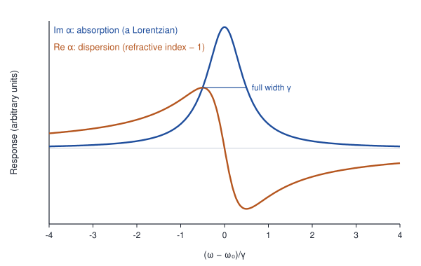
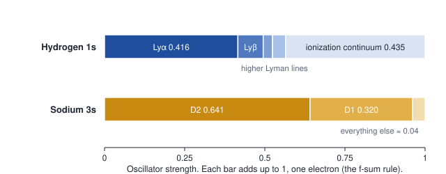

# Lecture 0 · What a spectrum measures: spectroscopy as linear response

**Where it fits.** The syllabus does not list this as a separate topic, but it is the common language behind several topics it does list: selection rules, the width of spectral lines, Einstein A and B coefficients, electron spin resonance, NMR and Raman spectra. Read it first. Every later lecture ends with a short note that connects back to it.

**For readers from condensed matter.** This is the same linear-response theory used for optical conductivity or neutron scattering, applied to a single atom.

The lecture follows the same path as the others: **data → puzzle → model → numbers from the data → test a prediction → problems.** Answers are at the end.

---

## 0.1 The data

> **How it is measured.**
> - **Absorption.** White light passes through a cell of sodium vapour into a spectrometer. The transmitted intensity is $`I = I_0\,e^{-N\sigma(\omega)L}`$, where N is the number of atoms per unit volume, L is the length of the cell and σ(ω) is the absorption cross-section (the Beer–Lambert law).
> - **Dispersion.** In Rozhdestvensky's "hook method" (1912), an interferometer has the vapour cell in one arm, and its output goes into a spectrograph. The fringes shift by the extra optical path, (n − 1)L. Near each absorption line they bend into hook shapes, and the separation of the hooks gives the product of the atom density and the strength of the line.
> - **Lifetimes.** Atoms are excited by a short pulse of light or electrons, and the emitted light is timed. Its intensity decays as $`e^{-t/\tau}`$.

**1. Absorption and dispersion go together.** Sodium vapour absorbs strongly at each D line, and near each line its refractive index changes sharply. Just below the line frequency, n is greater than 1 and rising; just above it, n is less than 1. This is called **anomalous dispersion**.

**2. Each line has a measurable strength.** It is expressed as the oscillator strength f, defined in Section 0.3:

| Transition | Wavelength (nm) | Oscillator strength f |
|---|---|---|
| Na 3s → 3p, D2 | 589.0 | 0.641 |
| Na 3s → 3p, D1 | 589.6 | 0.320 |
| H 1s → 2p, Lyman α | 121.6 | 0.416 |
| H 1s → 3p, Lyman β | 102.6 | 0.079 |

The hydrogen values are exact calculations, confirmed by measured lifetimes.

**3. The excited states decay.** Sodium's 3p level lives 16.2 ns; hydrogen's 2p level lives 1.6 ns.

## 0.2 The puzzle

- Why are absorption and the refractive index linked, so that every line affects both?
- Why does D2 absorb exactly twice as strongly as D1?
- Is there a connection between how strongly an atom absorbs a line and how quickly it emits it?

## 0.3 Model 1: the Lorentz oscillator

Lorentz treated the electron as a particle on a spring, with natural frequency ω₀ and damping γ, driven by the light's electric field:

```math
m\left(\ddot{x} + \gamma\dot{x} + \omega_0^2 x\right) = -eE_0\,e^{-i\omega t}.
```

The induced dipole p = −ex is proportional to the field, $`p = \alpha(\omega)E`$, with the **polarizability**

```math
\alpha(\omega) = \frac{e^2}{m}\,\frac{1}{\omega_0^2 - \omega^2 - i\gamma\omega}.
```

Both measurements follow from α:

- A dilute gas with N atoms per unit volume has refractive index $`n(\omega) - 1 \approx N\,\mathrm{Re}\,\alpha(\omega)/(2\varepsilon_0)`$.
- The absorption cross-section is

```math
\sigma(\omega) = \frac{\omega}{\varepsilon_0 c}\,\mathrm{Im}\,\alpha(\omega).
```

Close to resonance,

```math
\alpha(\omega) \approx \frac{e^2}{2m\omega_0}\,\frac{1}{\omega_0 - \omega - i\gamma/2}.
```

Im α is a Lorentzian of full width γ. Re α is positive below the resonance and negative above it, which is exactly the shape of anomalous dispersion.



*Figure 0.1. Absorption and dispersion of one damped oscillator near resonance. This is a model curve, not data.*

The area under the absorption line does not depend on γ:

```math
\int \sigma\,d\nu = \frac{e^2}{4\varepsilon_0 m c} = 2.65 \times 10^{-6}\ \text{m}^2\,\text{Hz}.
```

The model explains the **shape** of anomalous dispersion. But measured lines are weaker than one classical electron would make them. Each line must be multiplied by a factor f smaller than 1, once called the "number of dispersion electrons". The classical model cannot say what f is.

## 0.4 Model 2: the quantum response function

Now apply the perturbation $`H' = ezE(t)`$ to an atom in its ground state $`|0\rangle`$, and calculate the induced dipole to first order in E. This is **linear response**. The result, found by Kramers and Heisenberg, is

```math
\alpha(\omega) = \frac{e^2}{m}\sum_n \frac{f_{n0}}{\omega_{n0}^2 - \omega^2 - i\gamma_n\omega},
\qquad
f_{n0} = \frac{2m\,\omega_{n0}}{\hbar}\,\bigl|\langle n|z|0\rangle\bigr|^2,
\qquad
\omega_{n0} = \frac{E_n - E_0}{\hbar}.
```

Every transition behaves like a Lorentz oscillator, and quantum mechanics fixes the three things the classical model left open:

- **Position.** Each resonance sits at a transition frequency, a difference of two energy levels.
- **Weight.** Its strength is the oscillator strength $`f_{n0}`$, set by a matrix element.
- **Width.** Its width $`\gamma_n`$ is the decay rate of the excited state.

**For readers from condensed matter:** this is the Kubo formula for one atom,

```math
\alpha(\omega) = \frac{i}{\hbar}\int_0^\infty dt\,e^{i\omega t}\,\bigl\langle 0\bigl|\,[d_z(t), d_z(0)]\,\bigr|0\bigr\rangle, \qquad d_z = -ez,
```

evaluated by inserting a complete set of states, with the decay widths added by hand.

**A historical note.** Kramers' 1924 dispersion formula, which is a response function, was the starting point for Heisenberg's matrix mechanics in 1925. The "matrices" were the matrix elements $`\langle n|z|0\rangle`$ that set the line strengths.

### Three exact properties

**1. The f-sum rule (Thomas–Reiche–Kuhn).** From the commutator $`[z,[H,z]] = \hbar^2/m`$ for each electron:

```math
\sum_n f_{n0} = N_e,
```

the number of electrons. So far above every resonance, $`\alpha(\omega) \to -N_e e^2/(m\omega^2)`$: the electrons respond as if they were free. This is the same f-sum rule you know from condensed matter, and it is why X-rays see a refractive index slightly less than 1 (Problem 0.2).

**2. The Kramers–Kronig relations.** The response is causal: the dipole cannot respond before the field arrives. This links the real and imaginary parts:

```math
\mathrm{Re}\,\alpha(\omega) = \frac{2}{\pi}\,\mathcal{P}\!\int_0^\infty \frac{\omega'\,\mathrm{Im}\,\alpha(\omega')}{\omega'^2 - \omega^2}\,d\omega'.
```

Absorption lines and anomalous dispersion are two views of the same resonances.

**3. The golden rule gives the same answer.** For a weak field $`E_0\cos\omega t`$, Fermi's golden rule gives the transition rate

```math
W = \frac{2\pi}{\hbar}\,\Bigl|\bigl\langle n\bigl|\tfrac12 ezE_0\bigr|0\bigr\rangle\Bigr|^2\,\delta(E_n - E_0 - \hbar\omega).
```

Multiplied by ħω, this is exactly the power absorbed in linear response, $`P = \tfrac{\omega}{2}\,\mathrm{Im}\,\alpha(\omega)\,E_0^2`$, with each narrow Lorentzian replaced by a delta function (Problem 0.4). So linear response is the framework, and the golden rule is the calculating tool. The later units, and the NET exam, mostly use the golden rule.

## 0.5 Numbers from the data

- **Sodium.** The two D lines carry f = 0.641 + 0.320 = 0.961. Sodium's single valence electron has a total strength of 1, and 96% of it is in the D lines. Their ratio is 2.00, the same 2 : 1 ratio seen in emission (Unit 2).
- **Hydrogen.** Lyman α carries 0.416 and Lyman β 0.079. All the lines together carry 0.565, and the ionization continuum the remaining 0.435. The total is exactly 1.



*Figure 0.2. How one electron's total oscillator strength is shared among transitions from the ground state.*

## 0.6 Test a prediction: absorption predicts emission

Absorption and dispersion measure f. Einstein's relation between absorption and emission turns f into a rate of spontaneous emission. Unit 6 derives it from thermal equilibrium; it is a form of the fluctuation–dissipation theorem.

```math
A_{ul} = \frac{2\pi e^2\nu^2}{\varepsilon_0 m_e c^3}\,\frac{g_l}{g_u}\,f_{lu}.
```

Here l and u label the lower and upper levels, and g = 2J + 1 counts the states in each.

| Line | f | Predicted lifetime τ = 1/A | Measured lifetime |
|---|---|---|---|
| Na D2 (from 3p ²P<sub>3/2</sub>) | 0.641 | 16.2 ns | 16.2 ns |
| H Lyman α (from 2p) | 0.416 | 1.60 ns | 1.6 ns |

The width of each resonance follows too. Since γ = A, the natural line width A/2π is 9.8 MHz for the sodium D lines and 100 MHz for Lyman α. Unit 3 adds Doppler and collision broadening.

## 0.7 The course in response language

| Response-function idea | Where it appears |
|---|---|
| Positions of the resonances, $`\omega_{n0}`$ | Every energy level: hydrogen (Unit 1), fine and hyperfine structure (Unit 2), Zeeman and Stark shifts (Unit 4), molecular levels (Unit 5) |
| Weights of the resonances, $`f_{n0}`$ | Selection rules (Unit 1), line intensities (Unit 2), Franck–Condon factors (Unit 5) |
| Widths of the resonances, $`\gamma_n`$ | Natural line width, then Doppler and collision broadening (Unit 3) |
| The f-sum rule | Checks on line strengths; free-electron response at high frequency |
| Kramers–Kronig relations | Anomalous dispersion near absorption lines |
| Fluctuation–dissipation theorem | Einstein A and B coefficients (Unit 6) |
| Magnetic susceptibility χ″(ω) | ESR and NMR; the Bloch equations give Lorentzian lines of width 1/T₂ (Unit 4) |
| Correlation function of the polarizability, like S(q, ω) | Raman spectra (Unit 5) |
| Energy-loss function | The Franck–Hertz experiment, which is electron energy-loss spectroscopy (Unit 1) |
| Im χ < 0, meaning gain | Lasers and population inversion (Unit 6) |

## 0.8 What linear response does not cover

- **Stern–Gerlach** (Unit 2) measures a static magnetic moment and the quantization of its direction. It is not a spectrum.
- **Spontaneous emission** needs the quantized light field. Linear response reaches it only indirectly, through Einstein's relation or the fluctuation–dissipation theorem.
- **Lasers above threshold, saturation and two-photon spectroscopy** are nonlinear: the response depends on the strength of the field.
- **Linear response tells you how to read a spectrum,** but the positions and weights of the resonances still come from the atom's Hamiltonian. Calculating them is the job of Units 1–6.

---

## Problems

**0.1** For the Lorentz oscillator, show that the area under the absorption line, $`\int\sigma(\omega)\,d\omega = \pi e^2/(2\varepsilon_0 mc)`$, does not depend on γ. Use the near-resonance form of α.

**0.2** Use the f-sum rule to show that $`\alpha(\omega) \to -N_e e^2/(m\omega^2)`$ at high frequency. Show that the refractive index for X-rays is $`n = 1 - \omega_p^2/(2\omega^2)`$, where $`\omega_p^2 = n_e e^2/(\varepsilon_0 m)`$ and $`n_e`$ is the electron density. What happens to X-rays that strike a polished surface at a grazing angle?

**0.3** Using f = 0.416 for Lyman α, find the spontaneous emission rate and lifetime of the hydrogen 2p level.

**0.4** Show that the golden-rule rate multiplied by ħω equals $`\tfrac{\omega}{2}\,\mathrm{Im}\,\alpha\,E_0^2`$ when γ → 0. Use $`\lim_{\gamma\to0}\frac{\gamma/2\pi}{(\omega_0-\omega)^2 + \gamma^2/4} = \delta(\omega - \omega_0)`$.

**0.5** Find the peak absorption cross-section of the sodium D2 line for an atom at rest, using its natural width of 9.8 MHz. Compare it with the geometric size of an atom, about 10⁻²⁰ m².

**0.6** In atomic units the static polarizability is $`\alpha(0) = \sum_n f_{n0}/\omega_{n0}^2`$, with ω in hartrees. Estimate the polarizability of hydrogen from Lyman α alone. The exact value is 4.5. Where does the rest come from?

## Answers

**0.1** Near resonance, $`\mathrm{Im}\,\alpha \approx \frac{e^2}{2m\omega_0}\,\frac{\gamma/2}{(\omega_0-\omega)^2 + \gamma^2/4}`$, whose integral over ω is $`\frac{e^2}{2m\omega_0}\,\pi`$. Multiplying by $`\omega_0/(\varepsilon_0 c)`$ gives $`\pi e^2/(2\varepsilon_0 mc)`$. In frequency units, $`\int\sigma\,d\nu = e^2/(4\varepsilon_0 mc) = 2.65 \times 10^{-6}`$ m² Hz.

**0.2** For ω much larger than every $`\omega_{n0}`$, $`\alpha \approx -\frac{e^2}{m\omega^2}\sum_n f_{n0} = -\frac{N_e e^2}{m\omega^2}`$. Then $`n - 1 = N\,\mathrm{Re}\,\alpha/(2\varepsilon_0) = -\omega_p^2/(2\omega^2)`$. Since n < 1, X-rays at a grazing angle are totally reflected from the outside. This is how X-ray mirrors and telescopes work.

**0.3** $`A = \frac{2\pi e^2\nu^2}{\varepsilon_0 m_e c^3}\cdot\frac{2}{6}\cdot 0.416 = 6.26 \times 10^8\ \text{s}^{-1}`$, so τ = 1.60 ns, as in Unit 1.

**0.4** As γ → 0, $`\mathrm{Im}\,\alpha \to \frac{\pi e^2 f}{2m\omega_0}\,\delta(\omega - \omega_0) = \frac{\pi e^2|z_{n0}|^2}{\hbar}\,\delta(\omega - \omega_0)`$, so $`P = \frac{\pi e^2|z_{n0}|^2E_0^2\,\omega}{2\hbar}\,\delta(\omega - \omega_0)`$. The golden rule gives $`W = \frac{2\pi}{\hbar}\cdot\frac{e^2|z_{n0}|^2E_0^2}{4}\cdot\frac{1}{\hbar}\,\delta(\omega - \omega_0)`$, and $`\hbar\omega W`$ is the same expression.

**0.5** $`\sigma_0 = \frac{g_u}{g_l}\,\frac{\lambda^2}{2\pi} = 2 \times \frac{(589\ \text{nm})^2}{2\pi} = 1.1 \times 10^{-13}\ \text{m}^2`$. To resonant light, the atom looks about ten million times larger than it is.

**0.6** Lyman α alone gives $`0.416/(3/8)^2 = 2.96`$. All the Lyman lines together give 3.66, and the ionization continuum supplies the remaining 0.84.

---

## Sources of the data

- Oscillator strengths and lifetimes: NIST Atomic Spectra Database; hydrogen values from the exact formula in Bethe & Salpeter, *Quantum Mechanics of One- and Two-Electron Atoms*.
- Anomalous dispersion and the hook method: Thorne, Litzén and Johansson, *Spectrophysics*.
- Linear response and the Kramers–Heisenberg formula: Bransden & Joachain, *Physics of Atoms and Molecules*.
- Constants: CODATA 2018. Every derived number in these notes was checked with a short calculation.
