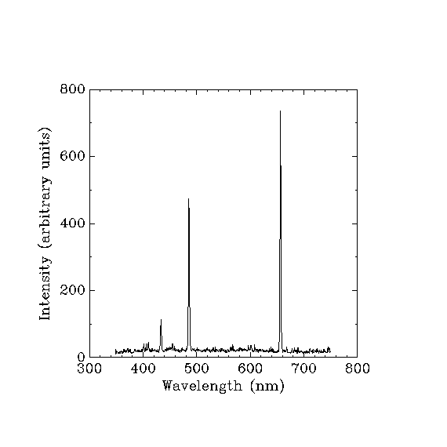

# Unit 0 · How do we learn about the microscopic world?

> We cannot directly see the internal quantum states of an atom or molecule. How do we learn about them through measurements?

An atom can emit light, absorb energy or respond to an applied field. We observe these effects and use them to ask what states the atom can occupy and how it changes between them. The first step is to distinguish the measured effect from the microscopic explanation we propose for it.

## 0.1 What does an experiment actually give us?

Consider two experiments.

**Light from hydrogen.** Passing an electric current through low-pressure hydrogen makes the gas emit light. A spectrometer separates the light by wavelength, and a detector records a signal at each wavelength. The graph contains narrow peaks, called *emission lines*. Why does the gas emit strongly at these particular wavelengths?

**A microwave resonance.** Microwaves pass through a sample placed in a magnetic field. We keep the microwave frequency fixed and vary the field. Near a particular field value, the sample absorbs more microwave energy and the transmitted signal falls. We record a detector voltage against magnetic field. Why does absorption increase there?

Both experiments give us a graph relating a detected signal to wavelength or magnetic field. Neither directly supplies a list of microscopic states. To infer those states, we need a model that explains why the signal changes where it does. Let us begin with the light from hydrogen.

## 0.2 An atomic emission spectrum

Figure 0.1 shows a measured hydrogen spectrum. The horizontal axis is wavelength in nanometres; the vertical axis is intensity in arbitrary units, indicating the relative size of the recorded signal. Light is concentrated in a few separated peaks.



*Figure 0.1. Visible spectrum of a hydrogen plasma, measured with an Ocean Optics USB2000 spectrometer. Measured data: Profeta, [Wikimedia Commons](https://commons.wikimedia.org/wiki/File:H_plasma_spectrum.gif), [CC BY-SA 3.0](https://creativecommons.org/licenses/by-sa/3.0/).*

The source identifies the three visible peaks as Hα, Hβ and Hγ. The table gives reference wavelengths for these and two weaker lines. These are names for spectral lines; their physical origin remains to be explained.

| Line | Approximate wavelength in air (nm) |
|---|---:|
| Hα | 656.28 |
| Hβ | 486.13 |
| Hγ | 434.05 |
| Hδ | 410.17 |
| Hε | 397.01 |

The source reports that the weaker lines are indistinguishable from noise in this record. Hδ and Hε are known from other measurements, even though we cannot pick them out here. This gives us a first limit on interpretation: failure to see a peak does not establish that the atom cannot emit at that wavelength.

What do the peak positions tell us? **Wavelength** is the spatial period of the light; **frequency** is the number of oscillations per second. Light of frequency $`\nu`$ carries energy in photons, each with energy $`E_\gamma=h\nu`$. In vacuum,

```math
\nu=\frac{c}{\lambda_{\mathrm{vac}}},
\qquad
E_\gamma=h\nu=\frac{hc}{\lambda_{\mathrm{vac}}}.
```

Here $`h`$ is Planck's constant and $`c`$ is the speed of light in vacuum. Shorter wavelengths therefore mean higher photon energies.

Spectroscopists also use **wavenumber**, the reciprocal of the vacuum wavelength:

```math
\tilde{\nu}=\frac{1}{\lambda_{\mathrm{vac}}}
=\frac{\nu}{c},
\qquad
E_\gamma=hc\tilde{\nu}.
```

Wavenumber is often reported in $`\mathrm{cm}^{-1}`$, using wavelength in centimetres. It is useful because photon energy is directly proportional to it.

The table quotes wavelengths in air, whereas the energy equations use vacuum wavelengths. They are related by $`\lambda_{\mathrm{vac}}=n_{\mathrm{air}}\lambda_{\mathrm{air}}`$, where $`n_{\mathrm{air}}`$ is air's refractive index, approximately $`1.00028`$ in visible light. This small correction matters when comparing precise measurements.

For example, using $`hc\simeq1239.84\ \mathrm{eV\,nm}`$, the Hα wavelength gives a photon energy of about $`1.89\ \mathrm{eV}`$. We can now translate a measured line position into an energy. We still need to explain why hydrogen emits photons with that energy.

## 0.3 What information does a spectral line contain?

A spectrum contains more information than the wavelengths of its peaks. Each line raises four questions.

**Where is the line?** Its position tells us the energy of the emitted photons. What change within the atom releases this energy?

**How strong is it?** The amount of emitted light depends on how many atoms occupy the emitting state and how readily they emit. The detector may also respond differently to different wavelengths. Why is one line stronger than another?

**How wide is it?** A line extends over a small range of wavelengths. Finite lifetimes of emitting states, atomic motion and collisions can all contribute to this spread, and the spectrometer can make it appear wider. Which of these sets the width we observe?

**How does it change under external conditions?** Electric or magnetic fields can shift or split lines; temperature and pressure can change their strengths and widths. What do these changes reveal about the atom and its surroundings?

These questions will require different parts of the theory. Predicting the line positions is the first task; explaining a complete spectrum requires more.

## 0.4 From observations to a mathematical model

Suppose an atom emits a photon while changing from a state of energy $`E_u`$ to one of lower energy $`E_l`$. Such a change is called a **transition**. Energy conservation gives

```math
E_u-E_l=h\nu.
```

Here we consider an atom initially at rest and neglect the small energy of its recoil. In absorption, the atom gains the energy supplied by the photon. A spectral line thus reveals a **difference between atomic energies**. One line alone does not tell us which two states are involved.

To predict those energies, we need a model of the atom: which particles are present, how they move and how they interact. In quantum mechanics, this information is expressed by the **Hamiltonian** $`H`$, the operator representing the system's energy. A stationary state $`|n\rangle`$ has a definite energy $`E_n`$ and satisfies

```math
H|n\rangle=E_n|n\rangle.
```

The label $`n`$ distinguishes the states. Solving this equation gives the energies $`E_n`$ that the model permits. Differences between these energies predict possible photon frequencies, which we can compare with the measured spectrum. Several lines must fit the same set of levels for the explanation to be convincing.

Matching an energy difference is necessary, but does not guarantee an observable line. Light interacts with the atom through its charges, and the strength of that interaction depends on the states involved. For some pairs of states this interaction is strong; for others it is weak or cannot connect them. An emission experiment also requires atoms to occupy the upper state. The allowed energies alone therefore do not determine the spectrum.

This leads to a distinction that will recur throughout the course:

**What we measure is not everything that exists in the system.**

We test a model by asking whether its states, their populations and their interaction with light account for the observations. When a prediction fails, we must ask whether the model omitted an interaction, whether the relevant states were populated, or whether the measurement could reveal the predicted feature.

## 0.5 The same reasoning across physics

A different probe can interact with a different property of a system and make previously unseen transitions accessible. Its recorded signal need not represent the same quantity as an optical spectrum. As we meet new measurements, we will ask which states and interactions they reveal, and how a model connects that information to the signal.

## 0.6 Questions that will guide the course

Why do apparently single lines split when measured more precisely? Which transitions can light produce, and what determines their strengths and widths? Why do molecules have spectra different from those of isolated atoms? The [course map](course-map.md) shows how these questions will unfold. We begin in [Unit 1](unit-1-hydrogen.md) with hydrogen's discrete spectrum.

The hydrogen spectrum gives us a pattern of photon energies, and energy conservation turns that pattern into constraints on atomic energy differences. It does not explain why those differences occur. What model of an electron bound to a nucleus predicts the observed pattern, and why does that model allow only certain bound-state energies?

---

## Sources of the data

- Figure 0.1: [H plasma spectrum](https://commons.wikimedia.org/wiki/File:H_plasma_spectrum.gif), measured with an Ocean Optics USB2000 spectrometer; by Profeta, Wikimedia Commons, [CC BY-SA 3.0](https://creativecommons.org/licenses/by-sa/3.0/).
- Hydrogen wavelengths: [NIST, Strong Lines of Hydrogen](https://physics.nist.gov/PhysRefData/Handbook/Tables/hydrogentable2.htm); Haken & Wolf, *The Physics of Atoms and Quanta*. The quoted values summarize unresolved lines; the reference table also lists fine-structure components.
- Constants: CODATA 2018.
