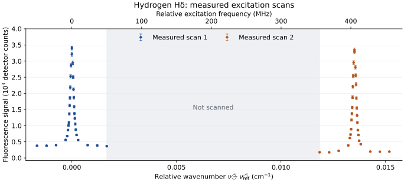

# Unit 1 · The hydrogen atom: from spectral lines to quantum states

> What physical model explains hydrogen's discrete spectral lines and the pattern of their wavelengths?

In [Unit 0](unit-0-learning-from-measurements.md), a line position told us the energy carried by a photon. We now ask what happens inside the atom to produce that energy. Hydrogen is the simplest place to begin: one electron interacts with one proton. Can this interaction explain the observed spectrum?

## 1.1 A pattern that needs explaining

The measured hydrogen spectrum in [Unit 0](unit-0-learning-from-measurements.md) contains three prominent peaks. Are these isolated features, or the beginning of a regular sequence? To investigate, we would extend the measurement towards shorter wavelengths and look for weaker lines. Reference measurements give the following members of the **Balmer series**:

| Line | Approximate wavelength in air (nm) |
|---|---:|
| Hα | 656.28 |
| Hβ | 486.13 |
| Hγ | 434.05 |
| Hδ | 410.17 |
| Hε | 397.01 |

What happens to the spacing between successive lines? The rounded wavelengths show that it decreases towards shorter wavelengths. Measurements of higher members extend the sequence towards a limit near 365 nm.

We need to explain both the separated lines and the systematic pattern of their spacings. Merely saying that an atom has discrete energies does not predict their values or the observed wavelengths.

## 1.2 An empirical rule for the wavelengths

Which quantity should we compare when looking for a rule? Photon energy is proportional to reciprocal vacuum wavelength, so wavenumber is a useful starting point. The spacings are not equal; a rule must account for their systematic decrease towards a finite limit.

Balmer's empirical candidate assigns the integers $`n=3,4,5,\ldots`$ to successive lines and takes the form

```math
\tilde\nu=\frac{1}{\lambda_{\mathrm{vac}}}
=R_{\mathrm H}\left(\frac{1}{2^2}-\frac{1}{n^2}\right),
\qquad R_{\mathrm H}\simeq1.0968\times10^7\ \mathrm{m}^{-1}.
```

Here $`R_{\mathrm H}`$ is the Rydberg constant for hydrogen. This is a proposed empirical pattern, not a result deduced uniquely from the few wavelengths above. We can set $`R_{\mathrm H}`$ using Hα, then ask whether the same value reproduces Hβ, Hγ and further lines without readjustment. The integer $`n`$ initially labels the pattern; its meaning as a quantum number has still to be established. As in Unit 0, convert the air wavelengths using $`\lambda_{\mathrm{vac}}=n_{\mathrm{air}}\lambda_{\mathrm{air}}`$ before comparing wavenumbers.

As $`n`$ increases, $`1/n^2`$ tends to zero, so the wavelengths approach $`4/R_{\mathrm H}\simeq364.7\ \mathrm{nm}`$ in vacuum. This is the **series limit**: a finite limiting photon energy, even though successive line spacings become smaller.

The broader hydrogen spectrum follows the Rydberg formula

```math
\tilde\nu=R_{\mathrm H}
\left(\frac{1}{n_l^2}-\frac{1}{n_u^2}\right),
\qquad n_u>n_l.
```

The subscripts distinguish the lower and upper integers. Balmer lines have $`n_l=2`$; other choices describe other series. The rule organizes the spectrum remarkably well. Why should differences of inverse squares occur at all?

## 1.3 From a spectral rule to atomic energy levels

For emission, energy conservation requires $`h\nu=E_u-E_l`$. Since $`\nu=c\tilde\nu`$, the empirical rule suggests a set of levels

```math
E_n=-\frac{hcR_{\mathrm H}}{n^2}
\simeq-\frac{13.6\ \mathrm{eV}}{n^2}.
```

We choose zero energy for a separated electron and proton at rest. A bound atom then has negative energy: energy must be supplied to separate its constituents. The ground level is $`n=1`$; higher values describe excited levels approaching the ionization threshold at $`E=0`$.

Only differences between levels enter the line frequencies. Consequently, transitions sharing an upper level reveal the spacing of their lower levels:

```math
\tilde\nu_{ua}-\tilde\nu_{ub}
=\frac{E_b-E_a}{hc}.
```

This is an application of the **Ritz combination principle**. Several measured lines can constrain one consistent level scheme, including spacings for which no direct line is observed. Balmer lines alone do not establish every level or locate the ground state; other series and ionization measurements test the wider interpretation.

### Can we test the level picture without using photons to supply the energy?

Our optical record tells us which photon energies the source emits. The level picture makes a further claim: an atom's internal excitation energies should also govern energy transfer in collisions. Can we supply a continuously adjustable amount of kinetic energy and measure how much the atom takes from it?

Electrons offer a way to do this. Let electrons from a heated cathode accelerate towards a grid through a voltage $`V_a`$, with an atomic gas in the accelerating region. Most target atoms should initially be in their ground state. Without collisions, an electron gains kinetic energy approximately $`eV_a`$. An excitation collision removes energy from this motion. If its incoming kinetic energy is $`K_{\mathrm{in}}`$, energy conservation predicts, neglecting the small atomic recoil,

```math
K_{\mathrm{out}}\simeq K_{\mathrm{in}}-\Delta E,
\qquad K_{\mathrm{in}}\gtrsim\Delta E.
```

Below that threshold, this internal excitation cannot occur, although elastic collisions can still change the electron's direction and transfer recoil energy. Above it, an inelastic collision can remove a definite amount of energy. How could we make that loss visible in an electrical measurement?

Place a collector beyond the grid, with a small **retarding voltage** $`V_r`$ opposing the electrons. They reach it only if their remaining kinetic energy along the collection direction exceeds $`eV_r`$. A collision near the grid can leave too little energy for collection; a collision earlier in the accelerating region allows the electron to regain energy before arrival. Raising $`V_a`$ can restore collection or permit another excitation collision. These competing effects can produce current reductions followed by recoveries. Whether they do so, and where, must be tested against a measured current–voltage curve.

The Franck–Hertz experiment implements this test using mercury vapour. Mercury supplies monatomic targets, and its density can be controlled through the vapour temperature. It is a practical system for testing the general excitation picture; the inferred energy intervals will belong to mercury. We would record collector current $`I`$ against $`V_a`$, keeping $`V_r`$ and the vapour temperature fixed.

> **TODO — Add the measured Franck–Hertz current–voltage plot.**
>
> Insert real mercury data showing collector current against accelerating voltage over a range sufficient to examine repeated current reductions. State the retarding voltage, vapour temperature, units and measurement uncertainties. Show the measured points before assigning excitation energies; do not impose an expected spacing.

Does the current simply rise, or are there reproducible reductions followed by recoveries? If reductions recur, what energy loss would explain their voltage spacing? Under suitable collision and collection conditions, a repeated spacing $`\Delta V_a`$ gives an estimate $`\Delta E\simeq e\Delta V_a`$. The position of the first reduction alone is insufficient: electrode contact potentials shift the voltage origin, and transport through the gas affects collection. The current is an indirect test of energy loss, not a direct plot of the atom's levels.

We could then compare the inferred collision energy with mercury's photon energies. Does an independently measured optical line satisfy $`hc/\lambda_{\mathrm{vac}}\simeq\Delta E`$? Agreement would connect two different ways of exchanging energy with the same atom. The probes need not access every state in common.

> **TODO — Add the optical comparison.**
>
> Once the collision energy has been inferred from the measured curve, supply the relevant mercury optical measurement and compare the two energies, including their uncertainties.

This proposed experiment tests whether the level picture extends to collision-induced excitation. A different question remains for hydrogen: what interaction and quantum conditions produce the particular energies inferred from its spectrum?

## 1.4 A model of the electron and nucleus

An electron of charge $`-e`$ and a nucleus of charge $`+Ze`$ attract through the Coulomb potential. Hydrogen has $`Z=1`$; a one-electron ion such as He⁺ has $`Z=2`$. Both particles move. Separating their overall centre-of-mass motion leaves an internal problem with **reduced mass**

```math
\mu=\frac{m_eM}{m_e+M},
\qquad
H_C=\frac{\mathbf p^2}{2\mu}
-\frac{Ze^2}{4\pi\varepsilon_0r}.
```

Here $`M`$ is the nuclear mass, $`r`$ is the electron–nucleus separation and $`\mathbf p`$ is the momentum associated with their relative motion. The terms are relative kinetic energy and electrostatic potential energy; $`\varepsilon_0`$ is the vacuum permittivity. For hydrogen $`M=m_p`$ and $`\mu`$ is slightly smaller than $`m_e`$; it approaches $`m_e`$ for an infinitely heavy nucleus.

This model treats both particles nonrelativistically and the nucleus as a point charge. It leaves any additional interactions aside. There will be experiments to test the validity of these assumptions (Can we think of any?).

Coulomb attraction alone does not select discrete energies in classical mechanics. Classical bound orbits can have continuously varying energies, and an orbiting charge radiates and loses energy. Bohr obtained the inverse-square energy pattern by postulating special non-radiating orbits with angular momentum $`n\hbar`$, where $`\hbar=h/(2\pi)`$. This supplied a successful energy rule, but imposed the allowed orbits. We needed theories (which we now call Quantum mechanics) to explain why only certain bound states are possible.

## 1.5 Why only certain bound energies occur

We seek stationary states satisfying $`H_C\psi=E\psi`$. The potential depends only on distance, so the angular dependence separates:

```math
\psi_{nlm}(r,\theta,\phi)
=R_{nl}(r)Y_{lm}(\theta,\phi).
```

The spherical harmonic $`Y_{lm}`$ describes orbital angular momentum. Its magnitude is $`\sqrt{l(l+1)}\,\hbar`$ and its component along a chosen axis is $`m\hbar`$. With $`u(r)=rR(r)`$, the radial equation is

```math
-\frac{\hbar^2}{2\mu}\frac{d^2u}{dr^2}
+\left[\frac{\hbar^2l(l+1)}{2\mu r^2}
-\frac{Ze^2}{4\pi\varepsilon_0r}\right]u=Eu.
```

The angular-momentum term acts as a barrier near the nucleus when $`l>0`$. A physical bound state must also be regular at the origin and normalizable: its total probability must be finite. These requirements restrict the energy.

For $`E<0`$, define $`\kappa=\sqrt{-2\mu E}/\hbar`$. The acceptable radial solution behaves as $`u\propto r^{l+1}`$ near the origin and decays at large distance. Factoring out $`r^{l+1}e^{-\kappa r}`$ leaves a power series. For a general trial energy, the solution regular at the origin develops an exponentially growing contribution at large distance. Eliminating that growth requires the series to terminate, imposing

```math
\frac{Z}{\kappa a_\mu}=n_r+l+1\equiv n,
\qquad
a_\mu=\frac{4\pi\varepsilon_0\hbar^2}{\mu e^2},
\qquad n_r=0,1,2,\ldots.
```

The integer $`n_r`$ counts radial nodes. The crucial requirement is satisfying both boundary conditions with the same solution. Arbitrary negative energies cannot do this. Substituting the permitted $`\kappa`$ gives

```math
E_n=-\frac{\mu Z^2e^4}
{2(4\pi\varepsilon_0)^2\hbar^2n^2}
=-hcR_M\frac{Z^2}{n^2},
\qquad
R_M=R_\infty\frac{\mu}{m_e}.
```

Here $`R_\infty\simeq1.097373\times10^7\ \mathrm{m}^{-1}`$ is determined by the constants in the Hamiltonian. The previously empirical inverse-square pattern has emerged from the Coulomb problem and the conditions on a bound wavefunction. For a proton, the reduced mass gives $`R_M=R_{\mathrm H}\simeq1.096776\times10^7\ \mathrm{m}^{-1}`$.

The states carry three orbital quantum numbers:

| Quantum number | Allowed values | Physical meaning |
|---|---|---|
| $`n`$ | $`1,2,3,\ldots`$ | Sets the bound-state energy in this model |
| $`l`$ | $`0,1,\ldots,n-1`$ | Sets the orbital angular-momentum magnitude |
| $`m`$ | $`-l,-l+1,\ldots,l`$ | Sets its component along the chosen axis |

The labels s, p, d and f mean $`l=0,1,2,3`$. A given $`n`$ contains $`\sum_{l=0}^{n-1}(2l+1)=n^2`$ orbital states with the same energy. Independence from $`m`$ follows from rotational symmetry; the additional degeneracy in $`l`$ is special to the Coulomb problem. Electron spin is not included in this count.

A wavefunction describes a probability distribution. The ground state is 1s, with $`l=0`$: it has no orbital angular momentum. It is a stationary quantum state and need not behave like a circulating classical charge that continuously radiates. Decay from an excited state requires an interaction with radiation, which we may see later how to explain.


*Figure 1.1. Model energy-level diagram for hydrogen, with selected transitions in the Lyman, Balmer and Paschen series. Energies are rounded; arrow lengths represent photon energies, not line strengths. The dashed zero-energy line marks the ionization threshold, not an additional bound state.*

## 1.6 Predictions that test the model

For Hα, the upper level is $`n_u=3`$ and the lower is $`n_l=2`$. The Coulomb model gives

```math
E_3-E_2\simeq13.5983\ \mathrm{eV}
\left(\frac14-\frac19\right)
\simeq1.889\ \mathrm{eV}.
```

This corresponds to approximately 656.5 nm in vacuum, or 656.3 nm in air, matching the main observed line at this precision. The 13.5983 eV factor is calculated from the reduced-mass Coulomb model. Its ground-state binding energy agrees with the measured ionization energy, about 13.6 eV, at this level of approximation.

Other choices of lower level predict further series without adjusting the interaction:

| Series | Lower level | First transition | Approximate first wavelength (vacuum) |
|---|---:|---|---:|
| Lyman | $`n_l=1`$ | $`2\to1`$ | 121.6 nm |
| Balmer | $`n_l=2`$ | $`3\to2`$ | 656.5 nm |
| Paschen | $`n_l=3`$ | $`4\to3`$ | 1876 nm |

Their observation tests the level scheme beyond the original visible lines. The model also predicts that bound levels approach $`E=0`$ from below. Above this threshold, the electron can escape with continuously varying kinetic energy: the atom has both discrete bound states and a continuum of unbound states.

The calculation used the nuclear mass through $`\mu`$. Can we test whether this dependence describes the atom? We need to vary nuclear mass while keeping nuclear charge fixed, so that the Coulomb attraction has the same form. Hydrogen and deuterium provide this comparison.

Before looking at their spectra, what shift should we expect? Deuterium's heavier nucleus gives a larger reduced mass. Its levels should be slightly more strongly bound and the corresponding transition wavelengths shorter. Within this model,

```math
\frac{\lambda_{\mathrm{vac,D}}}{\lambda_{\mathrm{vac,H}}}
=\frac{R_{\mathrm H}}{R_{\mathrm D}}
=\frac{\mu_{\mathrm H}}{\mu_{\mathrm D}},
\qquad
1-\frac{\mu_{\mathrm H}}{\mu_{\mathrm D}}
\simeq2.72\times10^{-4}.
```

The predicted Hα isotope separation is about 0.18 nm, placing deuterium's line near 656.10 nm in air. We would measure the two spectra on a common wavelength calibration, with enough resolution to distinguish a separation of this size. Does the deuterium line lie on the predicted side, and is the separation consistent with the reduced-mass calculation?

> **TODO — Add the measured hydrogen–deuterium comparison.**
>
> Plot the Hα region for hydrogen and deuterium on the same wavelength scale. Include the instrument resolution, wavelength calibration and uncertainties needed to test the predicted separation of about 0.18 nm. Keep the calculated shift distinct from the measured result.

This comparison would test whether nuclear motion has the predicted effect even when the nucleus is much heavier than the electron. Unit 2 will examine other isotope-dependent corrections.

For one-electron ions, the model predicts binding energies proportional to $`Z^2`$, with a small additional dependence through nuclear mass. Neutral helium has two electrons and is a different problem: the one-electron formula does not describe their mutual interaction.

## 1.7 Testing the predicted spectrum

The Coulomb model predicts more than the positions of the Balmer lines: every state with the same $`n`$ has the same energy. Is this degeneracy a property of the atom, or could unresolved energy differences be hidden within a spectral line? To design a test, we first need to ask which transitions our measurement can detect.

The model has infinitely many bound levels. For a transition from an upper level $`n_u`$ to a lower level $`n_l`$, we can calculate a candidate photon frequency,

```math
\nu_{ul}=\frac{E_{n_u}-E_{n_l}}{h},\qquad n_u>n_l.
```

Should every such energy difference appear in an emission spectrum? An upper state must first be populated, and its probability of emitting a photon depends on how it couples to radiation. Different transitions can also share one frequency. The instrument's wavelength range, sensitivity and resolution further determine which lines we can distinguish.

For example, the leading **electric-dipole interaction**, in which light's electric field acts on the atomic charge distribution, connects orbital states only when

```math
\Delta l=\pm1,\qquad \Delta m=0,\pm1.
```

These are necessary selection rules in the spin-independent model; polarization determines which $`\Delta m`$ components light can address. Thus 2p can decay to 1s by electric-dipole emission, whereas 2s cannot do so. An isolated 2s atom predominantly decays by the much slower two-photon process. A missing electric-dipole line does not imply a missing level. [Unit 5](unit-5-light-matter-interaction.md) will develop these coupling rules and transition rates.

We can now return to the predicted degeneracy. If several upper states have the same energy, excitation from one common initial state should reach them at the same photon frequency. Using a common initial state matters: otherwise a separation between lines could arise from differences in either the initial or final energies.

The long lifetime of 2s makes it useful as a prepared initial state. Scan a laser near the 2s → 6p transition, the excitation counterpart of Hδ in the opening table. All 6p states in the Coulomb model have energy $`E_6`$, so the prediction is a single resonance frequency, $`(E_6-E_2)/h`$. Can a sufficiently precise measurement resolve more than one? Frequency calibration, Doppler shifts from atomic motion and shifts caused by external fields must be checked when interpreting the result.

In the experiment, hydrogen atoms are prepared in the same 2s state, and a detector counts the fluorescence emitted after laser excitation. Figure 1.2 plots those measured counts against relative wavenumber, with $`\Delta\tilde\nu=\Delta\nu/c`$. The fluorescence is predominantly ultraviolet light from subsequent decay; the horizontal axis describes the exciting laser. How many separated resonances does the record contain?



*Figure 1.2. Independently acquired scans of hydrogen 2s → 6p excitation, from L. Maisenbacher's MPQ measurements, CC BY 4.0. Points show fluorescence detector counts in one velocity group; error bars show expected counting noise, $`\sqrt{N}`$. The grey interval was not scanned. Both scans use a shared, arbitrary frequency origin. Attribution and measurement details are recorded with the data.*

The two resonances are about $`405\ \mathrm{MHz}`$, or $`0.0135\ \mathrm{cm}^{-1}`$, apart. With the initial state fixed, they reveal distinct upper-state energies within what the Coulomb model describes as one 6p level. This tests its prediction of a single excitation frequency. Changing the reduced mass shifts the Coulomb energy scale but cannot produce this splitting. What additional physics distinguishes these upper states? [Unit 2](unit-2-spin-fine-hyperfine.md) takes up that question.

Observation and interpretation develop together: the measured pattern suggests a model, and the model guides the next measurement. Agreement supports its predictions at the precision tested; resolved differences raise the next physical question.

The hydrogen spectrum suggests that electronic energies are quantized, and the Coulomb Hamiltonian explains their approximate values. But sufficiently precise measurements reveal additional structure that the simplest model cannot explain. What physical degrees of freedom and interactions have we neglected?

---

## Sources and conventions

- Hydrogen reference wavelengths and ionization energy: NIST, *Handbook of Basic Atomic Spectroscopic Data*, hydrogen tables. Approximate line labels summarize fine-structure components.
- Coulomb bound states and radiative transitions: C. J. Foot, *Atomic Physics*. Franck–Hertz and collision-induced excitation: Haken and Wolf, *The Physics of Atoms and Quanta*.
- Figure 1.2: L. Maisenbacher, *Dataset for the hydrogen 2S–6P transition measurement at MPQ*, v1 (2026), doi:10.5281/zenodo.15874385, CC BY 4.0; L. Maisenbacher et al., *Nature* **650**, 845–851 (2026), doi:10.1038/s41586-026-10124-3. The [local data record](data/hydrogen-2s-6p-mpq/README.md) preserves provenance; the [plotting script](analysis/plot_hydrogen_fine_structure.py) reproduces the figure. Full precision-frequency corrections are outside this illustration.
- Constants use CODATA 2018. Visible reference wavelengths are in air unless marked vacuum; model wavelength calculations use vacuum wavelengths before conversion to air. Figure 1.1 is a model diagram; Figure 1.2 plots measured excitation signals.
