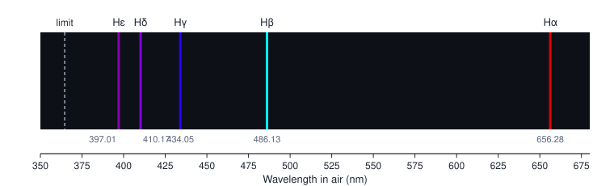
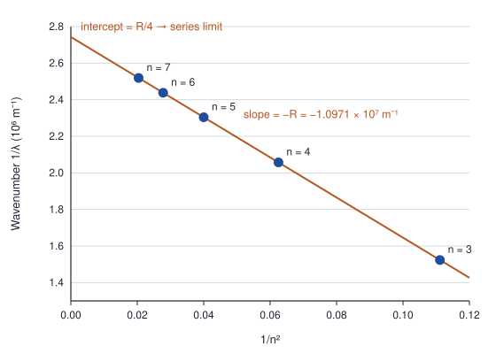
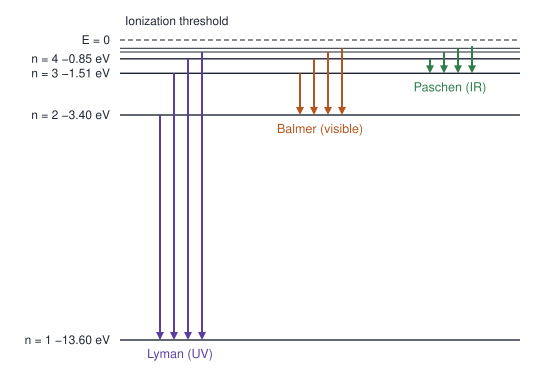
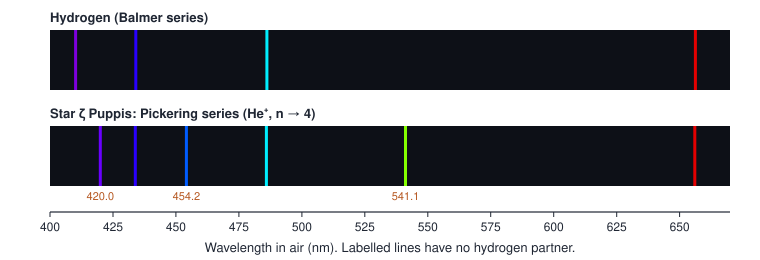

# Unit 1 · The hydrogen atom: from spectral lines to quantum states

**Syllabus (CSIR-UGC NET, Physical Sciences, Section VII):** Quantum states of an electron in an atom. This unit also introduces the reduced mass, which returns in Unit 2 as the isotope shift.

| Lecture | Data | Theory |
|---|---|---|
| 1. The hydrogen spectrum and the Rydberg formula | Balmer lines, other series | Rydberg formula, energy levels |
| 2. Energy levels are real | Franck–Hertz, Pickering series, deuterium | Bohr model, reduced mass |
| 3. Quantum states | Hydrogen Stern–Gerlach, 2s and 2p lifetimes | Schrödinger hydrogen atom, selection rules |

Each lecture follows the same path: **data → puzzle → model → numbers from the data → test a prediction → problems.**

Visible wavelengths are given in air, as in most textbooks. Answers to all problems are at the end.

---

## Lecture 1 · The hydrogen spectrum and the Rydberg formula

### 1.1 The data

Light from a hydrogen discharge tube, passed through a prism or a grating, does not give a continuous rainbow. It gives sharp lines. The visible ones are:

| Line | Wavelength in air (nm) | Colour |
|---|---|---|
| Hα | 656.28 | red |
| Hβ | 486.13 | blue-green |
| Hγ | 434.05 | violet |
| Hδ | 410.17 | violet |
| Hε | 397.01 | near ultraviolet |



*Figure 1.1. The visible hydrogen lines. They crowd together towards a limit near 364.6 nm.*

Three things stand out:

1. The spectrum is **discrete**.
2. The lines get **closer together** at shorter wavelengths.
3. They approach a **series limit** near 364.6 nm.

### 1.2 The puzzle

In Rutherford's model an electron orbits a small, heavy nucleus. Classical electrodynamics says that an accelerating charge radiates, which leads to two problems:

- As the electron loses energy, its orbital frequency changes continuously. The atom should emit a **continuous** spectrum, not lines.
- The atom should **collapse**. An electron starting at radius $`a_0`$ spirals into the nucleus in

```math
t \approx \frac{a_0^3}{4 r_e^2 c} \approx 1.6 \times 10^{-11}\ \text{s},
```

where $`r_e = e^2/(4\pi\varepsilon_0 m_e c^2) = 2.82\ \text{fm}`$ is the classical electron radius (Problem 1.2).

Real atoms are stable and emit sharp lines. Classical physics cannot explain Figure 1.1.

### 1.3 Finding the pattern

In 1885 Balmer noticed that the lines known to him fit

```math
\lambda = B\,\frac{n^2}{n^2 - 4}, \qquad n = 3, 4, 5, \dots, \qquad B = 364.6\ \text{nm}.
```

The pattern is clearer in **wavenumbers**, $`\tilde\nu = 1/\lambda`$. Balmer's formula becomes

```math
\tilde\nu = R\left(\frac{1}{2^2} - \frac{1}{n^2}\right), \qquad R = \frac{4}{B}.
```

**Test it on the data.** If this formula is right, a plot of $`\tilde\nu`$ against $`1/n^2`$ is a straight line with slope $`-R`$ and intercept $`R/4`$.

| n | λ (nm) | 1/n² | 1/λ (10⁶ m⁻¹) |
|---|---|---|---|
| 3 | 656.28 | 0.1111 | 1.5237 |
| 4 | 486.13 | 0.0625 | 2.0571 |
| 5 | 434.05 | 0.0400 | 2.3039 |
| 6 | 410.17 | 0.0278 | 2.4380 |
| 7 | 397.01 | 0.0204 | 2.5188 |



*Figure 1.2. Wavenumber against 1/n² for the five lines, with a least-squares straight line.*

A least-squares fit gives:

- **Slope:** $`R = 1.09710 \times 10^7\ \text{m}^{-1}`$.
- **Intercept divided by R:** 0.25000. The lower level really is $`n = 2`$.
- **Scatter:** every point lies within 1 part in 10⁵ of the line.

**A note on precision.** Textbook wavelengths are measured in air, but the formula needs vacuum wavelengths: $`\lambda_\text{vac} = n_\text{air}\lambda_\text{air}`$, with $`n_\text{air} - 1 \approx 2.8 \times 10^{-4}`$. After this correction the fit gives $`R = 1.09679 \times 10^7\ \text{m}^{-1}`$, in agreement with the accepted value for hydrogen, $`R_\text{H} = 1.09678 \times 10^7\ \text{m}^{-1}`$.

### 1.4 The model: spectral terms and energy levels

Rydberg and Ritz generalized the pattern. Every hydrogen line is the **difference of two terms**:

```math
\tilde\nu = T(n_1) - T(n_2), \qquad T(n) = \frac{R}{n^2}.
```

This is the **Ritz combination principle**. Multiply the terms by $`hc`$ and they become energies:

```math
E_n = -\frac{hcR}{n^2} = -\frac{13.6\ \text{eV}}{n^2}.
```

A line is a photon emitted when the atom drops from level $`n_2`$ to a lower level $`n_1`$:

```math
h\nu = E_{n_2} - E_{n_1}.
```



*Figure 1.3. Energy levels of hydrogen and the first three series.*

### 1.5 Test a prediction: other series

If the term picture is right, there must be other series that end on $`n = 1, 3, 4, \dots`$. Their wavelengths follow with no new parameters:

| Series | Ends on | First line (predicted) | Region | Found |
|---|---|---|---|---|
| Lyman | n = 1 | 121.6 nm | ultraviolet | 1906 |
| Balmer | n = 2 | 656.3 nm | visible | 1885 |
| Paschen | n = 3 | 1875 nm | infrared | 1908 |
| Brackett | n = 4 | 4052 nm | infrared | 1922 |
| Pfund | n = 5 | 7460 nm | infrared | 1924 |

Each series was found where the formula said. The measured Lyman α wavelength, 121.57 nm, agrees with the prediction to five figures.

The Lyman series limit is 91.2 nm, or 13.6 eV. This matches the **measured ionization energy** of hydrogen, 13.598 eV, which is an independent check.

### 1.6 What we have learned

- Hydrogen has discrete energy levels, $`E_n = -13.6\ \text{eV}/n^2`$.
- Every line is a jump between two of these levels.
- We have not yet explained *why* the levels exist. That is Lecture 2.

### Problems for Lecture 1

**1.1** Show that Balmer's formula and the wavenumber formula are the same, and find B in terms of R.

**1.2** Using the Larmor formula $`P = e^2 a^2/(6\pi\varepsilon_0 c^3)`$ for the power radiated by an accelerating charge, derive the classical collapse time $`t = a_0^3/(4 r_e^2 c)`$.

**1.3** Hydrogen atoms are excited to n = 5. How many different spectral lines can they emit on the way down?

**1.4** Which hydrogen line has a wavelength of 102.6 nm?

**1.5** The longest-wavelength line of a hydrogen series is at 1875 nm. Which series is it, and where is its series limit?

---

## Lecture 2 · Energy levels are real: Franck–Hertz, Bohr and the reduced mass

### 2.1 The data: the Franck–Hertz experiment (1914)

Electrons from a hot cathode are accelerated through mercury vapour by a voltage V. They reach a collector only if they still have enough energy to overcome a small retarding voltage. As V increases:

- The collector current rises, then **drops sharply at regular intervals of about 4.9 V**.
- Once V exceeds 4.9 V, the vapour **emits ultraviolet light at 253.7 nm**.

The current curve is reproduced in most textbooks (for example, Haken & Wolf and Eisberg & Resnick). The first drop is shifted by the contact potential of the electrodes, so use the **spacing** of the drops, not their positions.

**The puzzle.** Why does a mercury atom take energy from an electron only in lumps of 4.9 eV?

**Numbers from the data.** The photon energy of the 253.7 nm line is

```math
E = \frac{hc}{\lambda} = \frac{1239.8\ \text{eV nm}}{253.7\ \text{nm}} = 4.89\ \text{eV}.
```

The same 4.9 eV appears in two different experiments: collisions with electrons, and emission of light. Energy levels are a real property of the atom, not just a way to organize spectra.

### 2.2 The model: Bohr's atom (1913)

Bohr's postulates:

1. The electron moves on circular orbits with angular momentum $`L = n\hbar`$, where $`n = 1, 2, 3, \dots`$.
2. On these orbits it does not radiate.
3. It emits or absorbs a photon $`h\nu = E_i - E_f`$ when it jumps between orbits.

Take a nucleus of charge $`Ze`$, assumed infinitely heavy for now. Force balance, $`m_e v^2/r = Ze^2/(4\pi\varepsilon_0 r^2)`$, together with $`m_e v r = n\hbar`$, gives

```math
r_n = \frac{n^2}{Z}\,a_0, \qquad a_0 = \frac{4\pi\varepsilon_0\hbar^2}{m_e e^2} = 0.529\ \text{Å},
```

```math
v_n = \frac{Z\alpha c}{n}, \qquad \alpha = \frac{e^2}{4\pi\varepsilon_0\hbar c} \approx \frac{1}{137},
```

```math
E_n = -\frac{Z^2}{n^2}\,\frac{m_e e^4}{2(4\pi\varepsilon_0)^2\hbar^2} = -\frac{Z^2}{n^2}\times 13.6\ \text{eV}.
```

So Bohr **predicts** the Rydberg constant from fundamental constants:

```math
R_\infty = \frac{m_e e^4}{8\varepsilon_0^2 h^3 c} = 1.097373 \times 10^7\ \text{m}^{-1}.
```

Compare this with the data from Lecture 1, $`R = 1.09679 \times 10^7\ \text{m}^{-1}`$. They agree to 0.05%. But the difference is about 50 times larger than the scatter in our fit, so it is real. Section 2.3 explains it.

**A check on the model.** In the ground state $`v_1 = \alpha c \approx c/137`$. The electron is not relativistic, but only just. Relativistic corrections should be of relative size $`\alpha^2 \approx 5 \times 10^{-5}`$. They are the fine structure of Unit 2.

### 2.3 The reduced mass

The nucleus is not infinitely heavy. Electron and nucleus both orbit their common centre of mass. The two-body problem becomes a one-body problem with the **reduced mass**

```math
\mu = \frac{m_e M}{m_e + M},
```

so the Rydberg constant for a nucleus of mass $`M`$ is

```math
R_M = \frac{R_\infty}{1 + m_e/M}.
```

For hydrogen, $`M = m_p = 1836.15\,m_e`$, which gives $`R_\text{H} = 1.096776 \times 10^7\ \text{m}^{-1}`$. This matches the measured value.

### 2.4 Test a prediction: the Pickering series

In 1896 Pickering found a series of lines in the spectrum of the star ζ Puppis. Some of them sit almost on top of Balmer lines, but others fall between them:

| Pickering line (air, nm) | Hydrogen line nearby |
|---|---|
| 656.01 | Hα, 656.28 |
| 541.15 | none |
| 485.93 | Hβ, 486.13 |
| 454.16 | none |
| 433.87 | Hγ, 434.05 |
| 419.98 | none |



*Figure 2.1. Balmer lines of hydrogen (top) and the Pickering series (bottom).*

The Pickering lines fit a Balmer-type formula if n is allowed to take **half-integer** values. So they were thought to come from some new form of hydrogen.

**Bohr's explanation:** they come from **ionized helium**, He⁺ ($`Z = 2`$), falling to the level $`n = 4`$:

```math
\tilde\nu = Z^2 R_\text{He}\left(\frac{1}{4^2} - \frac{1}{n^2}\right) = R_\text{He}\left(\frac{1}{2^2} - \frac{1}{(n/2)^2}\right).
```

Even values of n make $`n/2`$ an integer, giving lines almost on top of the Balmer lines. Odd values of n give the "half-integer" lines.

The coincidences are not exact. In 1913 Fowler pointed out that Bohr's formula slightly missed his laboratory He⁺ wavelengths. Bohr replied by including the motion of the nucleus, which is the reduced mass:

```math
\frac{R_\text{He}}{R_\text{H}} = \frac{1 + m_e/m_p}{1 + m_e/M_\text{He}} = 1.000407.
```

So the He⁺ line near Hα should be at 656.28 nm ÷ 1.000407 = 656.01 nm, which is exactly where it is. With the reduced mass included, all six lines in the table are predicted to within 0.01 nm.

### 2.5 Test another prediction: deuterium

If hydrogen had a heavier isotope, its lines would be shifted slightly towards shorter wavelengths. For a nucleus of mass about $`2m_p`$:

```math
\frac{\Delta\lambda}{\lambda} = 1 - \frac{R_\text{H}}{R_\text{D}} = 2.72 \times 10^{-4}, \qquad \Delta\lambda(\text{H}\alpha) = 0.179\ \text{nm}.
```

In 1932 Urey, Brickwedde and Murphy found faint companion lines exactly there; for example, deuterium Hα at 656.10 nm. This is how deuterium was discovered. Isotope shifts return in Unit 2.

### 2.6 What Bohr's model cannot explain

- Any atom with more than one electron, even neutral helium.
- Why some lines are bright and others faint.
- Why the ground state of hydrogen has **no** orbital angular momentum (Lecture 3).
- At high resolution, Hα is a close **doublet** (Unit 2).

### Problems for Lecture 2

**2.1** Positronium is a bound electron and positron. Find the wavelength of its Lyman α line.

**2.2** In muonic hydrogen, a muon ($`m_\mu = 206.8\,m_e`$) replaces the electron. Find the energy of the 2p → 1s photon.

**2.3** Which hydrogen-like ion has its n = 3 → 2 line at 72.9 nm?

**2.4** In a Franck–Hertz experiment with an unknown atomic gas, the current drops are 10.2 V apart. Which gas is it likely to be, and what wavelength of light would it emit?

**2.5** Find the speed of the electron in the n = 1 orbit of U⁹¹⁺ (Z = 92), as a fraction of c. What does this tell you about using Bohr's or Schrödinger's theory for heavy ions?

---

## Lecture 3 · Quantum states: the Schrödinger hydrogen atom and selection rules

### 3.1 The data that Bohr cannot explain

1. **The ground state has no orbital magnetic moment.** In 1927 Phipps and Taylor sent a beam of ground-state hydrogen atoms through a Stern–Gerlach magnet. The beam split into **two** parts. A Bohr orbit with $`L = \hbar`$ would carry an orbital magnetic moment with three orientations. Two parts mean that the orbital angular momentum is zero, and that the splitting comes from something else: the electron's spin (Unit 2).
2. **Equal energies, very different lifetimes.** An atom in the 2p level emits Lyman α after an average of **1.6 ns**. An atom in the 2s level, which has the same energy, lives for **0.12 s**: about 10⁸ times longer. States with the same n must differ in some other quantum number.

### 3.2 The model: the Schrödinger equation for hydrogen

For an electron of reduced mass $`\mu`$ in the Coulomb field of a nucleus of charge $`Ze`$:

```math
\left[-\frac{\hbar^2}{2\mu}\nabla^2 - \frac{Ze^2}{4\pi\varepsilon_0 r}\right]\psi = E\psi.
```

The potential depends only on r, so separate variables in spherical coordinates:

```math
\psi_{nlm}(r,\theta,\phi) = R_{nl}(r)\,Y_{lm}(\theta,\phi).
```

**The angular part.** The spherical harmonics are eigenfunctions of $`L^2`$ and $`L_z`$:

```math
L^2 Y_{lm} = l(l+1)\hbar^2\,Y_{lm}, \qquad L_z Y_{lm} = m\hbar\,Y_{lm}, \qquad l = 0, 1, 2, \dots, \quad m = -l, \dots, +l.
```

**The radial part.** With $`u(r) = rR(r)`$:

```math
-\frac{\hbar^2}{2\mu}\frac{d^2u}{dr^2} + \left[-\frac{Ze^2}{4\pi\varepsilon_0 r} + \frac{l(l+1)\hbar^2}{2\mu r^2}\right]u = Eu.
```

The second term in the bracket is the **centrifugal barrier**. It keeps electrons with $`l > 0`$ away from the nucleus.

**Solving it (outline).** For a bound state ($`E < 0`$), define $`\kappa = \sqrt{-2\mu E}/\hbar`$ and $`\rho = 2\kappa r`$.

- At large ρ the solution behaves as $`e^{-\rho/2}`$; near the origin it behaves as $`\rho^{l+1}`$.
- Write $`u = \rho^{l+1}e^{-\rho/2}L(\rho)`$. Then $`L`$ satisfies the associated Laguerre equation.
- Its power series must stop after a finite number of terms. Otherwise $`u`$ grows like $`e^{\rho/2}`$ and cannot be normalized.

The series stops only if

```math
\frac{Z}{\kappa a_\mu} = n = n_r + l + 1, \qquad n_r = 0, 1, 2, \dots,
```

where $`a_\mu = a_0\,m_e/\mu`$. This gives

```math
E_n = -\frac{\mu}{m_e}\,\frac{Z^2}{n^2}\times 13.6\ \text{eV}.
```

These are Bohr's energies, now derived without his postulates.

### 3.3 Quantum numbers and degeneracy

| Quantum number | Values | Meaning |
|---|---|---|
| n (principal) | 1, 2, 3, … | sets the energy |
| l (orbital) | 0, 1, …, n − 1 | size of the orbital angular momentum, $`\sqrt{l(l+1)}\,\hbar`$ |
| m (magnetic) | −l, …, +l | its z-component, $`m\hbar`$ |

For each n there are $`\sum_{l=0}^{n-1}(2l+1) = n^2`$ states with the same energy, or 2n² once spin is included. This degeneracy in l is special to the 1/r potential. In other atoms it is lifted, which is why alkali spectra look different (Unit 3).

The letters s, p, d, f for l = 0, 1, 2, 3 come from the names of the alkali series: sharp, principal, diffuse and fundamental. Even the notation comes from data.

### 3.4 Wavefunctions

Write $`a`$ for $`a_\mu`$ (almost equal to $`a_0`$) and take Z = 1. The first radial functions are

```math
R_{10} = \frac{2}{a^{3/2}}\,e^{-r/a}, \qquad
R_{20} = \frac{1}{\sqrt{2}\,a^{3/2}}\left(1 - \frac{r}{2a}\right)e^{-r/2a}, \qquad
R_{21} = \frac{1}{\sqrt{24}\,a^{3/2}}\,\frac{r}{a}\,e^{-r/2a}.
```

Two useful results:

```math
\langle r \rangle_{nl} = \frac{a}{2}\left[3n^2 - l(l+1)\right], \qquad
\left\langle \frac{1}{r} \right\rangle_{nl} = \frac{1}{n^2 a}.
```

- ⟨r⟩ is 1.5a for 1s, 6a for 2s and 5a for 2p.
- The most probable radius in the 1s state is exactly $`a`$. Bohr's radius survives as the peak of a probability distribution.
- From ⟨1/r⟩, the mean potential energy is $`\langle V\rangle = 2E_n`$. This is the virial theorem for a 1/r potential.

### 3.5 Explaining the data: selection rules

The rate of spontaneous emission from a state i to a state f is (derived in Unit 6)

```math
A_{if} = \frac{\omega^3}{3\pi\varepsilon_0\hbar c^3}\,\bigl|\langle f|\,e\mathbf{r}\,|i\rangle\bigr|^2 .
```

The dipole matrix element is zero unless

```math
\Delta l = \pm 1, \qquad \Delta m = 0, \pm 1.
```

There are two reasons:

- **Parity.** $`Y_{lm}`$ has parity $`(-1)^l`$, and $`\mathbf{r}`$ is odd. So l must change between even and odd.
- **Angular momentum.** The photon carries one unit of angular momentum, so l can change by at most 1.

Now compare with the data:

- **2p → 1s** has Δl = −1, so it is **allowed**. Using $`|\langle 1s|z|2p,m{=}0\rangle| = \tfrac{128\sqrt{2}}{243}\,a = 0.745\,a`$ and λ = 121.6 nm, the formula gives $`A = 6.26 \times 10^8\ \text{s}^{-1}`$, so the lifetime is $`\tau = 1/A = 1.60\ \text{ns}`$. The measured value is 1.6 ns.
- **2s → 1s** has Δl = 0, so it is **forbidden**. The 2s state can decay only by emitting two photons at once, which is far slower. Its lifetime is 0.12 s.

The same rule tells us what Hα is made of. The allowed transitions from n = 3 to n = 2 are 3s → 2p, 3p → 2s and 3d → 2p. In this theory all three have the same energy, so they form a single line. At higher resolution they separate, and that is where Unit 2 begins.

### 3.6 Summary: data and theory

| Data | Explained by |
|---|---|
| Discrete lines that fit the Rydberg formula | Energy levels $`E_n = -13.6\ \text{eV}/n^2`$ |
| Franck–Hertz drops every 4.9 V in mercury | The same levels are reached by electron collisions |
| Pickering series; deuterium lines | Z² scaling and the reduced mass |
| Two Stern–Gerlach components for ground-state H | l = 0 in the ground state; electron spin (Unit 2) |
| τ(2p) = 1.6 ns but τ(2s) = 0.12 s | The selection rule Δl = ±1 |

### Problems for Lecture 3 (CSIR-NET style)

**3.1** What is the degeneracy of the n = 4 level of hydrogen, ignoring spin?

**3.2** Which of these electric-dipole transitions are allowed: 4f → 3d, 4f → 2p, 3d → 1s, 3p → 1s?

**3.3** Find ⟨r⟩ for the 3d state of hydrogen, in units of $`a_0`$.

**3.4** Find the most probable distance of the electron from the nucleus in the 2p state.

**3.5** What is the energy of He⁺ in its n = 2 level?

**3.6** How does the lifetime of the 2p state scale with Z in a hydrogen-like ion? Estimate the 2p lifetime of He⁺.

---

## Answers

**1.1** $`B = 4/R`$.

**1.2** With $`E = -e^2/(8\pi\varepsilon_0 r)`$ and acceleration $`a = e^2/(4\pi\varepsilon_0 m_e r^2)`$, setting $`dE/dt = -P`$ gives $`dr/dt = -\tfrac{4}{3}r_e^2 c/r^2`$. Integrate from $`r = a_0`$ to 0: $`t = a_0^3/(4r_e^2 c) = 1.6 \times 10^{-11}`$ s.

**1.3** $`n(n-1)/2 = 10`$ lines.

**1.4** Lyman β (n = 3 → 1): $`1/[R_\text{H}(1 - 1/9)] = 102.6`$ nm.

**1.5** The Paschen series (ends on n = 3). Its limit is $`9/R_\text{H} \approx 820`$ nm.

**2.1** $`\mu = m_e/2`$ halves every energy, so every wavelength doubles: 2 × 121.6 nm = 243 nm.

**2.2** The reduced mass is $`\mu = m_\mu m_p/(m_\mu + m_p) = 185.8\,m_e`$, and energies scale with it: $`\tfrac{3}{4} \times 13.606\ \text{eV} \times 185.8 = 1.90`$ keV. The photon is an X-ray.

**2.3** Wavelengths scale as $`1/Z^2`$: 656.5 nm/72.9 nm ≈ 9, so Z = 3. It is Li²⁺.

**2.4** 10.2 eV is the n = 1 → 2 excitation energy of atomic hydrogen. It would emit Lyman α at 121.6 nm.

**2.5** $`v/c = Z\alpha = 92/137 = 0.67`$. The electron is strongly relativistic, so non-relativistic theory fails badly. Relativistic (Dirac) theory is needed, as in Unit 2.

**3.1** $`n^2 = 16`$.

**3.2** 4f → 3d and 3p → 1s are allowed. 4f → 2p and 3d → 1s have Δl = 2 and are forbidden.

**3.3** $`\langle r\rangle = \tfrac{a_0}{2}[27 - 6] = 10.5\,a_0`$.

**3.4** The radial probability is $`P(r) = r^2 R_{21}^2 \propto r^4 e^{-r/a}`$. Setting $`dP/dr = 0`$ gives $`r = 4a_0`$.

**3.5** $`E = -13.6\ \text{eV} \times Z^2/n^2 = -13.6`$ eV.

**3.6** $`\omega \propto Z^2`$ and the dipole length $`\propto 1/Z`$, so $`A \propto \omega^3|d|^2 \propto Z^6 \cdot Z^{-2} = Z^4`$, and $`\tau \propto Z^{-4}`$. For He⁺, $`\tau(2p) \approx 1.6\ \text{ns}/16 = 0.10`$ ns.

---

## Sources of the data

- Balmer, Lyman and Paschen wavelengths: standard tables, as reproduced in Haken & Wolf, *The Physics of Atoms and Quanta*, and the NIST Atomic Spectra Database.
- Franck–Hertz experiment: Haken & Wolf; Eisberg & Resnick, *Quantum Physics of Atoms, Molecules, Solids, Nuclei, and Particles*.
- Pickering series (He II wavelengths): NIST Atomic Spectra Database.
- Lifetimes of the hydrogen 2s and 2p levels: NIST; Foot, *Atomic Physics*.
- Constants: CODATA 2018. Every derived number in these notes was checked with a short calculation.
