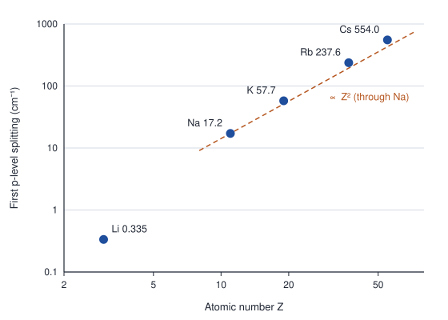
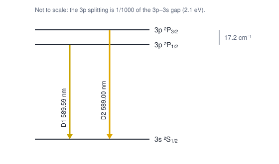
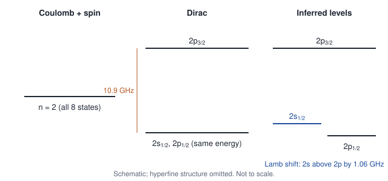
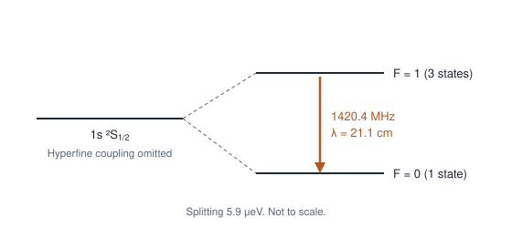

# Unit 2 · Spin, fine structure and hyperfine structure

**Syllabus (CSIR-UGC NET, Physical Sciences, Section VII):** Electron spin. Relativistic corrections for energy levels of hydrogen atom. Hyperfine structure and isotopic shift.

| Lecture | Data | Theory |
|---|---|---|
| 4. Electron spin | Stern–Gerlach, the sodium D doublet, alkali doublets | Spin ½, spin–orbit coupling, term symbols |
| 5. Fine structure of hydrogen | Hα and Lyman α doublets, He⁺, the Lamb shift | Relativistic, spin–orbit and Darwin corrections; the Dirac formula |
| 6. Hyperfine structure and isotope shifts | The 21 cm line, deuterium, the caesium clock, H and D lines | Nuclear spin, F = I + J, Fermi contact interaction; mass and field shifts |

Each lecture follows the same path as Unit 1: **data → puzzle → model → numbers from the data → test a prediction → problems.** Visible wavelengths are in air. Answers are at the end.

---

## Lecture 4 · Electron spin: Stern–Gerlach and the sodium doublet

### 4.1 The data

**Stern–Gerlach (1922).** A beam of silver atoms from an oven passes through a strongly non-uniform magnetic field and lands on a glass plate. The beam splits into **two** separate spots, about 0.2 mm apart. In 1927 Phipps and Taylor repeated the experiment with ground-state hydrogen atoms and also found two spots (Unit 1, Lecture 3).

**The sodium D line.** The yellow sodium line is a close pair:

| Line | Wavelength in air (nm) | Relative intensity |
|---|---|---|
| D2 | 588.995 | 2 |
| D1 | 589.592 | 1 |

The two lines are 0.597 nm apart: 17.2 cm⁻¹, or 2.13 meV. In a dilute source, D2 is twice as bright as D1.

**All the alkali atoms.** The first line of the principal series is a doublet in every alkali atom, and the splitting grows steeply with atomic number:

| Atom | Z | Splitting of the first p level (cm⁻¹) |
|---|---|---|
| Li | 3 | 0.335 |
| Na | 11 | 17.2 |
| K | 19 | 57.7 |
| Rb | 37 | 237.6 |
| Cs | 55 | 554.0 |



*Figure 4.1. Splitting of the first p level of the alkali atoms, on logarithmic scales. From Na to Cs it grows roughly as Z².*

### 4.2 The puzzle

- Silver and hydrogen atoms in their ground states have l = 0, so they have no orbital magnetic moment. They should not be deflected at all.
- Even if they had orbital angular momentum l, the beam would split into 2l + 1 parts, which is always an **odd** number. Two parts means an angular momentum with 2j + 1 = 2, so j = ½. Orbital motion cannot give this, because l is always a whole number.
- In sodium, the 3p → 3s transition should give one line, not two.

### 4.3 The model: electron spin

In 1925 Uhlenbeck and Goudsmit proposed that the electron has an intrinsic angular momentum, its **spin**, with quantum number s = ½:

```math
S^2 = s(s+1)\hbar^2 = \tfrac{3}{4}\hbar^2, \qquad S_z = m_s\hbar, \qquad m_s = \pm\tfrac{1}{2}.
```

The spin carries a magnetic moment

```math
\boldsymbol{\mu}_s = -g_s\,\mu_B\,\frac{\mathbf{S}}{\hbar}, \qquad g_s = 2.0023, \qquad \mu_B = \frac{e\hbar}{2m_e} = 5.79 \times 10^{-5}\ \text{eV/T}.
```

So $`\mu_z = \mp\mu_B`$ to within 0.1%. In a field gradient the force on the atom is $`F_z = \mu_z\,\partial B_z/\partial z`$. Half the atoms are pushed up and half are pushed down: two spots.

**Numbers from the data.** Problem 4.1 shows that a gradient of 10³ T/m, acting over 3.5 cm on silver atoms moving at about 550 m/s, separates two beams with $`\mu_z = \pm\mu_B`$ by 0.2 mm. That is what Stern and Gerlach saw, so the measured moment is one Bohr magneton.

### 4.4 The model: spin–orbit coupling

Why does the 3p level split? In the electron's rest frame the nucleus moves, and a moving charge produces a magnetic field. For an electron with potential energy V(r) this field is

```math
\mathbf{B} = \frac{1}{m_e e c^2}\,\frac{1}{r}\frac{dV}{dr}\,\mathbf{L}.
```

The spin's magnetic moment has energy $`-\boldsymbol{\mu}_s\cdot\mathbf{B}`$ in this field. Including the Thomas factor of ½, a relativistic correction for the electron's accelerated rest frame:

```math
H_{so} = \frac{1}{2m_e^2c^2}\,\frac{1}{r}\frac{dV}{dr}\,\mathbf{L}\cdot\mathbf{S} \equiv \xi(r)\,\mathbf{L}\cdot\mathbf{S}.
```

Now L and S are not separately conserved, but their sum, the **total angular momentum** $`\mathbf{J} = \mathbf{L} + \mathbf{S}`$, is. Its quantum number is $`j = l \pm \tfrac12`$, or only j = ½ when l = 0. From $`\mathbf{J}^2 = \mathbf{L}^2 + \mathbf{S}^2 + 2\,\mathbf{L}\cdot\mathbf{S}`$:

```math
\langle \mathbf{L}\cdot\mathbf{S}\rangle = \frac{\hbar^2}{2}\left[j(j+1) - l(l+1) - s(s+1)\right].
```

Write $`\zeta_{nl} = \hbar^2\langle\xi(r)\rangle`$, an energy. Then every level with l ≥ 1 splits in two, and s levels do not split:

```math
E_{so} = \frac{\zeta_{nl}}{2}\left[j(j+1) - l(l+1) - \tfrac{3}{4}\right], \qquad
E\!\left(j = l + \tfrac12\right) - E\!\left(j = l - \tfrac12\right) = \zeta_{nl}\left(l + \tfrac12\right).
```

**Term symbols.** A level is labelled $`^{2S+1}L_J`$, where L is written as S, P, D, F for L = 0, 1, 2, 3. For a single electron S = ½, so:

- 3s: ²S<sub>1/2</sub>
- 3p: ²P<sub>1/2</sub> and ²P<sub>3/2</sub>
- 3d: ²D<sub>3/2</sub> and ²D<sub>5/2</sub>

The sodium D lines are D1: 3p ²P<sub>1/2</sub> → 3s ²S<sub>1/2</sub>, and D2: 3p ²P<sub>3/2</sub> → 3s ²S<sub>1/2</sub>.



*Figure 4.2. The sodium D lines. Spin–orbit coupling splits the 3p level but not the 3s level.*

### 4.5 Numbers from the data

For a p level, the splitting is $`\tfrac32\zeta_{3p}`$. With the measured 17.2 cm⁻¹:

- $`\zeta_{3p} = 11.5\ \text{cm}^{-1}`$.
- The magnetic field felt by the 3p electron: turning the spin around in a field B costs about $`2\mu_B B`$, so $`B \approx 2.13\ \text{meV}/(2\mu_B) = 18\ \text{T}`$. That is a large field; a strong laboratory magnet gives about 1 T.

The splitting grows with Z (Figure 4.1) because the valence electron spends part of its time inside the inner shells, where it feels the strong field of a heavy, poorly screened nucleus.

### 4.6 Test a prediction: order and intensity of the D lines

- **Order.** For an electron in an attractive potential, $`\zeta > 0`$, so ²P<sub>3/2</sub> lies above ²P<sub>1/2</sub>. D2 should therefore have the shorter wavelength. It does: 588.995 nm against 589.592 nm.
- **Intensity.** A level with total angular momentum J contains 2J + 1 states. If all upper states are equally populated and decay at the same rate, each line's brightness is proportional to the number of states it starts from:

```math
\frac{I(\text{D2})}{I(\text{D1})} = \frac{2\cdot\tfrac32 + 1}{2\cdot\tfrac12 + 1} = \frac{4}{2} = 2,
```

as observed.

### 4.7 What we have learned

- The electron has spin ½ and a magnetic moment of one Bohr magneton (g ≈ 2).
- Spin–orbit coupling splits every level with l ≥ 1 into two levels, j = l ± ½.
- Levels are labelled by term symbols, $`^{2S+1}L_J`$.

### Problems for Lecture 4

**4.1** Silver atoms (mass 108 u) leave an oven at about 550 m/s and cross a magnet 3.5 cm long with a field gradient of 10³ T/m. Taking $`\mu_z = \pm\mu_B`$, find the separation of the two beams at the exit of the magnet.

**4.2** Atoms in a ²P<sub>3/2</sub> level pass through a Stern–Gerlach magnet. How many beams emerge?

**4.3** Write the term symbols of the levels of a single d electron and of a single f electron.

**4.4** Find $`\langle\mathbf{L}\cdot\mathbf{S}\rangle`$ for l = 2, j = 5/2.

**4.5** The first p level of potassium is split by 57.7 cm⁻¹, and the two lines are near 767 nm. Find $`\zeta_{4p}`$ and the wavelength difference between the lines.

**4.6** Why does a Stern–Gerlach experiment need a non-uniform field?

---

## Lecture 5 · Fine structure of hydrogen: relativistic corrections and the Dirac formula

### 5.1 The data

- In 1887 Michelson found that Hα is a close **doublet**. Its two strongest components are about **0.33 cm⁻¹** apart, or 0.014 nm.
- Lyman α (2p → 1s) is also a doublet. The 2p level is split by **10.969 GHz** (0.366 cm⁻¹).
- The same pattern appears in ionized helium, 16 times larger. Paschen measured it in 1916 in the He⁺ line at 468.6 nm.

**A practical difficulty.** The Doppler width of Hα is about 0.19 cm⁻¹ at room temperature and 0.34 cm⁻¹ at 1000 K, which is as large as the splitting itself. This is why the doublet is hard to resolve. Later measurements used discharges cooled with liquid nitrogen and, eventually, Doppler-free laser spectroscopy. Line widths are covered in Unit 3.

### 5.2 The puzzle

In Schrödinger's theory the energy depends only on n, so all eight n = 2 states (counting spin) should have the same energy. The data shows a splitting.

**What size should we expect?** In the ground state $`v/c \approx \alpha`$, so relativistic corrections should be about $`\alpha^2`$ times the binding energy: $`\alpha^2 \times 13.6\ \text{eV} \approx 0.7\ \text{meV}`$, or 6 cm⁻¹. The corrections fall off quickly with n, and the measured n = 2 splitting is 0.37 cm⁻¹, so the size is right. Spin–orbit coupling is one correction of this order, but not the only one.

### 5.3 The model: three corrections of the same size

All three corrections are of order $`\alpha^2 E_n`$, so all three must be kept. Here $`E_n = -13.6\ \text{eV}/n^2`$ and $`m = m_e`$.

**1. Relativistic kinetic energy.** Expanding $`T = \sqrt{p^2c^2 + m^2c^4} - mc^2 = \frac{p^2}{2m} - \frac{p^4}{8m^3c^2} + \dots`$ and treating the second term as a perturbation:

```math
E_\text{rel} = -\frac{E_n^2}{2mc^2}\left[\frac{4n}{l + \frac12} - 3\right].
```

**2. Spin–orbit coupling.** With the Coulomb potential and $`\langle r^{-3}\rangle = \left[n^3a^3\,l\left(l+\tfrac12\right)(l+1)\right]^{-1}`$:

```math
E_{so} = \frac{E_n^2}{mc^2}\;\frac{n\left[j(j+1) - l(l+1) - \frac34\right]}{l\left(l+\frac12\right)(l+1)}, \qquad l \ne 0.
```

**3. The Darwin term.** This applies only to s states. Relativistic quantum mechanics smears the electron's position over about a Compton wavelength, so an s electron samples the potential right at the nucleus:

```math
E_D = \frac{E_n^2}{mc^2}\,2n, \qquad l = 0.
```

**The sum.** Add the three terms and l drops out (Problem 5.1):

```math
E_{nj} = E_n\left[1 + \frac{\alpha^2}{n^2}\left(\frac{n}{j + \frac12} - \frac34\right)\right].
```

For a hydrogen-like ion, replace α by Zα. In 1928 Dirac solved the relativistic wave equation for hydrogen exactly:

```math
E_{nj} = mc^2\left[1 + \left(\frac{Z\alpha}{n - \left(j+\frac12\right) + \sqrt{\left(j+\frac12\right)^2 - Z^2\alpha^2}}\right)^2\right]^{-1/2} - mc^2.
```

Expanded to order α⁴, this reproduces the formula above.

**The predictions:**

- The energy depends only on n and j. Levels with the same n and j but different l, such as 2s<sub>1/2</sub> and 2p<sub>1/2</sub>, have **exactly** the same energy.
- The splittings fall as 1/n³ and grow as Z⁴.

### 5.4 Numbers from the data

| Interval | Dirac theory | Measured |
|---|---|---|
| n = 2: 2p<sub>3/2</sub> − 2p<sub>1/2</sub> | 10.944 GHz (0.365 cm⁻¹) | 10.969 GHz |
| n = 3: j = 3/2 − j = 1/2 | 0.108 cm⁻¹ | |
| n = 3: j = 5/2 − j = 3/2 | 0.036 cm⁻¹ | |
| Hα main doublet | 0.329 cm⁻¹ (0.0142 nm) | about 0.33 cm⁻¹ |

**Why Hα is a doublet.** The strongest components are 3d<sub>5/2</sub> → 2p<sub>3/2</sub>, and the group (3d<sub>3/2</sub>, 3p<sub>3/2</sub>) → (2p<sub>1/2</sub>, 2s<sub>1/2</sub>). Their separation is the n = 2 splitting minus the small n = 3 splitting: 0.365 − 0.036 = 0.329 cm⁻¹.

**The last 0.2%.** The 2p interval is pure spin–orbit coupling, because the other two corrections are the same for both 2p levels. Spin–orbit coupling is proportional to $`g_s - 1`$. Using the measured $`g_s = 2.0023`$ instead of 2 multiplies the Dirac value by 1.0023, giving 10.969 GHz, which is the measured value.

### 5.5 Test a prediction

**Ionized helium.** The Z⁴ scaling predicts an n = 2 splitting of 16 × 0.365 = 5.84 cm⁻¹ in He⁺. Paschen's 1916 measurements on the 468.6 nm line agreed with the formula.

**The Lamb shift: where Dirac fails.** The theory says 2s<sub>1/2</sub> and 2p<sub>1/2</sub> have exactly the same energy. In 1947 Lamb and Retherford tested this directly. They drove microwave transitions between the two levels in a beam of hydrogen atoms in the long-lived 2s state. They found that 2s<sub>1/2</sub> lies **above** 2p<sub>1/2</sub> by 1057.8 MHz (0.035 cm⁻¹, 4.4 μeV).



*Figure 5.1. The n = 2 level of hydrogen in three theories and in experiment. Not to scale.*

Explaining this shift needed quantum electrodynamics: the electron interacts with fluctuations of the electromagnetic field even in empty space. That is beyond the syllabus. The point here is that even Dirac's beautiful theory was eventually overturned by a better measurement.

### 5.6 What we have learned

- Fine structure is of relative size α² ≈ 5 × 10⁻⁵. Three effects contribute: relativistic kinetic energy, spin–orbit coupling and the Darwin term.
- Their sum depends only on n and j: $`E_{nj} = E_n\left[1 + \frac{\alpha^2}{n^2}\left(\frac{n}{j+1/2} - \frac34\right)\right]`$.
- The Lamb shift splits 2s<sub>1/2</sub> from 2p<sub>1/2</sub> by about 1 GHz, which is beyond Dirac's theory.

### Problems for Lecture 5

**5.1** Add the three corrections of Section 5.3 and show that the result depends only on n and j. Treat l = 0 and l ≥ 1 separately.

**5.2** Find the fine-structure splitting of the n = 2 level of He⁺.

**5.3** According to Dirac's theory, into how many levels does n = 3 of hydrogen split? Which states share each level?

**5.4** Show that the splitting between j = ½ and j = 3/2 falls as 1/n³. Find the ratio of this splitting for n = 2 and n = 3.

**5.5** Express the Lamb shift in cm⁻¹ and compare it with the Doppler width of Hα at room temperature. Why did Lamb use microwaves rather than optical spectroscopy?

**5.6** Estimate the ratio of fine structure to gross structure in hydrogen-like uranium (Z = 92). Can the corrections still be treated as small perturbations?

---

## Lecture 6 · Hyperfine structure and isotope shifts

### 6.1 The data

**The 21 cm line.** Radio telescopes receive a line at **1420.4 MHz** (λ = 21.1 cm) from hydrogen clouds all over the Milky Way. Van de Hulst predicted it in 1944, and Ewen and Purcell first detected it in 1951. In the laboratory, the hydrogen maser measures the same frequency: 1 420 405 751.77 Hz.

**Splittings of ground levels:**

| Atom | Level | Nuclear spin I | Splitting (MHz) |
|---|---|---|---|
| ¹H | 1s ²S<sub>1/2</sub> | ½ | 1420.406 |
| ¹H | 2s ²S<sub>1/2</sub> | ½ | 177.557 |
| ²H (deuterium) | 1s ²S<sub>1/2</sub> | 1 | 327.384 |
| ²³Na | 3s ²S<sub>1/2</sub> | 3/2 | 1771.6 |
| ¹³³Cs | 6s ²S<sub>1/2</sub> | 7/2 | 9192.631770 (exact) |

The caesium value is exact because it **defines the second**: one second is 9 192 631 770 periods of this transition.

**Isotope shifts.** The lines of deuterium are slightly shifted from those of hydrogen: Hα is at 656.10 nm instead of 656.28 nm, and Lyman α at 121.534 nm instead of 121.567 nm.

### 6.2 The puzzle

The hydrogen 1s level has l = 0 and j = ½, so it has no fine structure. Yet it is split, by 5.9 μeV. Something other than the electron must have angular momentum and a magnetic moment.

The splitting is about a hundred times smaller than the fine-structure scale, α² × 13.6 eV. That points to a magnetic moment much smaller than the electron's, which is the size we would expect for a moment carried by the heavy nucleus.

### 6.3 The model: nuclear spin and the hyperfine interaction

The nucleus has a spin I and a magnetic moment

```math
\boldsymbol{\mu}_I = g_I\,\mu_N\,\frac{\mathbf{I}}{\hbar}, \qquad \mu_N = \frac{e\hbar}{2m_p} = \frac{\mu_B}{1836}.
```

For the proton, I = ½ and $`g_p = 5.586`$, so its moment is 2.79 μ<sub>N</sub>, about 660 times smaller than the electron's.

The electron and nuclear moments interact. To lowest order:

```math
H_{hf} = A\,\frac{\mathbf{I}\cdot\mathbf{J}}{\hbar^2}.
```

The good quantum number is now the **total angular momentum of the atom**, $`\mathbf{F} = \mathbf{I} + \mathbf{J}`$, with $`F = |I - J|, \dots, I + J`$. Exactly as for L·S:

```math
E_F = \frac{A}{2}\left[F(F+1) - I(I+1) - J(J+1)\right], \qquad E_F - E_{F-1} = A\,F.
```

The second equation is the **interval rule**. For a ground level with J = ½ there are two levels, F = I ± ½, split by $`A\left(I + \tfrac12\right)`$.

**The Fermi contact interaction.** An s electron has a nonzero probability density at the nucleus. There it feels the field inside the nuclear magnetic dipole. Fermi showed in 1930 that this gives

```math
A = \frac{2\mu_0}{3}\,g_s\mu_B\,g_I\mu_N\,|\psi(0)|^2.
```

For hydrogen 1s, $`|\psi(0)|^2 = 1/(\pi a_0^3)`$, and the splitting is

```math
\Delta E = \frac{4}{3}\,g_p\,\frac{m_e}{m_p}\,\alpha^4 m_e c^2 = 5.88\ \mu\text{eV}, \qquad \nu = 1421.2\ \text{MHz}.
```



*Figure 6.1. The hydrogen ground state is split by the hyperfine interaction. The F = 1 → F = 0 transition is the 21 cm line.*

### 6.4 Numbers from the data

- **Hydrogen.** Fermi's formula gives 1421.2 MHz against the measured 1420.406 MHz. Two small corrections, the reduced mass (Unit 1) and the electron's $`g_s = 2.0023`$, bring the prediction to 1420.5 MHz: agreement to 0.007%.
- **Sodium.** With I = 3/2, the 3s splitting is $`A(I + \tfrac12) = 2A`$, so $`A = 885.8`$ MHz.
- **Caesium.** With I = 7/2, the splitting is 4A, so $`A = 2298.2`$ MHz.

### 6.5 Test a prediction

**The 2s level.** The contact interaction is proportional to $`|\psi(0)|^2`$, which falls as 1/n³ for s states. The 2s splitting should be 1420.406 MHz/8 = 177.55 MHz. Measured: **177.557 MHz**.

**Deuterium.** The deuteron has I = 1 and $`g_d = 0.857`$. Compared with hydrogen, A is smaller by the factor $`g_d/g_p`$, and the splitting is $`A(I + \tfrac12) = \tfrac32 A`$. Including the small reduced-mass change, the prediction is 327.3 MHz. Measured: **327.384 MHz**.

**Why the 21 cm line is so faint, but still seen.** F = 1 → F = 0 is a magnetic dipole transition, which is extremely slow. Its rate is $`A \approx 2.9 \times 10^{-15}\ \text{s}^{-1}`$, so an atom waits **11 million years** on average before emitting. We see the line anyway because there is an enormous amount of hydrogen in the galaxy. Its Doppler shifts are used to map the spiral arms of the Milky Way.

### 6.6 Isotope shifts

Different isotopes of the same element have slightly different line positions, for two reasons.

**1. The mass shift.** Changing the nuclear mass changes the reduced mass (Unit 1):

```math
\frac{\Delta\nu}{\nu} \approx \frac{m_e}{u}\left(\frac{1}{A_1} - \frac{1}{A_2}\right),
```

where $`A_1`$ and $`A_2`$ are the mass numbers and u is the atomic mass unit. This shift falls rapidly with mass: 2.7 × 10⁻⁴ for H and D, 6.5 × 10⁻⁷ for mass numbers 40 and 42, and 2.7 × 10⁻⁸ for 200 and 202. It explains the H–D shifts exactly. In atoms with several electrons there is an extra mass shift from correlations between the electrons.

**2. The field (volume) shift.** The nucleus is not a point. Inside it the potential is weaker than $`-Ze^2/(4\pi\varepsilon_0 r)`$, so s electrons, which reach the nucleus, are slightly less tightly bound. Isotopes have slightly different nuclear radii, so their levels shift by

```math
\Delta E_\text{field} = \frac{Ze^2}{6\varepsilon_0}\,|\psi(0)|^2\,\delta\langle r^2\rangle_\text{nucleus}.
```

Because $`|\psi(0)|^2`$ grows rapidly with Z, this shift dominates in heavy atoms. Isotope shifts of heavy elements are used to measure how nuclear charge radii change from one isotope to the next.

**Summary:** the mass shift dominates in light atoms and the field shift in heavy atoms.

> **Beyond the syllabus: the proton radius puzzle.** In ordinary hydrogen, the finite size of the proton shifts the 1s level by only about 1 MHz. In muonic hydrogen the muon orbits 186 times closer, so the same effect on the 2s level is about 3.7 meV. In 2010 measurements of muonic hydrogen gave a proton radius about 4% smaller than earlier values from ordinary hydrogen. Later experiments on ordinary hydrogen moved towards the smaller value.

### 6.7 What we have learned

- Nuclei have spin I and magnetic moments of order μ<sub>N</sub> = μ<sub>B</sub>/1836.
- The hyperfine interaction couples I and J into F = I + J. Levels follow $`E_F = \tfrac{A}{2}[F(F+1) - I(I+1) - J(J+1)]`$ and the interval rule.
- For s electrons, the Fermi contact interaction predicts the 21 cm line to 0.007%.
- Isotope shifts come from the change in mass (light atoms) and the change in nuclear size (heavy atoms).

### Problems for Lecture 6 (CSIR-NET style)

**6.1** The ²³Na nucleus has I = 3/2. List the F values of the 3p ²P<sub>3/2</sub> level.

**6.2** Give the F values of the ground levels of ⁸⁷Rb (I = 3/2) and ⁸⁵Rb (I = 5/2).

**6.3** Use Fermi's formula to calculate the frequency of the 21 cm line.

**6.4** Predict the hyperfine splitting of the 2s level of hydrogen.

**6.5** The deuteron has I = 1 and magnetic moment 0.857 μ<sub>N</sub>. Predict the ground-state hyperfine splitting of deuterium.

**6.6** A level shows three hyperfine components, with intervals of 90 MHz and 60 MHz. Use the interval rule to find A and the F values.

**6.7** Find the mean lifetime of the F = 1 level of ground-state hydrogen, given $`A = 2.9 \times 10^{-15}\ \text{s}^{-1}`$. Why can astronomers still see the line?

**6.8** (Challenge.) Take the proton radius to be 0.84 fm. Estimate the shift of the hydrogen 1s level caused by the proton's finite size. Then estimate the same effect on the 2s level of muonic hydrogen.

---

## Summary of Unit 2

| Data | Explained by |
|---|---|
| Two Stern–Gerlach beams; μ = μ<sub>B</sub> | Electron spin ½, g ≈ 2 |
| Sodium D doublet, 17.2 cm⁻¹; intensity ratio 2 : 1 | Spin–orbit coupling; 2J + 1 states per level |
| Alkali doublets growing roughly as Z² | Valence electron penetrating the inner shells |
| Hα doublet 0.33 cm⁻¹; 2p splitting 10.969 GHz | Relativistic, spin–orbit and Darwin terms; Dirac formula with g<sub>s</sub> = 2.0023 |
| 2s<sub>1/2</sub> above 2p<sub>1/2</sub> by 1057.8 MHz | Lamb shift (quantum electrodynamics) |
| 21 cm line; 2s and deuterium splittings | Nuclear spin, F = I + J, Fermi contact interaction |
| H–D line shifts | Reduced mass (mass shift); in heavy atoms, nuclear size (field shift) |

---

## Answers

**4.1** Acceleration $`a = \mu_B (\partial B/\partial z)/m = 5.2 \times 10^4\ \text{m/s}^2`$. Time in the magnet: 0.035 m ÷ 550 m/s = 6.4 × 10⁻⁵ s. Each beam is deflected by $`\tfrac12 at^2 = 0.1`$ mm, so the separation is 0.2 mm.

**4.2** 2J + 1 = 4 beams.

**4.3** d electron: ²D<sub>3/2</sub>, ²D<sub>5/2</sub>. f electron: ²F<sub>5/2</sub>, ²F<sub>7/2</sub>.

**4.4** $`\tfrac{\hbar^2}{2}\left[\tfrac{35}{4} - 6 - \tfrac34\right] = \hbar^2`$.

**4.5** $`\zeta_{4p} = \tfrac23 \times 57.7 = 38.5\ \text{cm}^{-1}`$. $`\Delta\lambda = \lambda^2\,\Delta\tilde\nu = (767\ \text{nm})^2 \times 57.7\ \text{cm}^{-1} = 3.4`$ nm. The measured lines are at 766.49 and 769.90 nm.

**4.6** In a uniform field a magnetic dipole feels a torque but no net force, so the beam is not deflected.

**5.1** For l ≥ 1, use $`j = l \pm \tfrac12`$ to replace l in $`E_\text{rel}`$ and $`E_{so}`$; both cases give $`\frac{E_n^2}{2mc^2}\left[3 - \frac{4n}{j+1/2}\right]`$. For l = 0, $`E_\text{rel} + E_D = \frac{E_n^2}{2mc^2}[3 - 8n + 4n]`$, the same expression with j = ½.

**5.2** 16 × 0.365 cm⁻¹ = 5.84 cm⁻¹.

**5.3** Three levels: j = ½ (3s<sub>1/2</sub>, 3p<sub>1/2</sub>), j = 3/2 (3p<sub>3/2</sub>, 3d<sub>3/2</sub>) and j = 5/2 (3d<sub>5/2</sub>).

**5.4** The interval is $`|E_n|\frac{\alpha^2}{n^2}\left(n - \frac{n}{2}\right) = \frac{\alpha^2|E_n|}{2n} \propto \frac{1}{n^3}`$. The ratio for n = 2 and n = 3 is (3/2)³ = 27/8 = 3.375, and indeed 0.365/0.108 = 3.38.

**5.5** 1057.8 MHz ÷ c = 0.035 cm⁻¹, about one fifth of the Doppler width of Hα at room temperature (0.19 cm⁻¹). The Doppler width is proportional to the transition frequency, so it is tiny for a direct 1 GHz microwave transition between the two n = 2 levels.

**5.6** The ratio is about (Zα)² = (92/137)² ≈ 0.45. The corrections are not small, so the exact Dirac formula must be used.

**6.1** F runs from |I − J| to I + J: F = 0, 1, 2, 3.

**6.2** ⁸⁷Rb: F = 1, 2. ⁸⁵Rb: F = 2, 3.

**6.3** $`\tfrac43 \times 5.586 \times \tfrac{1}{1836} \times \alpha^4 \times 511\ \text{keV} = 5.88\ \mu\text{eV}`$, or 1421 MHz. The measured value is 1420.4 MHz.

**6.4** 1420.4 MHz ÷ 8 = 177.6 MHz, because $`|\psi_{2s}(0)|^2 = |\psi_{1s}(0)|^2/8`$.

**6.5** $`g_d = 0.857/1 = 0.857`$. Splitting = $`\tfrac32 \times \frac{0.857}{5.586} \times 1420.4\ \text{MHz} = 327`$ MHz.

**6.6** The interval rule gives intervals AF and A(F − 1) in the ratio 90 : 60 = 3 : 2, so F = 3 and 2 are the upper levels of each pair. The levels are F = 1, 2, 3 and A = 30 MHz.

**6.7** τ = 1/A = 3.5 × 10¹⁴ s ≈ 11 million years. There are so many hydrogen atoms along any line of sight that enough of them emit at any moment.

**6.8** $`\Delta E_{1s} = \frac{2}{3}\,\frac{e^2}{4\pi\varepsilon_0}\,\frac{r_p^2}{a_0^3} = 4.6 \times 10^{-9}`$ eV, or 1.1 MHz. For the muon, $`a_0`$ is 185.8 times smaller, so the effect is 185.8³ times larger, and the 2s state has a further factor of 1/8: about 3.7 meV.

---

## Sources of the data

- Stern–Gerlach and Phipps–Taylor experiments, alkali doublets: Haken & Wolf, *The Physics of Atoms and Quanta*; Foot, *Atomic Physics*.
- Alkali fine-structure intervals and the sodium and potassium wavelengths: NIST Atomic Spectra Database.
- Hydrogen fine structure and the Lamb shift: Haken & Wolf; Bransden & Joachain, *Physics of Atoms and Molecules*.
- Hyperfine splittings of H, D and the alkalis: NIST; Arimondo, Inguscio and Violino, *Reviews of Modern Physics* 49, 31 (1977).
- The definition of the second: the SI Brochure (BIPM).
- Constants: CODATA 2018. Every derived number in these notes was checked with a short calculation.
