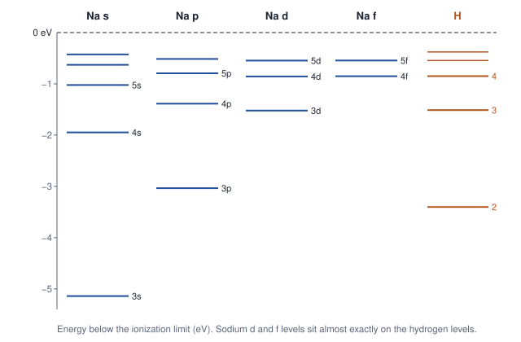
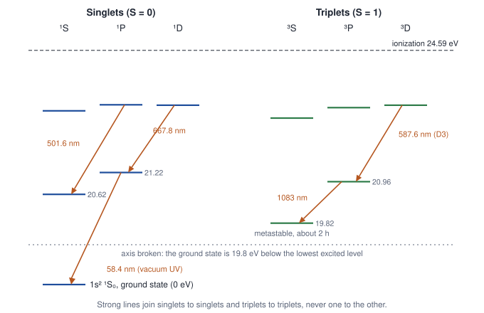
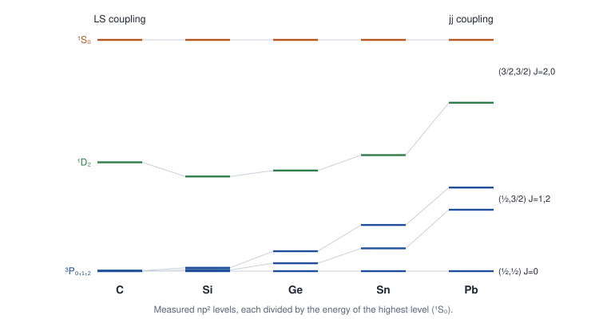

# Unit 3 · Many-electron atoms: alkalis, helium and coupling schemes

**Syllabus (CSIR-UGC NET, Physical Sciences, Section VII):** Spectrum of helium and alkali atom. LS & JJ couplings.

| Lecture | Data | Theory |
|---|---|---|
| 7. Alkali spectra and the quantum defect | Sodium's four series and energy levels; quantum defects of all the alkalis | Central-field approximation, core penetration, quantum defect |
| 8. Helium | Two separate line systems, singlet–triplet splittings, the ground-state energy | Pauli principle, exchange, perturbation and variational methods |
| 9. LS and jj coupling | Calcium ³P intervals, np² levels from carbon to lead, rare-earth magnetic moments | Term symbols, Hund's rules, Landé interval rule, jj coupling |

Line widths, Lecture 10 in the first draft, are now in [Unit 5](unit-5-light-matter-interaction.md), where the [course map](course-map.md) places them.

Each lecture follows the pattern described in the [course README](README.md#how-the-units-are-written): **data (with how it is measured) → puzzle → model → numbers from the data → test a prediction → in response language → problems.** Visible wavelengths are in air. Answers are at the end.

---

## Lecture 7 · Alkali spectra and the quantum defect

### 7.1 The data

> **How it is measured.** Sodium vapour in a flame, an arc or a discharge lamp emits its spectrum, which is recorded with prism and grating spectrographs from the infrared to the ultraviolet. The lines fall into series. The Ritz combination principle (Lecture 1) turns the line wavenumbers into energy levels, and the limit of each series gives the ionization energy. The principal series also appears in absorption when white light passes through sodium vapour, because it starts from the ground state. Modern laser spectroscopy measures levels up to n ≈ 100.

**Four series.** Nineteenth-century spectroscopists named sodium's series after the look of the lines on their photographic plates. The names became the letters s, p, d and f.

| Series | Transition | First lines (nm, air) | Appearance |
|---|---|---|---|
| Principal | np → 3s | 589.0/589.6, 330.2/330.3 | Strongest; also seen in absorption |
| Sharp | ns → 3p | 1138.2/1140.4, 615.4/616.1, 514.9/515.4 | Sharp |
| Diffuse | nd → 3p | 818.3/819.5, 568.3/568.8, 497.9/498.3 | Blurred |
| Fundamental | nf → 3d | 1846 | Hydrogen-like |

**The energy levels** that the Ritz principle gives from these lines, in eV below the ionization limit:

| n | s | p | d | f | Hydrogen |
|---|---|---|---|---|---|
| 3 | 5.139 | 3.035 | 1.522 | | 1.512 |
| 4 | 1.948 | 1.386 | 0.856 | 0.851 | 0.850 |
| 5 | 1.023 | 0.794 | 0.547 | 0.545 | 0.544 |
| 6 | 0.629 | 0.515 | | | 0.378 |

The p values are averages over the two fine-structure levels.



*Figure 7.1. Energy levels of sodium (blue) and hydrogen (orange), measured from the ionization limit.*

### 7.2 The puzzle

- In hydrogen the energy depends only on n. In sodium the 3s, 3p and 3d levels are very different: 5.14, 3.04 and 1.52 eV below the ionization limit.
- Yet sodium's d and f levels are almost exactly hydrogen's: 1.522 eV against 1.512 eV for n = 3.
- Why does l matter so much for s and p electrons, and hardly at all for d and f?

### 7.3 The model: one electron outside a core

Sodium is a closed core of ten electrons (1s² 2s² 2p⁶) plus one valence electron. In the **central-field approximation**, the valence electron moves in an average, spherically symmetric potential V(r):

- Far outside the core, the nuclear charge +11e is screened by ten electrons, so $`V \to -e^2/(4\pi\varepsilon_0 r)`$, as in hydrogen.
- Inside the core, the screening is incomplete, and V approaches $`-11e^2/(4\pi\varepsilon_0 r)`$.

**Penetration.** The centrifugal barrier $`l(l+1)\hbar^2/(2mr^2)`$ keeps high-l electrons out of the core. An s electron penetrates deeply, a p electron less, and d and f electrons hardly at all. An electron that penetrates feels more of the nuclear charge, so it is more tightly bound.

**The quantum defect.** The energies follow Rydberg's formula with an effective principal quantum number $`n^* = n - \delta_l`$:

```math
E_{nl} = -\frac{hcR}{(n - \delta_l)^2}.
```

**Why δ<sub>l</sub> hardly depends on n.** Penetration happens close to the nucleus, where the potential is tens of eV deep. Levels that differ by a few eV have almost the same wavefunction shape there. So the core's only effect on the outer part of the wave is a fixed shift of its phase, which shifts n by a fixed amount. More precisely, πδ<sub>l</sub> is the phase shift that the core adds to the Coulomb wave, the same idea as a phase shift in scattering theory.

**A toy model.** Add a short-range extra attraction $`-C/r^2`$ to the Coulomb potential. It combines with the centrifugal term, replacing l(l + 1) by l\*(l\* + 1), where $`l^*(l^*+1) = l(l+1) - 2mC/\hbar^2`$. The hydrogen solution then gives exactly the Rydberg form, with

```math
\delta_l = l - l^* \approx \frac{mC}{\hbar^2\left(l + \frac12\right)}.
```

So δ<sub>l</sub> is independent of n and falls with l. The real core is not a 1/r² potential, so this model gets the trend right but not the numbers.

### 7.4 Numbers from the data

From each level, $`n^* = \sqrt{R/T}`$, where T is the binding energy in wavenumbers, and $`\delta = n - n^*`$:

| n | δ<sub>s</sub> | δ<sub>p</sub> | δ<sub>d</sub> | δ<sub>f</sub> |
|---|---|---|---|---|
| 3 | 1.373 | 0.883 | 0.010 | |
| 4 | 1.357 | 0.867 | 0.012 | 0.001 |
| 5 | 1.353 | 0.862 | 0.013 | 0.001 |
| 6 | 1.351 | 0.859 | | |
| 7 | 1.350 | | | |

Down each column the defect is almost constant: δ<sub>s</sub> ≈ 1.35, δ<sub>p</sub> ≈ 0.86, δ<sub>d</sub> ≈ 0.01, δ<sub>f</sub> ≈ 0.

Another way to read the same data: write $`E = -13.6\ \text{eV}\times Z_\text{eff}^2/n^2`$. The effective nuclear charge is 1.84 for 3s, 1.42 for 3p and 1.00 for 3d.

### 7.5 Test a prediction

**The next level.** The 6s defect, 1.3508, predicts the 7s level at 38 010.9 cm⁻¹ above the ground state. It is measured at 38 012.0 cm⁻¹: agreement within 1 cm⁻¹.

**The other alkali atoms.** Each extra closed shell in the core adds about one to δ<sub>s</sub>. In the heavy alkalis, whose cores contain filled d shells, even the d electrons penetrate. Values for high n:

| Atom | δ<sub>s</sub> | δ<sub>p</sub> | δ<sub>d</sub> |
|---|---|---|---|
| Li | 0.40 | 0.05 | 0.00 |
| Na | 1.35 | 0.86 | 0.01 |
| K | 2.18 | 1.71 | 0.28 |
| Rb | 3.13 | 2.65 | 1.35 |
| Cs | 4.05 | 3.57 | 2.47 |

### 7.6 What we have learned

- An alkali atom is one electron outside a closed core.
- Penetration of the core lowers the s and p levels, and the energies follow $`E = -hcR/(n - \delta_l)^2`$.
- The quantum defect hardly depends on n, falls with l, and grows with the size of the core.

**In response language ([optional reading](reading-spectroscopy-as-response.md)).** Each series is a sequence of resonances that crowd together at the ionization limit. Above the limit, absorption continues smoothly as photoionization, so the oscillator strength flows from the lines into the continuum (Figure 0.2). The quantum defect is the core's phase shift divided by π, the same quantity that appears in Friedel's sum rule for impurities in metals.

### Problems for Lecture 7

**7.1** Using δ<sub>s</sub> = 1.35 and δ<sub>p</sub> = 0.86, calculate the wavelength of the sodium 3p → 3s line. Compare with 589 nm and explain the difference.

**7.2** Sodium's ionization energy is 5.139 eV. Find the effective nuclear charge felt by the 3s electron.

**7.3** The ionization energy of potassium is 4.341 eV. Find the quantum defect of its 4s ground state.

**7.4** Sodium's d levels are almost hydrogenic, but caesium's have δ<sub>d</sub> = 2.47. Why?

**7.5** Estimate the radius and the binding energy of a sodium atom in the 50s level.

**7.6** Which sodium series appears in absorption by sodium vapour at room temperature, and why only that one?

---

## Lecture 8 · Helium: exchange, singlets and triplets

### 8.1 The data

> **How it is measured.** A helium discharge tube and a grating spectrometer record the visible lines. The strong lines down to the ground state lie in the vacuum ultraviolet, near 58 nm, where air absorbs, so the spectrograph and the whole light path are evacuated. The ionization energy comes from the limit of that ultraviolet series, at 50.4 nm. Adding the ionization energy of He⁺ (54.4 eV, from its own series limit at 22.8 nm) gives the total binding energy of both electrons.

**1. Helium was discovered from a spectral line.** During a solar eclipse in 1868, a yellow line at 587.6 nm was seen in light from the Sun. It matched no known element and was called D3, because it is close to the sodium D lines. Helium was found on Earth only in 1895.

**2. Two separate line systems.** Helium's lines fall into two families. Strong lines join levels within a family but never between the families. For a time the two were thought to come from two different gases, "parhelium" and "orthohelium". Strong visible lines of the first family are at 667.8 and 501.6 nm; of the second at 587.6, 706.5 and 388.9 nm, with a strong infrared line at 1083 nm.

**3. Energy levels,** in eV above the ground state:

| Configuration | Singlet (S = 0) | Triplet (S = 1) | Difference |
|---|---|---|---|
| 1s2s | 20.616 | 19.820 | 0.796 |
| 1s2p | 21.218 | 20.964 | 0.254 |
| 1s3s | 22.920 | 22.718 | 0.202 |
| 1s3p | 23.087 | 23.007 | 0.080 |
| 1s3d | 23.074 | 23.074 | 0.0004 |

In every case the triplet lies lower.

**4. The ground state.** 1s² is a single level, a singlet; there is no 1s² triplet. The first ionization energy is 24.587 eV, and the total binding energy of both electrons is 79.005 eV.

**5. Very different decay rates.**

- The singlet 1s2p ¹P₁ decays to the ground state at 58.4 nm with $`A = 1.8 \times 10^9\ \text{s}^{-1}`$, a lifetime of 0.56 ns.
- The triplet 1s2p ³P₁ decays to the same ground state at 59.1 nm with $`A = 177\ \text{s}^{-1}`$, ten million times more slowly.
- The lowest triplet, 1s2s ³S₁, lives about 2 hours (7870 s).



*Figure 8.1. Energy levels of helium. Strong lines join singlets to singlets and triplets to triplets.*

### 8.2 The puzzle

- Why are there two families of levels, as if helium were two different gases?
- Why does every triplet lie below its singlet, by as much as 0.8 eV? The Hamiltonian contains no spin, and spin–orbit coupling in helium is less than 10⁻⁴ eV.
- Why is there no 1s² triplet?
- If the two electrons did not repel each other, the ground state would be at 2 × (−54.4 eV) = −108.8 eV. The measured −79.0 eV is 30 eV higher.

### 8.3 The model

The Hamiltonian for the two electrons is

```math
H = \sum_{i=1,2}\left(\frac{p_i^2}{2m} - \frac{2e^2}{4\pi\varepsilon_0 r_i}\right) + \frac{e^2}{4\pi\varepsilon_0 r_{12}}.
```

**The ground state.** Without the repulsion, each electron is in a He⁺ 1s orbital, giving $`E^{(0)} = -108.8`$ eV.

- **First-order perturbation theory.** The average repulsion in this state is $`\langle e^2/(4\pi\varepsilon_0 r_{12})\rangle = \tfrac58 Z \times 27.2\ \text{eV} = 34.0`$ eV, so E = −74.8 eV.
- **The variational method.** Let each electron see an effective charge Z′ and minimize the energy, $`E(Z') = \left[Z'^2 - 2ZZ' + \tfrac58 Z'\right] \times 27.2\ \text{eV}`$. The minimum is at $`Z' = Z - \tfrac{5}{16} = \tfrac{27}{16}`$, with $`E = -\left(\tfrac{27}{16}\right)^2 \times 27.2\ \text{eV} = -77.5`$ eV. Each electron screens 5/16 of a proton charge from the other.
- **Exact numerical result:** −79.0 eV. The last 1.5 eV includes about 0.4 eV from improving the restricted orbital to the Hartree–Fock limit (about −77.9 eV), and a further lowering of about 1.1 eV from **correlation**: the electrons avoid each other more than any product of two orbitals allows.

**Excited states, 1s nl.** One electron is in 1s and the other in nl. Because the electrons are identical, the spatial wavefunction must be either symmetric or antisymmetric when they are exchanged:

```math
\psi_\pm = \frac{1}{\sqrt2}\Bigl[\phi_{1s}(\mathbf r_1)\,\phi_{nl}(\mathbf r_2) \pm \phi_{nl}(\mathbf r_1)\,\phi_{1s}(\mathbf r_2)\Bigr].
```

The Pauli principle requires the total wavefunction, space times spin, to be antisymmetric. So the symmetric ψ₊ goes with the antisymmetric spin **singlet** (S = 0), and the antisymmetric ψ₋ with the symmetric spin **triplet** (S = 1). To first order in the repulsion:

```math
E_\pm = E_{1s} + E_{nl} + J \pm K,
```

where J is the ordinary (direct) Coulomb repulsion between the two charge clouds, and K is the **exchange integral**:

```math
K = \int \phi_{1s}^*(\mathbf r_1)\,\phi_{nl}^*(\mathbf r_2)\;\frac{e^2}{4\pi\varepsilon_0 r_{12}}\;\phi_{nl}(\mathbf r_1)\,\phi_{1s}(\mathbf r_2)\;d^3r_1\,d^3r_2 \;>\; 0.
```

The singlet is at J + K and the triplet at J − K, so the triplet is lower by 2K. In the triplet the spatial wavefunction vanishes when **r**₁ = **r**₂: the electrons keep apart and repel each other less.

**The same thing written with spins.** Since $`\mathbf{s}_1\cdot\mathbf{s}_2`$ is $`-\tfrac34\hbar^2`$ in the singlet and $`+\tfrac14\hbar^2`$ in the triplet,

```math
E = E_{1s} + E_{nl} + J - \frac{K}{2} - \frac{2K}{\hbar^2}\,\mathbf{s}_1\cdot\mathbf{s}_2.
```

A Coulomb force that knows nothing about spin, combined with the Pauli principle, acts like a coupling between the spins. This is the origin of the Heisenberg exchange interaction of magnetism. Here K > 0 favours parallel spins, which is Hund's first rule (Lecture 9).

**Why there are two systems.** The electric dipole operator, $`-e(\mathbf r_1 + \mathbf r_2)`$, does not act on spin, so it connects only states with the same S. The selection rule is **ΔS = 0**.

**Why the ground state is a singlet.** With both electrons in 1s, only the symmetric spatial function exists, so only the singlet is allowed.

### 8.4 Numbers from the data

From the table in Section 8.1, K = half the singlet–triplet difference:

| Configuration | 1s2s | 1s2p | 1s3s | 1s3p | 1s3d |
|---|---|---|---|---|---|
| K (eV) | 0.40 | 0.13 | 0.10 | 0.040 | 0.0002 |

K falls quickly with l. It measures how much the nl orbital overlaps the 1s orbital, and electrons with higher l stay farther from the nucleus. For the ground state, the variational screening charge is Z′ = 1.69.

### 8.5 Test a prediction

**Weak intercombination lines.** ΔS = 0 predicts that lines between singlets and triplets should be very weak. The 1s2p ³P₁ → 1s² line at 59.1 nm has $`A = 177\ \text{s}^{-1}`$, ten million times weaker than the singlet line at 58.4 nm. It is not zero only because spin–orbit coupling mixes a little singlet character into ³P₁.

**A metastable triplet.** The lowest triplet, 1s2s ³S₁, has nowhere to go. ΔS = 0 forbids a dipole decay to the singlet ground state, and there is no lower triplet. Its lifetime, measured with atoms held in a trap, is 7870 s, about two hours: one of the longest-lived excited states of any neutral atom.

**Another two-electron ion.** The variational result for Li⁺ (Z = 3) is $`-\left(3 - \tfrac{5}{16}\right)^2 \times 27.2\ \text{eV} = -196.5`$ eV. The measured value is −198.1 eV.

### 8.6 What we have learned

- Helium has a singlet and a triplet system, joined only by weak intercombination lines, because ΔS = 0.
- Coulomb repulsion plus the Pauli principle puts each triplet below its singlet. In spin language, the coupling is $`-(2K/\hbar^2)\,\mathbf s_1\cdot\mathbf s_2`$.
- In the ground state each electron screens the other by 5/16 of a charge. The variational energy, −77.5 eV, is close to the measured −79.0 eV.

**In response language ([optional reading](reading-spectroscopy-as-response.md)).** Helium's resonances fall into two families. The dipole operator does not act on spin, so the response function never connects singlets to triplets. Spin–orbit mixing gives the intercombination lines only a tiny weight.

### Problems for Lecture 8

**8.1** Show that first-order perturbation theory gives −74.8 eV for the ground state of helium, given $`\langle e^2/(4\pi\varepsilon_0 r_{12})\rangle = \tfrac58 Z \times 27.2`$ eV for two 1s electrons.

**8.2** Minimize $`E(Z') = \left[Z'^2 - 2ZZ' + \tfrac58 Z'\right] \times 27.2`$ eV to find the best effective charge and the variational energy of helium.

**8.3** Use the measured levels to find the exchange integrals K for the 1s2s and 1s2p configurations.

**8.4** Which of these transitions are allowed in helium, which are weak, and which are forbidden?
(a) 1s3d ¹D₂ → 1s2p ¹P₁ (b) 1s2p ³P₁ → 1s² ¹S₀ (c) 1s2s ³S₁ → 1s² ¹S₀ (d) 1s3p ³P → 1s2s ³S₁

**8.5** Use the variational method to estimate the ground-state energy of Li⁺. Compare with the measured value: the sum of the ionization energies of Li⁺ (75.64 eV) and Li²⁺ (122.45 eV).

**8.6** Using $`\mathbf s_1\cdot\mathbf s_2 = \tfrac{\hbar^2}{2}\left[S(S+1) - \tfrac32\right]`$, show that the spin form of the energy reproduces E = J ± K.

---

## Lecture 9 · LS and jj coupling

### 9.1 The data

> **How it is measured.** All the levels in this lecture belong to the lowest configuration of each atom. They have the same parity, so electric-dipole lines between them are forbidden, and they cannot be measured directly. They are found in three ways:
> - **Pairs of lines with a shared upper level.** Carbon's 2p3s ¹P₁ level emits at 193.09 nm (vacuum) down to ¹D₂ and at 247.86 nm (air) down to ¹S₀. The difference of the two wavenumbers, 51 789.16 − 40 333.80 = 11 455.36 cm⁻¹, is the spacing between ¹S₀ and ¹D₂, although no line joins those two levels. Spectroscopists collect thousands of lines and solve for the set of levels that explains them all: the Ritz principle of Lecture 1. The [worked example](worked-example-raw-spectrum.md) carries out every step on a real lamp spectrum.
> - **Forbidden lines where atoms are left undisturbed.** In a thin gas, atoms have time to make even very slow transitions. The aurora shows oxygen's 557.7 nm line (¹S₀ → ¹D₂) and 630.0 nm line (¹D₂ → ³P₂), and radio telescopes see carbon's ³P₁ → ³P₀ line at 492 GHz in interstellar clouds.
> - **Which term is lowest.** Cold vapour absorbs only from levels that are populated at its temperature (k<sub>B</sub>T ≈ 208 cm⁻¹ at 300 K). Carbon absorbs from all three ³P levels but not from ¹D₂, so ³P is the ground term.
>
> The labels, such as ³P₁, are interpretation. J values come from Zeeman patterns (Unit 4) and selection rules; the terms come from the patterns of spacings and intensities, and from Hund's rules.
>
> **Magnetic moments** of rare-earth ions come from the temperature dependence of their magnetic susceptibility. In a salt where the ions are far apart, χ = C/T (Curie's law), and the Curie constant C gives the moment. The susceptibility is measured with a Gouy or Faraday balance, or today with a SQUID magnetometer.

**1. Calcium's 4s4p ³P term** has three levels, with J = 0, 1, 2, at 15 157.90, 15 210.06 and 15 315.94 cm⁻¹. The two intervals are 52.16 and 105.88 cm⁻¹, in the ratio 2.03. The singlet of the same configuration, 4s4p ¹P₁, lies much higher, at 23 652.30 cm⁻¹; it gives calcium's strong line at 422.7 nm.

**2. The np² configuration down group 14** (levels in cm⁻¹):

| Atom | ³P₀ | ³P₁ | ³P₂ | ¹D₂ | ¹S₀ |
|---|---|---|---|---|---|
| C (2p²) | 0 | 16.4 | 43.4 | 10 193 | 21 648 |
| Si (3p²) | 0 | 77.1 | 223.2 | 6 299 | 15 394 |
| Ge (4p²) | 0 | 557.1 | 1 410.0 | 7 125 | 16 367 |
| Sn (5p²) | 0 | 1 691.8 | 3 427.7 | 8 613 | 17 162 |
| Pb (6p²) | 0 | 7 819.3 | 10 650.3 | 21 458 | 29 467 |

In carbon the five levels form three widely separated groups, one of which holds three close levels. In lead the pattern is completely different.



*Figure 9.1. Measured np² levels from carbon to lead, each divided by the energy of the highest level.*

**3. Oxygen (2p⁴)** has the same three ³P levels, but in reverse order: ³P₂ at 0, ³P₁ at 158.3 and ³P₀ at 227.0 cm⁻¹.

**4. Rare-earth ions.** Their measured effective magnetic moments, in Bohr magnetons, are Nd³⁺ 3.5, Sm³⁺ 1.5, Gd³⁺ 8.0, Dy³⁺ 10.6 and Er³⁺ 9.5.

### 9.2 The puzzle

- How should the levels of a many-electron atom be labelled, and what fixes their order?
- Why does carbon's 2p² configuration give exactly these five levels, in this order?
- Why is the pattern in lead so different?
- Why is oxygen's ³P term upside down compared with carbon's?

### 9.3 The model: a hierarchy of interactions

After the central field (Lecture 7), two smaller interactions remain:

1. **The residual electrostatic interaction** between the electrons: the part of their repulsion not included in the central field. Through exchange, as in helium, it depends on how the electrons' spins and orbital angular momenta are arranged.
2. **Spin–orbit coupling,** $`\xi(r_i)\,\mathbf l_i\cdot\mathbf s_i`$ for each electron. It grows rapidly with Z.

Which of the two is larger decides how the angular momenta couple.

**LS (Russell–Saunders) coupling: light atoms, where electrostatics is stronger.**

- The orbital angular momenta add to $`\mathbf L = \sum \mathbf l_i`$, and the spins add to $`\mathbf S = \sum \mathbf s_i`$. Each combination is a **term**, $`^{2S+1}L`$.
- Spin–orbit coupling then splits each term into levels $`J = |L - S|, \dots, L + S`$:

```math
E_J = \frac{A}{2}\left[J(J+1) - L(L+1) - S(S+1)\right], \qquad E_J - E_{J-1} = AJ.
```

The second equation is the **Landé interval rule**.

- For equivalent electrons, the Pauli principle limits the terms. Two p electrons have 6 × 5/2 = 15 allowed states. They form the terms ¹S (1 state), ³P (9 states) and ¹D (5 states): 1 + 9 + 5 = 15.

**Hund's rules for the ground term.** They come from the same exchange physics as in helium:

1. The term with the largest S lies lowest.
2. For that S, the term with the largest L lies lowest.
3. In a shell less than half full, the level with the smallest J lies lowest (A > 0). In a shell more than half full, the largest J lies lowest (A < 0); such terms are called **inverted**. A shell more than half full behaves like a full shell with a few positive "holes", and this reverses the sign of the spin–orbit energy.

**jj coupling: heavy atoms, where spin–orbit coupling is stronger.**

- Each electron first couples its own l and s, to $`j_i = l_i \pm \tfrac12`$. For a p electron, j = ½ or 3/2.
- Then the $`j_i`$ add to the total J.
- For p², the pairs are (½, ½), giving J = 0; (½, 3/2), giving J = 1, 2; and (3/2, 3/2), where the Pauli principle allows only J = 0, 2. That makes three groups, separated by the spin–orbit energy and each split slightly by electrostatics.
- Atoms between the two limits are in **intermediate coupling**.

**Selection rules for electric dipole lines:** ΔJ = 0, ±1, but not J = 0 → 0, and the parity must change. In LS coupling there are also ΔS = 0 and ΔL = 0, ±1 (but not L = 0 → 0). In heavy atoms, ΔS = 0 breaks down.

### 9.4 Numbers from the data

- **Calcium.** The first interval gives A = 52.16 cm⁻¹. The interval rule then predicts 2A = 104.3 cm⁻¹ for the second interval; it is measured at 105.9 cm⁻¹, within 1.5%.
- **Carbon.** The whole ³P term spans 43 cm⁻¹, while ³P and ¹D are 10 193 cm⁻¹ (1.26 eV) apart. Electrostatics is about 240 times stronger than spin–orbit coupling, so carbon is a clean case of LS coupling. Its interval ratio is 1.65 rather than 2, because of the smaller spin–spin interaction.
- **Lead.** ³P₁ is 7819 cm⁻¹ above ³P₀, comparable to the electrostatic splittings, so lead is close to jj coupling. Its levels form three groups: 0 | 7819, 10 650 | 21 458, 29 467 cm⁻¹. Figure 9.1 shows the gradual change from carbon to lead. One measure of it is the ratio of ³P₂ to ¹S₀, which is 0.002 for carbon, 0.014 for silicon, 0.086 for germanium, 0.20 for tin and 0.36 for lead.

### 9.5 Test a prediction

**Ground terms.** For carbon (2p², less than half full), Hund's rules predict ³P with J = 0 lowest: correct. For oxygen (2p⁴, more than half full), they predict ³P with J = 2 lowest and an inverted order, ³P₂ < ³P₁ < ³P₀: correct. For nitrogen (2p³) they predict ⁴S<sub>3/2</sub>: correct.

**Rare-earth magnetic moments.** The 4f shell lies deep inside a rare-earth ion, shielded by the filled 5s and 5p shells. So each ion in a salt behaves almost like a free ion in its Hund's-rule ground level, $`^{2S+1}L_J`$. Its effective magnetic moment is $`\mu_\text{eff} = g_J\sqrt{J(J+1)}\,\mu_B`$, where the Landé g-factor (derived in Unit 4) is

```math
g_J = 1 + \frac{J(J+1) + S(S+1) - L(L+1)}{2J(J+1)}.
```

| Ion | 4f electrons | Hund's-rule ground level | Predicted μ<sub>eff</sub> (μ<sub>B</sub>) | Measured |
|---|---|---|---|---|
| Nd³⁺ | 3 | ⁴I<sub>9/2</sub> | 3.62 | 3.5 |
| Sm³⁺ | 5 | ⁶H<sub>5/2</sub> | 0.85 | 1.5 |
| Gd³⁺ | 7 | ⁸S<sub>7/2</sub> | 7.94 | 8.0 |
| Dy³⁺ | 9 | ⁶H<sub>15/2</sub> | 10.65 | 10.6 |
| Er³⁺ | 11 | ⁴I<sub>15/2</sub> | 9.58 | 9.5 |

The agreement is excellent except for Sm³⁺. Its next level, J = 7/2, lies only about 1000 cm⁻¹ above the ground level, close enough to add to the susceptibility. This is where Hund's rules become the magnetism of solids.

**Intercombination lines in heavy atoms.** The mercury line at 253.7 nm, the line of the Franck–Hertz experiment (Lecture 2), is an intercombination line: 6s6p ³P₁ → 6s² ¹S₀. Yet it is strong, with $`A = 8 \times 10^6\ \text{s}^{-1}`$ (lifetime 125 ns), compared with 177 s⁻¹ for the corresponding line in helium. In mercury, spin–orbit coupling mixes singlet and triplet states strongly.

### 9.6 What we have learned

- Light atoms follow LS coupling. Their levels are labelled $`^{2S+1}L_J`$, ordered by Hund's rules, and obey the Landé interval rule.
- Heavy atoms approach jj coupling, and the rule ΔS = 0 breaks down.
- Hund's rules predict the magnetic moments of rare-earth ions.

**In response language ([optional reading](reading-spectroscopy-as-response.md)).** The coupling scheme decides which resonances carry weight. In LS coupling only ΔS = 0 lines are strong. As spin–orbit coupling grows, singlets and triplets mix and the intercombination lines gain weight, from 177 s⁻¹ in helium to 8 × 10⁶ s⁻¹ in mercury.

### Problems for Lecture 9

**9.1** List the allowed terms of the 2p² configuration and check that they contain 15 states in all.

**9.2** Use Hund's rules to find the ground level of N (2p³), O (2p⁴), Fe²⁺ (3d⁶), Cr³⁺ (3d³) and Gd³⁺ (4f⁷).

**9.3** Check the Landé interval rule for the calcium ³P term and find the spin–orbit constant A.

**9.4** Calculate g<sub>J</sub> and μ<sub>eff</sub> for Er³⁺ (4f¹¹), and compare with the measured 9.5 μ<sub>B</sub>.

**9.5** In jj coupling, list the levels of a p² configuration as (j₁, j₂) J. Why are only J = 0 and 2 allowed for (3/2, 3/2)?

**9.6** Why is mercury's 253.7 nm intercombination line strong, while helium's 59.1 nm intercombination line is very weak?

---

## Summary of Unit 3

| Data | Explained by |
|---|---|
| Sodium's s, p, d and f series; d and f levels almost hydrogenic | One electron outside a core; penetration; quantum defect δ<sub>l</sub> |
| δ<sub>l</sub> almost constant in n; grows from Li to Cs | The core shifts the phase of the outer wave |
| Two line systems in helium; triplets below singlets | Pauli principle and exchange; ΔS = 0 |
| Helium ground state at −79.0 eV | Screening (Z′ = 27/16, −77.5 eV), orbital optimization to the Hartree–Fock limit (about −77.9 eV), then correlation |
| Calcium interval ratio 2.03; carbon's three groups of levels | LS coupling, Landé interval rule |
| Lead's three groups of levels | jj coupling |
| Oxygen's inverted ³P; rare-earth magnetic moments | Hund's rules |

---

## Answers

**7.1** $`T(3s) = 109\,735/(1.65)^2 = 40\,307`$ cm⁻¹ and $`T(3p) = 109\,735/(2.14)^2 = 23\,962`$ cm⁻¹. The difference, 16 345 cm⁻¹, gives 612 nm instead of 589 nm. The defects of the lowest levels (1.373 and 0.883) are a little larger than the high-n values, so the quantum defect depends weakly on energy.

**7.2** $`Z_\text{eff} = n\sqrt{E/13.6\ \text{eV}} = 3\sqrt{5.139/13.606} = 1.84`$.

**7.3** $`n^* = \sqrt{13.606/4.341} = 1.771`$, so δ = 4 − 1.771 = 2.23. The high-n value is 2.18.

**7.4** The caesium core is large and contains filled d shells, so the 5d orbital overlaps it. Sodium's core is small, and the centrifugal barrier keeps a d electron outside it.

**7.5** n\* = 50 − 1.35 = 48.65. The radius is about $`n^{*2}a_0 = 2400\,a_0 \approx 0.13\ \mu\text{m}`$, and the binding energy is $`R/n^{*2} = 46`$ cm⁻¹, or 5.7 meV.

**7.6** The principal series. At room temperature almost every atom is in the 3s ground state (l = 0), and the rule Δl = ±1 allows absorption only to p levels.

**8.1** −108.8 eV + 34.0 eV = −74.8 eV.

**8.2** dE/dZ′ = 0 gives Z′ = Z − 5/16 = 27/16 = 1.69, and $`E = -(27/16)^2 \times 27.21\ \text{eV} = -77.5`$ eV.

**8.3** K(1s2s) = 0.796/2 = 0.40 eV; K(1s2p) = 0.254/2 = 0.13 eV.

**8.4** (a) Allowed: the 667.8 nm line. (b) An intercombination line, very weak. (c) Forbidden: ΔS = 1 and Δl = 0, so the 1s2s ³S₁ level is metastable. (d) Allowed: the 388.9 nm line.

**8.5** $`-(3 - 5/16)^2 \times 27.21\ \text{eV} = -196.5`$ eV. Measured: −(75.64 + 122.45) = −198.1 eV.

**8.6** The formula gives $`\mathbf s_1\cdot\mathbf s_2 = -\tfrac34\hbar^2`$ for S = 0 and $`+\tfrac14\hbar^2`$ for S = 1. Then $`-\tfrac{K}{2} - \tfrac{2K}{\hbar^2}\mathbf s_1\cdot\mathbf s_2`$ is +K for the singlet and −K for the triplet.

**9.1** ¹S (1 state), ³P (3 × 3 = 9) and ¹D (5): 15 = (6 × 5)/2 states in all.

**9.2** N: ⁴S<sub>3/2</sub>. O: ³P₂. Fe²⁺: ⁵D₄. Cr³⁺: ⁴F<sub>3/2</sub>. Gd³⁺: ⁸S<sub>7/2</sub>.

**9.3** A = 52.2 cm⁻¹. The predicted second interval is 2A = 104.3 cm⁻¹; the measured value is 105.9 cm⁻¹, 1.5% larger.

**9.4** S = 3/2, L = 6, J = 15/2: $`g_J = 1 + \frac{63.75 + 3.75 - 42}{127.5} = 1.2`$, so $`\mu_\text{eff} = 1.2\sqrt{63.75}\,\mu_B = 9.58\,\mu_B`$. Measured: 9.5 μ<sub>B</sub>.

**9.5** (½, ½) J = 0; (½, 3/2) J = 1, 2; (3/2, 3/2) J = 0, 2. Two identical electrons in the same j = 3/2 level must form an antisymmetric state, and for two j = 3/2 particles the antisymmetric states are J = 0 and 2. Counting states: 1 + (3 + 5) + (1 + 5) = 15.

**9.6** Spin–orbit coupling grows steeply with Z. In mercury it mixes ³P₁ strongly with ¹P₁, so the intercombination line borrows much of the singlet line's strength. In helium the mixing is tiny.

---

## Sources of the data

- Energy levels of Na, He, Ca, C, Si, Ge, Sn, Pb and O, and the decay rates: NIST Atomic Spectra Database.
- Quantum defects of the alkalis: Gallagher, *Rydberg Atoms*; Foot, *Atomic Physics*.
- Helium, exchange and the variational method: Bransden & Joachain, *Physics of Atoms and Molecules*; Haken & Wolf, *The Physics of Atoms and Quanta*.
- Lifetime of the helium 2³S level: Hodgman et al., *Physical Review Letters* 103, 053002 (2009).
- Rare-earth magnetic moments: Kittel, *Introduction to Solid State Physics*.
- Constants: CODATA 2018. Every derived number in these notes was checked with a short calculation.
