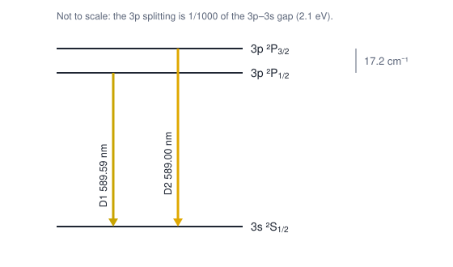

# Unit 3 · Many-electron atoms: helium, alkalis and coupling

## 3.1 Does helium behave like two independent electrons?

Unit 2 proposed a controlled change: keep the helium nucleus, but compare the one-electron ion He⁺ with neutral helium. If the two electrons in helium moved independently in the nuclear Coulomb field, each could occupy a hydrogenic 1s state with $`Z=2`$. Their combined ground-state energy would be about $`-108.8\ \mathrm{eV}`$, measured from the bare nucleus and two free electrons.

How can we test this total binding energy? An optical line measures a difference between two bound-state energies. Instead, measure the photon energy needed to remove an electron. Scan the photon energy and detect the onset of photoelectrons or ions, with the initial charge state identified. Repeat for He⁺. The two ionization thresholds add to the energy required to remove both electrons from neutral helium.

> **TODO — Add the helium ionization-threshold comparison.**
>
> Show calibrated ion or electron yield against photon energy for identified He and He⁺ samples. Establish the thresholds and their uncertainties before adding them to infer the total binding energy. Keep this measurement distinct from a bound–bound emission spectrum.

The reference thresholds are about 24.587 eV for He and 54.418 eV for He⁺. Thus the experimentally inferred helium ground-state energy is about $`-79.005\ \mathrm{eV}`$. These are published reference values; the detector records remain to be added. The independent-electron estimate binds the atom too strongly by nearly 30 eV. This is much larger than the fine-structure corrections of Unit 2. What interaction did that estimate omit?

## 3.2 Can electron repulsion account for the energy?

With a fixed nucleus, the non-relativistic two-electron Hamiltonian is

```math
H=\sum_{i=1}^{2}\left(
\frac{\mathbf p_i^2}{2m_e}
-\frac{Ze^2}{4\pi\varepsilon_0r_i}\right)
+\frac{e^2}{4\pi\varepsilon_0r_{12}},
\qquad Z=2,
```

where $`r_{12}=|\mathbf r_1-\mathbf r_2|`$. The last term couples the electron coordinates, so two separate hydrogenic equations no longer solve the problem. Its positive sign has the right effect: repulsion makes the total energy less negative.

We can test the size of that effect without a lengthy calculation. In a product of two hydrogenic 1s orbitals, the mean repulsion is $`(5Z/8)E_h`$, where $`E_h\simeq27.2114\ \mathrm{eV}`$ is the Hartree energy. For helium this adds about 34.0 eV, giving $`-74.8\ \mathrm{eV}`$. The repulsion is substantial, and the orbitals should adjust to it.

Allow each normalized 1s orbital to have the spatial form $`\phi_q(r)\propto e^{-qr/a_0}`$, with an adjustable parameter $`q`$. The expectation value in this trial spatial state is

```math
E(q)=E_h\left[q^2-2Zq+\frac58q\right].
```

Minimizing gives $`q=Z-5/16=27/16`$ and $`E\simeq-77.5\ \mathrm{eV}`$. The less compact orbital lowers the repulsion. This is a simple model of **screening**: the other electron reduces the effective attraction. The fitted charge is a parameter of this trial state, not an exact charge experienced everywhere in the atom.

The remaining difference from $`-79.005\ \mathrm{eV}`$ invites a better wavefunction. Optimizing independent orbitals improves the energy further, but an accurate state also depends on the electrons' separation: their motions are correlated. In the usual atomic-structure terminology, **correlation energy** is the improvement beyond the optimized Hartree–Fock independent-orbital description. Finite nuclear mass and relativistic effects also matter in a precision comparison.

This connects to Unit 2's isotope question. For a finite nuclear mass $`M`$, recoil contains terms $`\mathbf p_i\cdot\mathbf p_j/M`$ as well as individual kinetic-energy terms. Their expectation values depend on interelectron momentum correlations, including exchange. This additional mass shift is missed by simply giving each electron the same reduced-mass correction.

## 3.3 Why can one configuration give different states?

Repulsion improves the ground-state energy, but does it explain the pattern of excited states? A **configuration** specifies occupied orbitals, such as 1s2s; it does not yet specify a complete atomic state.

To investigate excited helium, we need a source that populates excited states. A discharge supplies energy through electron collisions; alternatively, a prepared metastable beam provides a chosen starting state for laser excitation. Record the emitted light, or scan the exciting laser and count fluorescence. Linked transitions can then reconstruct level spacings by the Ritz reasoning of Unit 1.

> **TODO — Add helium spectra with their state preparation.**
>
> Show a calibrated helium emission or excitation record, identify the initial populations and explain how linked transitions establish the levels. Compare ground-state and metastable-state excitation where useful. Ground-state optical absorption alone cannot reveal the full set of excited-state families. Present the recorded lines before assigning singlet and triplet labels.

The reference level scheme contains two 1s2s states, near 19.820 and 20.616 eV above the ground state. More generally, strong transitions group into two families, with much weaker links between them. What can distinguish states built from the same two orbitals?

The electrons have spin and are indistinguishable. We must also impose the **Pauli principle**: exchanging the complete position-and-spin coordinates of two electrons changes the sign of the total wavefunction. This is an additional physical principle, not a consequence of Coulomb repulsion.

For distinct orthonormal orbitals $`a,b`$ of a common one-electron reference problem, the spatial combinations are

```math
\psi_\pm(1,2)=\frac{a(1)b(2)\pm b(1)a(2)}{\sqrt2}.
```

The symmetric spatial function $`\psi_+`$ must accompany the antisymmetric spin **singlet**, with total spin $`S=0`$. The antisymmetric spatial function $`\psi_-`$ accompanies the symmetric spin **triplet**, with $`S=1`$. The names count the $`2S+1`$ spin projections, not classical orientations of two spinning objects.

For 1s2s the orbital angular momentum is $`L=0`$. The resulting levels are therefore $`1s2s\,{}^1S_0`$ and $`1s2s\,{}^3S_1`$, using the term notation introduced in Unit 2. For the ground configuration 1s², the antisymmetric spatial combination vanishes: both electrons occupy the same orbital. Only the symmetric spatial product and spin singlet remain. This explains why helium has a $`1s^2\,{}^1S_0`$ ground level and no corresponding 1s² triplet.

## 3.4 Can exchange explain the separation and the spectral families?

The Coulomb interaction contains no spin operator. Why should singlet and triplet energies differ? Pauli symmetry ties their spin states to different spatial distributions, so their mean repulsions need not be equal.

For fixed distinct orthonormal orbitals, first-order treatment of the repulsion gives

```math
\begin{aligned}
E_{\mathrm{singlet}}&\simeq E^{(0)}+J_C+K,\\
E_{\mathrm{triplet}}&\simeq E^{(0)}+J_C-K,\\
J_C&=\langle ab|V_{12}|ab\rangle,
\qquad K=\langle ab|V_{12}|ba\rangle,
\qquad V_{12}=\frac{e^2}{4\pi\varepsilon_0r_{12}}.
\end{aligned}
```

The **direct integral** $`J_C`$ is the repulsion between the two orbital charge distributions. The **exchange integral** $`K`$ arises from interference between the indistinguishable assignments of electrons to orbitals. It is not an extra magnetic force. For this model $`K>0`$, so the triplet lies lower by $`2K`$. Its antisymmetric spatial wavefunction vanishes when the two electron positions coincide.

The 1s2s reference separation is about 0.796 eV, corresponding to an effective exchange scale of about 0.398 eV in this model. This is not an exact experimental determination of a fixed-orbital integral: real singlet and triplet states also have different orbital relaxation and correlation corrections.

What should light reveal about these states? The leading electric-dipole operator is

```math
\mathbf d=-e(\mathbf r_1+\mathbf r_2).
```

It acts on position, leaving the spin overlap unchanged. Pure singlet and triplet spin functions are orthogonal, so electric-dipole transitions preserve $`S`$: $`\Delta S=0`$. This explains the two strong spectral families. Spin–orbit coupling mixes states of the same total $`J`$ and parity, allowing weak **intercombination lines** between levels with predominantly different spin character. The dipole operator remains spin independent; the states are no longer pure singlets or triplets.


*Figure 3.1. Schematic reconstruction from helium reference levels, not a measured spectrum. The lower excited S and P levels represent 1s2s and 1s2p; the upper S, P and D levels represent 1s3s, 1s3p and 1s3d. Selected strong transitions illustrate the spin families; fine structure and weak intercombination lines are omitted. The ground-state separation uses a broken scale.*

The lowest triplet, $`1s2s\,{}^3S_1`$, has no lower triplet state to reach. Electric-dipole decay to the ground state is also excluded by their equal parity, as well as the spin change. It is therefore metastable, with an isolated-atom lifetime of roughly two hours. Preparing atoms there makes triplet transitions accessible to a later optical probe. An absent line in ground-state absorption does not mean that its upper level is absent.

## 3.5 When do many electrons behave like one outer electron?

Helium showed why independent electrons are insufficient. Must every many-electron spectrum be equally complicated? A useful simplification is possible when most electrons form a closed core with zero net orbital and spin angular momenta, leaving one outer electron. Alkali atoms provide this situation. Sodium has a ten-electron closed core and one valence electron; the same kind of reduction underlies Unit 2's discussion of silver.

We can test the approximation by recording alkali absorption from the ground state. A common lower state makes each line frequency a measure of an upper-level energy relative to that ground state. Do the levels follow hydrogen's pattern, and does the energy depend only on $`n`$?

> **TODO — Add the calibrated alkali series record.**
>
> Show sodium absorption or excitation with the lower state specified. Identify resolved fine-structure components, the common series limit and the frequency calibration. Reconstruct the level energies before fitting a quantum defect. Reserve at least one series member for an independent prediction.

Published sodium levels give the following binding energies relative to ionization; the p and d entries are fine-structure centroids:

| Valence level | Binding energy (eV) |
|---|---:|
| 3s | 5.139 |
| 3p | 3.035 |
| 3d | 1.522 |

A hydrogenic $`n=3`$ electron bound to a net unit charge would have a binding energy near 1.51 eV. Sodium's 3d level is close, while 3s and 3p are much more tightly bound. The core therefore preserves an approximate Coulomb pattern without preserving the degeneracy in $`l`$.

In a **central-field approximation**, the valence electron moves in an average spherical potential. Far outside the core, the screened charge is $`+e`$, giving the hydrogenic Coulomb tail. Closer in, screening is incomplete. Low-$`l`$ orbitals penetrate this region more strongly; the centrifugal term $`l(l+1)\hbar^2/(2m_er^2)`$ suppresses core penetration for high $`l`$. Orthogonality to occupied core orbitals also matters. These effects alter the inner wavefunction and its matching to the outer Coulomb solution.

The resulting level pattern can be expressed through a **quantum defect**. Write excitation energies in wavenumber units as $`T_n=(E_n-E_g)/(hc)`$ and the ionization limit as $`T_{\mathrm{ion}}`$. For a given series,

```math
B_n=T_{\mathrm{ion}}-T_n
\simeq\frac{R_M}{[n-\delta_l(E)]^2},
\qquad
\delta_l=n-\sqrt{\frac{R_M}{B_n}}.
```

Here $`B_n`$ is a binding wavenumber, and $`R_M`$ uses the valence-electron–ion-core reduced mass. With fine structure resolved, the defect can also depend on $`j`$. Near the series limit it often changes slowly with energy; high-$`l`$ levels can retain smaller core-polarization shifts even when penetration is weak.

Can a constant defect predict an unused level? Ignoring hyperfine structure, use the $`2j+1`$ weighted p-level centroids. Sodium's reference limit is $`41449.451\ \mathrm{cm}^{-1}`$, and 4p lies at $`30270.717\ \mathrm{cm}^{-1}`$ above the ground state. With $`R_M\simeq109735\ \mathrm{cm}^{-1}`$, these give $`\delta_p\simeq0.8669`$. Holding that value fixed predicts 5p near $`35026\ \mathrm{cm}^{-1}`$.

The reference 5p centroid is near $`35042\ \mathrm{cm}^{-1}`$: the prediction misses by about $`16\ \mathrm{cm}^{-1}`$. It captures the level's approximate position but is not a precision description. This discrepancy tests the constant-defect approximation and motivates its energy dependence. A separate defect fitted to every level would not provide this test.

The core changes orbital binding, while spin–orbit coupling still distinguishes p<sub>1/2</sub> from p<sub>3/2</sub>. Sodium's familiar yellow doublet connects those two 3p levels to the same 3s<sub>1/2</sub> lower level. The higher 3p<sub>3/2</sub> state produces the shorter-wavelength D2 line, near 589.0 nm; D1 lies near 589.6 nm. Their relative brightness additionally requires populations and transition strengths, developed in Unit 5.



*Figure 3.2. Schematic sodium D-line assignment, not an intensity trace. Both transitions share a lower state, so their frequency separation measures the upper fine-structure interval. Visible wavelengths are in air.*

## 3.6 How should several angular momenta combine?

A closed core simplified sodium, but an open shell contains several active electrons. Helium already showed that a configuration can contain different total-spin states. We now need labels that organize both their orbital and spin angular momenta.

If residual electrostatic interactions are larger than spin–orbit coupling, first combine

```math
\mathbf L=\sum_i\mathbf l_i,
\qquad
\mathbf S=\sum_i\mathbf s_i,
\qquad
\mathbf J=\mathbf L+\mathbf S,
\qquad J=|L-S|,\ldots,L+S.
```

This is **LS coupling**. A term specifies $`L,S`$ and is labelled $`{}^{2S+1}L`$; a level also specifies $`J`$. In an isolated atom, each level has $`2J+1`$ magnetic substates. Residual electrostatic interactions separate terms; the weaker spin–orbit interaction then splits levels within a term.

Pauli antisymmetry restricts the terms. For two equivalent p electrons, meaning the same $`n,l`$, there are six available one-electron spin-orbitals and $`\binom62=15`$ antisymmetric two-electron states. Their allowed LS terms are

| Term | Allowed $`J`$ | Number of magnetic states |
|---|---|---:|
| $`{}^1S`$ | 0 | 1 |
| $`{}^1D`$ | 2 | 5 |
| $`{}^3P`$ | 0, 1, 2 | 9 |

The count remains 15; adding every conceivable $`L,S`$ combination would include states forbidden by Pauli symmetry.

For a single open subshell in the usual LS regime, **Hund's rules** guide the lowest-term ordering:

1. Prefer the largest allowed $`S`$.
2. For that $`S`$, prefer the largest allowed $`L`$.
3. Within the selected term, the smallest $`J`$ lies lowest for a less-than-half-filled subshell, and the largest for a more-than-half-filled subshell. A half-filled ground subshell has $`L=0`$.

Thus the rules predict $`{}^3P_0`$ for a p² ground configuration and $`{}^3P_2`$ for p⁴. These are rules for this coupling regime and configuration, not a universal ordering of all atomic excited states.

How can spacings test LS coupling? Within an isolated term, approximate its spin–orbit interaction by $`A_{\mathrm{LS}}\mathbf L\cdot\mathbf S/\hbar^2`$, where $`A_{\mathrm{LS}}`$ has energy units. Then

```math
E_J=E_{\mathrm{term}}+\frac{A_{\mathrm{LS}}}{2}
\left[J(J+1)-L(L+1)-S(S+1)\right],
\qquad
E_J-E_{J-1}=A_{\mathrm{LS}}J.
```

This **Landé interval rule** predicts a 2:1 ratio for the consecutive intervals of a $`{}^3P`$ term. We need three assigned levels to test it, rather than one fitted separation. Calcium's 4s4p $`{}^3P`$ term supplies an example.

> **TODO — Reconstruct a multiplet from measured lines.**
>
> Use calibrated transitions with common upper or lower states to obtain calcium's three level energies and their uncertainties. Explain how the $`J`$ assignments are constrained and which magnetic-field observations could test them. The level intervals themselves are not necessarily optical electric-dipole lines.

Reference intervals are $`52.162\ \mathrm{cm}^{-1}`$ between $`J=0,1`$ and $`105.880\ \mathrm{cm}^{-1}`$ between $`J=1,2`$. The first fixes $`A_{\mathrm{LS}}/(hc)=52.162\ \mathrm{cm}^{-1}`$; the rule then predicts $`104.324\ \mathrm{cm}^{-1}`$ for the second. The approximately 1.5% difference measures the accuracy of this simple description. A discrepancy alone does not identify which additional interaction or state mixing caused it.

Transition patterns provide another check. Electric-dipole lines require a parity change and $`\Delta J=0,\pm1`$, excluding $`J=0\leftrightarrow0`$. In pure LS coupling, also require $`\Delta S=0`$ and $`\Delta L=0,\pm1`$, excluding $`L=0\leftrightarrow0`$. These restrictions help test assignments; the probabilities and populations still determine the observed strengths.

## 3.7 When does LS coupling cease to be useful?

LS coupling assumes an order of interaction strengths. What if each electron's spin–orbit interaction is comparable to, or larger than, the residual electrostatic splittings? We should not continue assigning pure $`L,S`$ labels merely because they worked for a lighter atom.

In the opposite limiting hierarchy, first couple each electron's orbital and spin angular momenta, then combine the results:

```math
\mathbf j_i=\mathbf l_i+\mathbf s_i,
\qquad
\mathbf J=\sum_i\mathbf j_i.
```

This is **jj coupling**. Spin–orbit coupling first separates groups with different individual $`j_i`$; residual electrostatic interactions further separate levels within those groups. Stronger spin–orbit effects make this limit more relevant in some heavy-atom configurations, but many real spectra require **intermediate coupling**.

For p², Pauli symmetry permits

| Occupation in the jj basis | Allowed total $`J`$ | Number of magnetic states |
|---|---|---:|
| $`(p_{1/2})^2`$ | 0 | 1 |
| $`p_{1/2}p_{3/2}`$ | 1, 2 | 8 |
| $`(p_{3/2})^2`$ | 0, 2 | 6 |

Again there are 15 states. LS and jj coupling organize the same state space in different bases; they do not create different numbers of atomic states. In an isolated atom with a spherical nucleus, total electronic $`J`$ and parity remain useful labels for the electronic Hamiltonian, while $`L,S`$ or the individual $`j_i`$ may be approximate. Resolved hyperfine structure subsequently couples electronic $`J`$ to nuclear spin, as in Unit 2.

> **TODO — Add an experimental comparison of coupling regimes.**
>
> Compare reconstructed p² level patterns across a selected sequence of atoms, using a consistent energy reference. Include transition or magnetic evidence for the assignments. Test LS interval patterns and the grouping expected in the jj limit, rather than assuming every heavy atom is in pure jj coupling.

As states of the same $`J`$ and parity mix, intercombination lines can gain strength. A weak or strong line therefore tests the state composition as well as the level energies. The electric-dipole operator still does not directly change spin; the approximate singlet and triplet labels have lost purity.

## 3.8 How can we test the state assignments more directly?

Electron repulsion changed the independent-electron energies. Pauli symmetry and exchange explained why an orbital configuration could produce different spin families. A closed core recovered an approximate one-electron pattern, while competing interactions determined which angular-momentum labels were useful.

These explanations make predictions beyond zero-field line positions. An assigned angular momentum should carry a definite magnetic response, and an electric field can probe how states mix and shift. Unit 2 used a field gradient to reveal a magnetic moment; we can now use controlled fields to test the more detailed state assignments developed here.

[Unit 4](unit-4-atoms-in-external-fields.md) develops those measurements. What shifts, splittings and polarization patterns should an applied field produce, and when will the field become strong enough to change the coupling scheme itself?

---

## Sources and conventions

- **Scope:** helium and alkali spectra; LS and jj coupling, as specified in Section VII of the supplied CSIR–UGC NET Physical Sciences syllabus. Term assignments, selection rules and model assumptions are distinguished from recorded signals.
- Reference ionization thresholds and energy levels: NIST, *Handbook of Basic Atomic Spectroscopic Data*, helium atomic data and He I, Na I and Ca I level tables. Numbers reproduced here are reference values; TODO boxes identify the missing detector records. Sodium p centroids use $`2j+1`$ weights; hyperfine structure is omitted in these comparisons.
- Helium, the variational estimate, exchange and correlation: C. J. Foot, *Atomic Physics*; B. H. Bransden and C. J. Joachain, *Physics of Atoms and Molecules*. The simple energy calculation uses a fixed nucleus, non-relativistic dynamics and a one-parameter product of normalized 1s orbitals.
- Alkali series and quantum defects: Foot; T. F. Gallagher, *Rydberg Atoms*. The constant defect inferred from sodium 4p is used to predict 5p before comparison; it is not refitted to that level.
- Allowed equivalent-electron terms and coupling schemes: NIST, *Atomic Spectroscopy: A Compendium of Basic Ideas, Notation, Data, and Formulas*, sections “Allowed Terms” and “Different Coupling Schemes”; Foot. Hund's rules are used within their LS-coupling scope.
- Helium metastability: S. S. Hodgman et al., *Physical Review Letters* **103**, 053002 (2009), doi:10.1103/PhysRevLett.103.053002. The roughly two-hour lifetime concerns isolated metastable atoms; collisions can shorten survival in a discharge.
- Figures 3.1–3.2 are schematic level diagrams, not measured spectra. Visible sodium wavelengths are in air. Binding and excitation energies use explicitly stated zeroes. $`J_C`$ is a direct Coulomb energy, $`K`$ an exchange energy, and $`J`$ an angular-momentum quantum number; $`A_{\mathrm{LS}}`$ is an energy, so its value in $`\mathrm{cm}^{-1}`$ means $`A_{\mathrm{LS}}/(hc)`$. Constants use CODATA 2018; numerical comparisons are rounded to the accuracy of the models.
