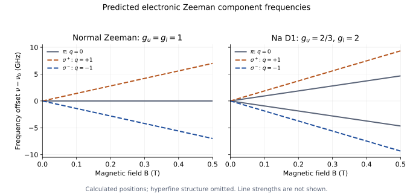

# Unit 4 · Atoms in external fields

## 4.1 What would an applied field test?

Unit 3 assigned angular momenta to levels reconstructed from spectra. Those assignments predict more than zero-field energy differences: they also predict magnetic moments. Can an independently controlled magnetic field test them?

Place a dilute atomic source in a calibrated, approximately uniform field and record the same optical line with the field off and on. Vary the field strength, specify the viewing direction and analyse the polarization. The quantities to compare are component frequencies and their slopes with field. Unlike the gradient used for Stern–Gerlach deflection, a uniform field changes internal energies without separating the atomic beam by a force.

For electronic orbital and spin moments, with the field along $`z`$,

```math
\boldsymbol\mu_e=-\frac{\mu_B}{\hbar}(\mathbf L+g_s\mathbf S),
\qquad
H_Z=-\boldsymbol\mu_e\cdot\mathbf B
=\frac{\mu_BB}{\hbar}(L_z+g_sS_z).
```

Begin with a singlet term, $`S=0`$, so $`J=L`$ and $`\Delta E=\mu_BBm_J`$. An optical transition measures the difference of the upper and lower shifts. Since electric-dipole transitions can have $`q=m_u-m_l=0,\pm1`$, their frequency offsets are

```math
\Delta\nu=\frac{\mu_BB}{h}(m_u-m_l)
=0,\ \pm\frac{\mu_BB}{h}.
```

This predicts three frequencies, the **normal Zeeman triplet**, even when several pairs of magnetic substates contribute to each frequency.

Cadmium's line near 643.8 nm provides a test: its assignment is $`5s5d\,{}^1D_2\to5s5p\,{}^1P_1`$. Use an even-mass isotope with nuclear spin zero to avoid hyperfine complications. The prediction is an adjacent-component separation of $`\mu_B/h\simeq13.996\ \mathrm{GHz/T}`$, or approximately 0.0194 nm at 1 T near this wavelength. The outer components are separated by twice that amount. These are calculated separations to compare with a measurement.

## 4.2 What should change when spin contributes?

In an LS-coupled level, the magnetic moment need not be proportional to $`\mathbf J`$ with unit coefficient: orbital and spin moments contribute differently. Projecting their sum onto $`\mathbf J`$ gives, for $`J>0`$,

```math
\Delta E=g_J\mu_BBm_J,
\qquad
g_J=1+(g_s-1)
\frac{J(J+1)+S(S+1)-L(L+1)}{2J(J+1)}.
```

This **Landé factor** assumes an approximately pure LS term and a field weak enough to preserve its electronic coupling. The numerical examples below use $`g_s\simeq2`$. A $`J=0`$ level has no first-order electronic Zeeman shift; the displayed expression is not used at $`J=0`$.

For any optical line, predict the actual frequency shift from

```math
\Delta\nu=\frac{\mu_BB}{h}(g_um_u-g_lm_l).
```

We therefore cannot count observed lines by counting the substates of just one level. Selection rules, coincident frequencies, polarization and populations all enter.

Sodium D1, already assigned in Unit 3, connects $`3p\,{}^2P_{1/2}`$ and $`3s\,{}^2S_{1/2}`$. Their electronic factors are $`g_u=2/3`$ and $`g_l=2`$. Ignoring nuclear structure initially, predict four component slopes:

| Component type | $`q=m_u-m_l`$ | $`(h/\mu_B)\,d\nu/dB`$ |
|---|---|---|
| $`\pi`$ | 0 | $`-2/3,\ +2/3`$ |
| $`\sigma^-,\sigma^+`$ | −1, +1 | $`-4/3,\ +4/3`$ |

This more complicated pattern is called the **anomalous Zeeman effect**; the spin-dependent moment accounts for it within the same magnetic interaction.



*Figure 4.1. Calculated electronic line positions, not measured spectra. The normal triplet and ideal sodium D1 pattern follow from the stated angular momenta with $`g_s=2`$. Hyperfine structure is omitted, and line thickness does not represent intensity. The [plotting script](analysis/plot_zeeman_predictions.py) generates these predictions.*

Polarization supplies another test. Viewed perpendicular to $`\mathbf B`$, the $`\pi`$ components are linearly polarized parallel to the field and the $`\sigma`$ components perpendicular to it. Viewed along the field, $`\pi`$ radiation is absent and the two $`\sigma`$ types have opposite circular polarizations. In absorption, propagation direction and incident polarization determine which components can be driven.

Real sodium has nuclear spin $`I=3/2`$. At very weak fields, resolved hyperfine states require $`F,m_F`$ and a corresponding $`g_F`$, rather than $`J,m_J`$. Figure 4.1 is an electronic model: a comparison must account for nuclear components, or use a regime where hyperfine coupling is decoupled while electronic spin–orbit coupling remains intact. “Weak field” always refers to a specified competing interaction.

> **TODO — Add the field-dependent optical records.**
>
> Show calibrated field-off and field-on spectra, including polarization and viewing geometry. Compare component slopes with the predicted normal and spin-dependent patterns. Specify isotope and hyperfine treatment, instrument resolution and field uniformity. Predict an unused field setting or polarization channel, then compare with its measured record as a further test of the assignment.

## 4.3 What happens when the field competes with spin–orbit coupling?

The fixed-$`J`$ prediction used an approximation. Increase $`B`$ until the magnetic energy becomes comparable to the fine-structure interval. Do the same component slopes continue, or do the branches bend and reorganize?

The Hamiltonian already contains the competing terms,

```math
H=H_0+H_{\mathrm{so}}+
\frac{\mu_BB}{\hbar}(L_z+g_sS_z).
```

When $`\mu_BB\ll\Delta E_{\mathrm{fs}}`$, spin–orbit coupling makes $`J,m_J`$ useful labels. When $`\mu_BB\gg\Delta E_{\mathrm{fs}}`$, the field largely decouples $`\mathbf L`$ and $`\mathbf S`$. The useful labels become $`m_L,m_S`$, with leading shifts

```math
\Delta E\simeq\mu_BB(m_L+g_sm_S).
```

This is the electronic **Paschen–Back regime**. Curved branches in the crossover can test the same Hamiltonian without assuming that $`J`$ remains fixed; they do not automatically demand a new interaction. Residual spin–orbit coupling still contributes smaller offsets.

For leading electric-dipole transitions, $`\Delta m_S=0`$ and $`\Delta m_L=0,\pm1`$. The spin Zeeman contribution then cancels between the two states, giving offsets grouped around $`0,\pm\mu_BB/h`$, although residual interactions can retain additional structure. To make the test practical, choose a fine-structure interval small enough that the required field is accessible, and scan through the estimated scale $`B\sim\Delta E_{\mathrm{fs}}/\mu_B`$.

Nuclear and electronic angular momenta can decouple at a lower field scale set by the hyperfine interval. That hyperfine Paschen–Back crossover is distinct from electronic $`L,S`$ decoupling. Here we also assume that diamagnetic $`B^2`$ effects and mixing with other electronic configurations remain small; a field can be strong relative to spin–orbit coupling while still small relative to electronic binding energies.

> **TODO — Add a measured coupling crossover.**
>
> Select an atom and transition with a reachable crossover field. Predict its scale from an independently measured fine-structure interval, then plot component frequencies against calibrated field through both regimes. Identify nuclear structure and residual offsets before interpreting departures from the leading slopes.

## 4.4 What different information could an electric field reveal?

The magnetic test probes moments and angular-momentum coupling. An electric field couples instead to the charge distribution,

```math
H_E=-\mathbf d\cdot\boldsymbol{\mathcal E}.
```

We can test the wavefunctions by placing atoms between electrodes, varying the calibrated field and recording optical frequencies. Reverse the field as well as varying its magnitude. Is the shift proportional to $`\mathcal E`$, to $`\mathcal E^2`$, or does the dependence change as states mix? Remember that a transition shift is $`(\Delta E_u-\Delta E_l)/h`$.

For an isolated, nondegenerate state of definite parity, $`\langle\mathbf d\rangle=0`$: the electric-dipole operator changes sign under spatial inversion. The first-order shift vanishes. Mixing with opposite-parity states gives the leading quadratic **Stark shift**. For a specified state and field axis,

```math
\Delta E_a=-\frac12\alpha_{a,zz}(0)\mathcal E^2,
\qquad
\alpha_{a,zz}(0)=2\sum_{b\ne a}
\frac{|\langle b|d_z|a\rangle|^2}{E_b-E_a}.
```

The sum includes continuum contributions where needed. The ground-state static polarizability is positive; an excited state's coefficient need not be. Resolved angular-momentum substates can also have different polarizabilities.

What if opposite-parity states are degenerate? In the ideal spinless, fixed-nucleus Coulomb $`n=2`$ manifold, the electric field mixes 2s and $`2p,m=0`$. Diagonalizing within that pair gives shifts $`\pm3ea_0\mathcal E`$; the $`2p,m=\pm1`$ states have zero first-order shift. This **linear Stark effect** tests both the degeneracy and the nonzero dipole matrix element between the states.

Unit 2 established that real hydrogen has fine, Lamb and hyperfine intervals. At asymptotically weak fields the relevant opposite-parity levels are therefore not exactly degenerate. A two-state model makes the distinction clear:

```math
E_\pm=\bar E\pm
\sqrt{\left(\frac{\Delta}{2}\right)^2+
|d_{ab}\mathcal E|^2}.
```

Here $`\Delta`$ is the zero-field energy gap. Small mixing gives quadratic shifts; mixing much larger than the gap approaches a linear dependence. Recovering the full ideal Coulomb pattern requires the electric mixing to dominate the relevant small splittings while remaining small compared with neighbouring-$`n`$ separations. The prediction depends on the regime, rather than assigning an unconditional “linear” or “quadratic” response to an element.

> **TODO — Add a calibrated Stark field series.**
>
> Plot transition frequencies against both signed field and field squared, including stray-field control and reversal. Specify initial states and the relevant zero-field gaps. Compare a nondegenerate quadratic response with a near-degenerate mixing regime, and distinguish upper- and lower-state contributions to each line shift.

## 4.5 Can we drive transitions between the split states directly?

Optical spectra combine shifts from two electronic levels. A more direct test of a magnetic interval would connect substates within one level. Those states have the same parity, so the optical electric-dipole interaction does not generally connect them. Their magnetic moments offer another coupling.

Apply a static field $`\mathbf B_0`$ to define the splitting and a weak oscillating field transverse to it:

```math
H'(t)=-\boldsymbol\mu\cdot\mathbf B_1(t),
\qquad
h\nu=E_b(B_0)-E_a(B_0)>0.
```

The transverse magnetic operator connects appropriate neighbouring projections. We can scan frequency at fixed $`B_0`$, or field at fixed frequency. A resonance should appear when the applied frequency matches the predicted interval. Detection can measure absorbed power, a change in state populations or a change in beam transmission; it need not count emitted photons.

Rabi and colleagues' [original 1938 paper](https://journals.aps.org/pr/abstract/10.1103/PhysRev.53.318) gives a useful example of this reasoning. Resonant magnetic-state transfer changed whether a molecular beam refocused onto a detector, producing a loss of transmitted intensity. Its plotted control variable is magnet current at fixed radio frequency. This is a historical detection method for the same resonance condition, not an optical absorption trace.

## 4.6 What does electron spin resonance test?

Start with an approximately isolated effective electron spin $`S=\tfrac12`$, an isotropic factor $`g`$ and no resolved additional coupling. The two magnetic states have an interval

```math
\Delta E=g\mu_BB_0,
\qquad
\nu_{\mathrm{ESR}}=\frac{g\mu_BB_0}{h}.
```

This is **electron spin resonance**, also called electron paramagnetic resonance. For $`g\simeq2`$, a microwave frequency of 9.5 GHz predicts a resonance field near 0.339 T. This is a prediction for the simple spin model, not a measured value for every paramagnetic sample.

Place a suitable paramagnetic sample in the microwave field and scan $`B_0`$ through the predicted value. Repeat at another microwave frequency: the field should scale with frequency. The slope tests $`g`$; resolved additional components can test hyperfine coupling, while orientation dependence can reveal an anisotropic electronic environment. A missing resonance also requires checking population, coupling and detection conditions.

> **TODO — Add an ESR record and a second-frequency test.**
>
> Identify the sample, orientation, temperature, microwave frequency and field calibration. State whether the recorded ordinate is absorption or its field derivative, as commonly measured in continuous-wave ESR. Test the predicted field–frequency relation before interpreting additional components through hyperfine or environmental interactions.

## 4.7 Can we apply the same reasoning to nuclei?

Unit 2 established that nuclei carry magnetic moments. Their moments are smaller, so the same field should produce much smaller resonance frequencies. Can a radio-frequency measurement test that prediction independently of the electronic spectrum?

Write $`\boldsymbol\mu_I=\gamma_N\mathbf I`$, where $`\gamma_N`$ is the nuclear gyromagnetic ratio. In a uniform field,

```math
H_{Z,N}=-\gamma_N I_zB_0,
\qquad
\nu_N=\frac{|\gamma_N|B_0}{2\pi}.
```

For a bare proton, $`\gamma_p/(2\pi)\simeq42.5775\ \mathrm{MHz/T}`$. At 1 T the prediction is therefore about 42.58 MHz, compared with roughly 28 GHz for an electron spin at the same field.

This motivates **nuclear magnetic resonance**. A transverse radio-frequency field excites nuclear polarization. In one modern measurement route, a pulse creates transverse magnetization, and a receiver coil records an induced voltage as that magnetization evolves. Fourier transformation of the time record gives a frequency spectrum. The peaks are reconstructed from an electrical signal; the detector is not counting radio photons individually.

Bloch's [original “Nuclear Induction” paper (1946)](https://journals.aps.org/pr/abstract/10.1103/PhysRev.70.460) explains why transverse nuclear polarization can induce an observable voltage. It provides the detection principle; the pulse-and-Fourier description above is a modern route, not a claim about that paper's experimental sequence.

Now keep the nuclear species and applied field fixed, but change its chemical environment. Should every proton resonate at exactly the same frequency? This controlled comparison can reveal the response of surrounding electrons, information absent from the bare-nucleus model.

For an isotropic diamagnetic environment, electronic **shielding** gives approximately

```math
B_{\mathrm{local}}=(1-\sigma)B_0,
\qquad
\nu\simeq\frac{|\gamma_N|B_0}{2\pi}(1-\sigma).
```

Compare with a specified reference measured under consistent conditions. The **chemical shift** is

```math
\delta_{\mathrm{ppm}}=10^6
\frac{\nu_{\mathrm{sample}}-\nu_{\mathrm{reference}}}
{\nu_{\mathrm{reference}}}.
```

Greater shielding lowers frequency at fixed field and gives a smaller chemical shift. A separation of 1 ppm corresponds to 400 Hz on a 400 MHz proton instrument. Comparing shifts in ppm lets us test whether absolute frequency differences scale with the operating field. Nuclear spin–spin coupling can split a chemical-shift group into a multiplet, so each peak need not represent a separate chemical environment.

> **TODO — Add a referenced NMR environment comparison.**
>
> Identify the sample, nuclear species, field, temperature and chemical-shift reference. Show the recorded voltage and its spectrum, or clearly identify which is supplied. Compare the same nuclear species in different environments, accounting for field drift and resolved spin–spin multiplets. Test frequency or field scaling before assigning small differences to shielding.

The shift is a response of the electronic environment around the nucleus; a new nuclear species is not needed. Molecular structure will return in Units 6–7, but its influence on local magnetic fields is already measurable here.

## 4.8 What remains after we predict resonance positions?

The field tests have connected state assignments to magnetic moments, exposed the range of coupling approximations and used electric mixing to test parity and wavefunctions. Oscillating magnetic fields then offered a direct way to drive the predicted electronic and nuclear intervals.

But matching the resonance frequency is only part of explaining the record. Why does one component dominate while another is weak? Why do resonances broaden as conditions change, and why does a pulsed signal decay? What preparation makes a transition visible at all?

[Unit 5](unit-5-light-matter-interaction.md) develops the interactions, populations and time scales needed to answer these questions. How do matrix elements, relaxation and coherence turn an allowed energy difference into the strength, width and time dependence of a measured signal?

---

## Sources and conventions

- **Scope:** normal and anomalous Zeeman effects, Paschen–Back and Stark effects, ESR, NMR and chemical shift, as specified in Section VII of the supplied CSIR–UGC NET Physical Sciences syllabus. The progression tests predictions from Units 2–3; detailed transition rates and widths follow in Unit 5.
- Angular-momentum projection, field regimes and Stark perturbations: C. J. Foot, *Atomic Physics*; B. H. Bransden and C. J. Joachain, *Physics of Atoms and Molecules*. Landé factors assume LS coupling. The ideal hydrogen linear Stark example omits spin, recoil and the small zero-field splittings explicitly discussed in the text.
- Zeeman formulas and cadmium assignment: NIST, *Atomic Spectroscopy: A Compendium of Basic Ideas, Notation, Data, and Formulas*, section “Zeeman Effect”; *Handbook of Basic Atomic Spectroscopic Data*, Cd I persistent-line and isotope tables. The cadmium wavelength is in air. Sodium's electronic D1 calculation uses $`g_s=2`$ and requires the stated hyperfine qualification when compared with real spectra.
- Original magnetic-resonance method: I. I. Rabi, J. R. Zacharias, S. Millman and P. Kusch, “A New Method of Measuring Nuclear Magnetic Moment,” *Physical Review* **53**, 318 (1938), doi:10.1103/PhysRev.53.318.
- Nuclear induction: F. Bloch, “Nuclear Induction,” *Physical Review* **70**, 460–474 (1946), doi:10.1103/PhysRev.70.460. The selected original-paper links supplement the physical explanation and do not fill the missing-record TODOs.
- NMR conventions: R. K. Harris et al., *Pure and Applied Chemistry* **73**, 1795–1818 (2001), doi:10.1351/pac200173111795; **80**, 59–84 (2008), doi:10.1351/pac200880010059. The simple shielding formula assumes an isotropic environment.
- Frequencies $`\nu`$ are in cycles per second; gyromagnetic ratios $`\gamma_N`$ use angular frequency per tesla, hence the factor $`2\pi`$. Constants and the bare-proton gyromagnetic ratio use CODATA 2018. Numerical examples are predictions unless explicitly identified as measured. Figure 4.1 contains no experimental points or fitted line strengths.
