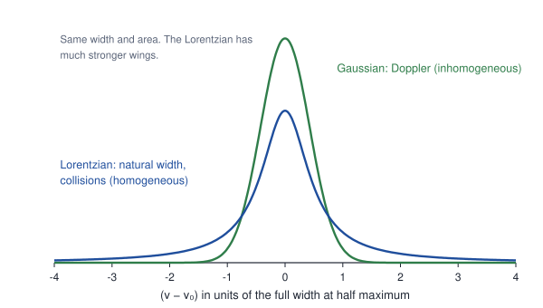

# Unit 5 · Light–matter interaction

> **Version 1 of this unit is still to be written.** Its central question, observations and equations are in the [course map](course-map.md#unit-5--lightmatter-interaction): transition matrix elements and selection rules, Einstein A and B coefficients, lifetimes and widths, optical pumping, population inversion, rate equations, resonator modes and coherence length. For now it holds the lecture on line widths, which was Lecture 10 of Unit 3 in the first draft of these notes. The [optional reading on spectroscopy as linear response](reading-spectroscopy-as-response.md) belongs with this unit.

**Syllabus (CSIR-UGC NET, Physical Sciences, Section VII):** Width of spectrum lines. Lasers: spontaneous and stimulated emission, Einstein A & B coefficients. Optical pumping, population inversion, rate equation. Modes of resonators and coherence length.

Visible wavelengths are in air. Answers are at the end.

---

## Lecture 10 · Widths of spectral lines

### 10.1 The data

> **How it is measured.** **Natural width:** a tunable laser crosses a collimated beam of sodium atoms at right angles, so the atoms have almost no velocity along the laser. The fluorescence is recorded as the laser frequency is scanned. **Doppler width:** the same laser passes through a cell of sodium vapour. **Collision broadening:** a buffer gas such as helium or nitrogen is added to the cell at known pressures. **Hydrogen 1S–2S:** two laser beams travelling in opposite directions excite a two-photon transition in a cold beam of hydrogen atoms, and the laser frequency is measured with an optical frequency comb.

**1. The sodium D2 line (589.0 nm):**

| Conditions | Full width at half maximum | Line shape |
|---|---|---|
| Atomic beam, laser at right angles | about 10 MHz | Lorentzian |
| Vapour cell at room temperature | about 1.3 GHz | Gaussian |
| Vapour cell with buffer gas | increases by roughly 20 MHz per torr | Lorentzian |

**2. Hidden structure.** In the vapour cell, the ground-level hyperfine splitting of 1.77 GHz (Unit 2) is barely resolved. In the atomic beam it is cleanly resolved.

**3. Hydrogen Hα** from a discharge at room temperature has a Doppler width of 0.19 cm⁻¹ (5.6 GHz), as large as its fine structure (Unit 2).

**4. Hydrogen 1S–2S.** This two-photon line has a natural width of only 1.3 Hz. Its frequency, 2 466 061 413 187 kHz, has been measured to 15 significant figures.

### 10.2 The puzzle

- If energy levels are sharp, why do lines have any width at all?
- Why are lines in a vapour a hundred times wider than in a beam, and why does their shape change?
- Why does adding helium, which does not absorb at 589 nm, broaden the sodium line?

### 10.3 The model: three broadening mechanisms

**1. Natural broadening.** An excited state decays at the rate Γ = 1/τ. The light it emits is a damped oscillation, and the Fourier transform of a damped oscillation is a Lorentzian:

```math
I(\omega) \propto \frac{\Gamma/2\pi}{(\omega - \omega_0)^2 + \Gamma^2/4}, \qquad \Delta\nu_\text{nat} = \frac{\Gamma}{2\pi} = \frac{1}{2\pi\tau}.
```

If the lower level also decays, the two rates add: Γ = Γ<sub>u</sub> + Γ<sub>l</sub>. This is the energy–time uncertainty relation, ΔE ≈ ħ/τ.

**2. Doppler broadening.** An atom moving towards the observer with velocity $`v_z`$ emits at $`\nu_0(1 + v_z/c)`$. The Maxwell distribution of $`v_z`$ is a Gaussian, so the line is a Gaussian with full width

```math
\Delta\nu_D = \nu_0\sqrt{\frac{8k_BT\ln 2}{Mc^2}} = 7.16 \times 10^{-7}\,\nu_0\sqrt{\frac{T\,[\text{K}]}{M\,[\text{u}]}}.
```

**3. Collision (pressure) broadening.** Each collision interrupts the phase of the atom's oscillating dipole. If collisions happen at a rate $`1/\tau_c`$, the line is a Lorentzian with an extra width

```math
\Delta\nu_\text{coll} = \frac{1}{\pi\tau_c},
```

which is proportional to the pressure.

**Homogeneous and inhomogeneous broadening.** Natural and collision broadening affect every atom in the same way: this is **homogeneous** broadening, with a Lorentzian shape. Doppler broadening gives different atoms different centre frequencies: this is **inhomogeneous** broadening, with a Gaussian shape. When both are present, the line is their convolution, called a Voigt profile. The distinction matters for lasers (Unit 6). Smaller effects include power broadening and transit-time broadening: an atom that crosses a laser beam of diameter d interacts with it only for a time d/v.



*Figure 10.1. A Lorentzian and a Gaussian with the same width and area. This is a model, not data.*

### 10.4 Numbers from the data

- **Natural width.** Sodium's 3p lifetime of 16.2 ns gives Δν = 1/(2π × 16.2 ns) = 9.8 MHz, the width seen in the atomic beam.
- **Doppler width.** For sodium (M = 23 u, ν₀ = 5.09 × 10¹⁴ Hz) the formula gives 1.32 GHz at 300 K and 1.70 GHz at 500 K. At room temperature it is about 130 times the natural width.
- **Hydrogen.** For Hα at 300 K, the formula gives 5.6 GHz. Relative to its frequency, hydrogen's Doppler width is √23 ≈ 4.8 times larger than sodium's, because hydrogen is so light.
- **Collisions.** At 1 torr and 300 K there are 3.2 × 10²² atoms per m³. With a collision cross-section of about 10⁻¹⁸ m² and a relative speed of about 600 m/s, each atom collides about 2 × 10⁷ times a second, giving a width of about 6 MHz per torr. This is the same order as the measured value of roughly 20 MHz per torr; the real broadening cross-sections are a few times larger than this estimate.

### 10.5 Test a prediction

**Removing the Doppler width reveals hidden structure.** Crossing an atomic beam with a laser at right angles removes most of the Doppler width. As predicted, the two hyperfine components of the D2 line, 1.77 GHz apart, then separate cleanly.

**Cold atoms.** The Doppler width of the sodium line equals its natural width at about 17 mK (Problem 10.3). Laser-cooled atoms reach this regime.

**The hydrogen 1S–2S line.** When the two photons come from opposite directions, their Doppler shifts cancel: ν(1 + v/c) + ν(1 − v/c) = 2ν. The 2s level also lives a long time, 0.12 s (Lecture 3), so the natural width is only 1.3 Hz. Together these make the 1S–2S frequency the best-measured property of hydrogen, known to 15 digits, and it is used to determine the Rydberg constant. These measurements relied on the optical frequency comb, recognized by the 2005 Nobel Prize (Hall and Hänsch).

### 10.6 What we have learned

- Natural broadening gives a Lorentzian of width 1/(2πτ). Doppler broadening gives a Gaussian whose width grows as √(T/M). Collision broadening gives a Lorentzian whose width grows with pressure.
- Homogeneous broadening affects every atom equally; inhomogeneous broadening spreads the atoms over different frequencies.
- Doppler-free methods reveal fine and hyperfine structure hidden inside the Doppler width.

**In response language ([optional reading](reading-spectroscopy-as-response.md)).** A line width is the width of a resonance in α(ω). Natural and collision broadening widen every atom's resonance in the same way: homogeneous broadening. Doppler broadening gives different atoms different resonance frequencies, so the measured Im α is an average over atoms: inhomogeneous broadening, like disorder broadening of a spectrum in a solid.

### Problems for Lecture 10

**10.1** The hydrogen 2p level lives 1.6 ns. Find the natural width of Lyman α.

**10.2** Find the Doppler width of Hα at 300 K and of the sodium D2 line at 500 K.

**10.3** At what temperature would the Doppler width of the sodium D2 line equal its natural width of 9.8 MHz?

**10.4** Collisions broaden the sodium D2 line by about 20 MHz per torr of buffer gas. At what pressure does the collision width equal the room-temperature Doppler width of 1.3 GHz?

**10.5** Why is the natural width of the hydrogen 1S–2S line only 1.3 Hz? Why does excitation by two photons from opposite directions remove the first-order Doppler shift?

**10.6** Hydrogen gas in an interstellar cloud has internal velocities of about 10 km/s. Estimate the Doppler width of the 21 cm line and compare it with the natural width.

---

## Summary so far

| Data | Explained by |
|---|---|
| Line widths of 10 MHz, 1.3 GHz and more | Natural, Doppler and collision broadening |

---

## Answers

**10.1** 1/(2π × 1.6 ns) = 100 MHz.

**10.2** Hα at 300 K: 5.6 GHz, or 0.19 cm⁻¹. Sodium D2 at 500 K: 1.7 GHz.

**10.3** Setting $`7.16\times10^{-7}\,\nu_0\sqrt{T/23} = 9.8`$ MHz with ν₀ = 5.09 × 10¹⁴ Hz gives T ≈ 17 mK.

**10.4** 1.3 GHz ÷ 20 MHz per torr ≈ 65 torr.

**10.5** The 2s level lives 0.12 s, so Δν = 1/(2π × 0.12 s) = 1.3 Hz. Two photons from opposite directions are shifted by +νv/c and −νv/c, and the shifts cancel.

**10.6** Δν ≈ ν v/c = 1.42 GHz × (10⁴/3 × 10⁸) ≈ 47 kHz. The natural width is about 5 × 10⁻¹⁶ Hz, so the line width measures only the motion of the gas, which is how astronomers use it.

---

## Sources of the data

- Decay rates: NIST Atomic Spectra Database.
- Line widths and Doppler-free spectroscopy: Demtröder, *Laser Spectroscopy*.
- Hydrogen 1S–2S frequency: Parthey et al., *Physical Review Letters* 107, 203001 (2011).
- Constants: CODATA 2018. Every derived number in these notes was checked with a short calculation.
