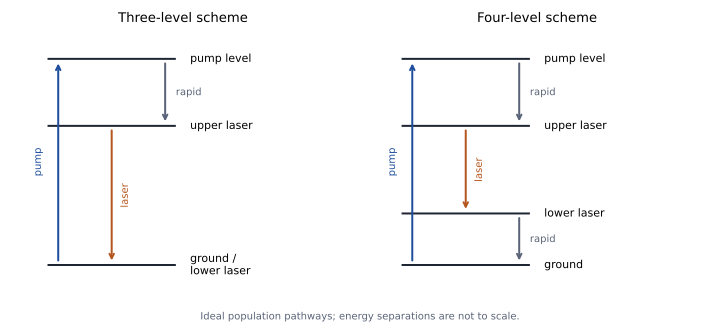

# Unit 5 · Light–matter interaction

## 5.1 Why are allowed lines unequal?

Unit 4 predicted resonance positions and field-dependent splittings. A recorded spectrum contains more: peaks have different strengths and widths, and their signals change with preparation. How do we connect these features to the atom and its interaction with the probe?

Begin with two emission branches from one prepared upper state. Record the full profiles, integrate their areas and correct for collection and detector response. The shared upper population removes one ambiguity in their ratio. Comparing peak heights alone would mix transition strength with line width; a detector's photon counts also differ from emitted energy because each photon carries $`h\nu`$.

For an optical electric field, the leading interaction is

```math
H'(t)=-\mathbf d\cdot\mathbf E(t),
\qquad
\mathbf d_{ul}=\langle u|\mathbf d|l\rangle.
```

Weak-excitation probabilities contain $`|\boldsymbol\epsilon\cdot\mathbf d_{ul}|^2`$, where $`\boldsymbol\epsilon`$ specifies polarization. The energy difference locates a resonance; this **transition matrix element** determines how strongly the chosen light can connect the states. Other probes require their corresponding interaction, such as the magnetic coupling of Unit 4.

The electric-dipole rules introduced earlier follow from this operator: parity changes, $`\Delta J=0,\pm1`$ excluding $`0\leftrightarrow0`$, and $`\Delta m=0,\pm1`$ with polarization constraints. Pure LS states also obey $`\Delta S=0`$. These are necessary restrictions, not a guarantee of a large signal. An allowed matrix element can be small, and preparation can leave the relevant state unpopulated.

> **TODO — Add a calibrated strength comparison.**
>
> Show integrated branches sharing an upper state, or weak absorption lines sharing a lower state. Specify populations, polarization, optical depth and detector response. Predict a ratio from the assigned states before comparing it with corrected line areas. Keep photon counts, emitted power and peak heights distinct.

## 5.2 What determines absorption and emission rates?

A driven atom can absorb energy or transfer energy back to the field. An excited atom can also emit without an applied resonant field. We describe these processes through the **Einstein coefficients**. For isotropic radiation with spectral energy density $`\rho_\nu`$ per unit ordinary frequency, the rates per atom are

| Process | Direction | Rate |
|---|---|---|
| Absorption | lower $`l`$ → upper $`u`$ | $`B_{lu}\rho_\nu`$ |
| Stimulated emission | upper $`u`$ → lower $`l`$ | $`B_{ul}\rho_\nu`$ |
| Spontaneous emission | upper $`u`$ → lower $`l`$ | $`A_{ul}`$ |

Here the radiation density is evaluated over the transition profile. Level-averaged coefficients assume the specified magnetic-substate populations; the standard equilibrium relations use equal populations within each degenerate level.

Requiring thermal atomic populations to remain in equilibrium with Planck radiation gives

```math
g_lB_{lu}=g_uB_{ul},
\qquad
\frac{A_{ul}}{B_{ul}}=\frac{8\pi h\nu_{ul}^3}{c^3},
\qquad g_a=2J_a+1
```

for electronic levels without resolved hyperfine structure. Thus absorption and stimulated emission are related processes, while the frequency dependence also fixes their relation to spontaneous emission. The density convention matters: using angular frequency would change the numerical prefactor.

A classical applied field explains driven transitions. Deriving spontaneous emission requires the quantized electromagnetic field; here we use its electric-dipole result for a specified pair of states,

```math
A_{ul}=\frac{\omega_{ul}^3}{3\pi\varepsilon_0\hbar c^3}
|\langle l|\mathbf d|u\rangle|^2,
\qquad \omega_{ul}=2\pi\nu_{ul}.
```

For unresolved levels, sum over final magnetic states and average over the appropriate initial distribution. For an upper population $`N_u`$, the photon-emission rate on a branch is $`N_uA_{ul}`$, whereas its emitted power is $`N_uA_{ul}h\nu_{ul}`$. Calibrated branching ratios therefore test matrix elements without equating raw peak heights to transition probabilities.

## 5.3 Can a lifetime predict a line width?

We can test the rates independently in time. Prepare an upper state, turn off its excitation and record fluorescence versus delay. With no feeding or collisions, the radiative model predicts

```math
N_u(t)=N_u(0)e^{-\Gamma_ut},
\qquad
\Gamma_u=\sum_l A_{ul},
\qquad \tau_u=\Gamma_u^{-1}.
```

A lifetime measures the sum of decay channels, not generally one branch's $`A_{ul}`$. A non-exponential record would require examining feeding, preparation, detection and the decay model.

What spectral profile should accompany that decay? Population and coherence are different quantities. Write $`T_2`$ for the decay time of the transition coherence: under exponential homogeneous decay its amplitude varies as $`e^{-t/T_2}`$. Fourier transformation gives a Lorentzian with frequency full width at half maximum

```math
\Delta\nu_{\mathrm{hom}}=\frac{1}{\pi T_2},
\qquad
\frac1{T_2}=\frac{\Gamma_u+\Gamma_l}{2}+\gamma_\phi.
```

Here $`\gamma_\phi`$ describes pure dephasing, which destroys phase coherence without requiring population loss. For a stable lower state and an upper state with only radiative decay, $`T_2=2\tau_u`$, giving the **natural width** $`\Delta\nu_{\mathrm{nat}}=1/(2\pi\tau_u)`$.

For example, a representative sodium 3p lifetime of 16.2 ns predicts about 9.8 MHz. Before measuring an isolated component, we can ask whether that lifetime-limited width is visible. A broader spectrum need not imply a shorter population lifetime: additional dephasing or a distribution of resonance frequencies can broaden it.

> **TODO — Compare a decay record with an isolated spectral component.**
>
> Fit the time-resolved fluorescence with its instrumental response and check for feeding. Predict the natural width from the lifetime, then compare with a low-power spectrum of the same transition. Identify lower-state decay, resolved hyperfine structure and other broadening before interpreting a discrepancy.

## 5.4 Why does changing the sample change the width?

To separate mechanisms, vary one condition at a time. Change temperature, collision-partner density, beam geometry and probe intensity while following the same identified transition. Does the width scale with temperature, density or optical power? Does the population decay change with it?

Thermal motion gives atoms different Doppler shifts. A Maxwell distribution of the velocity component along the light produces a Gaussian profile with FWHM

```math
\Delta\nu_D=\frac{\nu_0}{c}
\sqrt{\frac{8k_BT\ln2}{M}}.
```

For sodium at 589 nm, this predicts about 1.32 GHz at 300 K and 1.70 GHz at 500 K. These are thermal-model predictions, not supplied measurements of a room-temperature vapour cell. They are much larger than the lifetime-limited width. Crossing a collimated atomic beam perpendicular to the light reduces the sampled velocity spread, although divergence and finite transit time remain.

Collisions can change both populations and phase. In the impact regime their contribution to coherence decay can be approximately proportional to gas density at fixed temperature. The coefficient depends on the atom, collision partner and conditions; it is not a universal width per unit pressure.

Natural decay and homogeneous dephasing give Lorentzian contributions in this exponential model. Doppler shifts give an **inhomogeneous** distribution of centre frequencies. Their convolution is a **Voigt profile**. Unresolved fine or hyperfine components and the instrument's response must also be included before attributing a broad envelope to a single transition.


*Figure 5.1. Model profiles with equal integrated area and FWHM, not experimental records. Their peak heights and wings differ. The comparison shows why a peak height alone does not measure integrated transition strength.*

> **TODO — Add a controlled broadening series.**
>
> Supply spectra with temperature, density, geometry and probe power specified. Use an independent instrument profile. Test Doppler scaling and any pressure-dependent homogeneous width, including the relevant hyperfine components. Extrapolate toward weak excitation before calling a residual width natural; probe power itself can broaden a driven resonance.

## 5.5 Can light change which states are populated?

So far, preparation entered as a known input. But every absorption and subsequent decay changes the state populations. Can repeated cycles reshape the absorption itself?

Consider a bright ground state $`b`$, an excited state $`e`$ and another ground state $`d`$. The chosen light drives $`b\to e`$, and spontaneous decay has a branch into $`d`$. If that light does not excite $`d`$, repeated cycles transfer population there. Absorption should decrease even while the incident light remains unchanged. The dark state is dark relative to the chosen frequency and polarization, not inaccessible to every probe.

This is **optical pumping**. Angular-momentum selection rules let polarized light redistribute magnetic-substate populations. The resulting state need not be dark for every transition, and pumping need not create population inversion.

We can test the interpretation by applying a second field that remixes the ground states. If absorption returns, it supports redistribution into a state missed by the original light. Unit 4's radio-frequency resonance can provide that remixing.

Kastler's [original 1950 proposal](https://doi.org/10.1051/jphysrad:01950001106025500) explicitly connects the optical production and detection of unequal sublevel populations with magnetic resonance. It is useful historical context for this choice of experiment.

> **TODO — Add optical pumping and remixing records.**
>
> Plot transmitted light or fluorescence against time after changing the pumping polarization. Identify the bright and dark states and the decay branches. Predict how a second optical or radio-frequency field should restore the signal, then compare with the record. Control intensity changes and detector drift separately from population transfer.

## 5.6 Could the prepared medium amplify a probe?

If stimulated emission adds energy to light, can pumping make it exceed absorption? Send a weak probe through the prepared medium and compare transmission with pumping off and on. Modulating the probe helps distinguish amplified probe light from unseeded fluorescence.

For upper and lower population densities $`N_u,N_l`$, a simple small-signal gain coefficient is

```math
g_{\mathrm{net}}(\nu)=\sigma_e(\nu)N_u-\sigma_a(\nu)N_l.
```

The cross-sections describe stimulated emission and absorption. For matching profiles and uniformly populated magnetic substates, the Einstein relation gives positive gain when

```math
\frac{N_u}{g_u}>\frac{N_l}{g_l}.
```

This is **population inversion** per available state. Under steady continuous incoherent excitation, a closed two-level system saturates toward equal population per state from below. It cannot maintain this inversion. Coherent pulses can produce transient inversion, but sustained pumping requires an additional population pathway or reservoir.

A three-level arrangement pumps atoms out of the ground state, relaxes them into a longer-lived upper laser level and emits back to the ground state. With equal degeneracies in the ideal model, more than half the participating atoms must leave the lower laser level. A four-level arrangement instead empties the lower laser level rapidly into the ground reservoir, making inversion easier to maintain.



*Figure 5.2. Ideal population pathways, not measured energies. Pumping and rapid relaxation feed the upper laser level. The four-level arrangement rapidly empties the lower laser level; achieving inversion still does not establish that gain exceeds optical losses.*

> **TODO — Test weak-probe amplification.**
>
> Measure probe transmission with and without pumping, subtracting the pump-induced background and accounting for passive losses. Keep the probe weak enough not to erase the prepared populations. Test whether the inferred gain follows the population model before interpreting bright emission as evidence of amplification.

## 5.7 What turns amplification into sustained laser oscillation?

A gain medium can amplify a passing beam. To sustain its own optical field, return light through it using a resonator. Stimulated emission then feeds already occupied resonator modes. Will repeated amplification overcome photon loss through the mirrors and within the cavity?

For an ideal four-level medium with a rapidly emptied lower laser level, use an upper-state density $`N`$ and photon density $`n_\gamma`$ in one selected mode:

```math
\begin{aligned}
\dot N&=R_p-\frac{N}{\tau}-v_g\sigma_eNn_\gamma,\\
\dot n_\gamma&=(v_g\sigma_eN-\kappa)n_\gamma
+\beta\frac{N}{\tau}.
\end{aligned}
```

Here $`R_p`$ is the population feed rate per volume, $`\tau`$ the upper-state lifetime, $`v_g`$ the light group velocity and $`\sigma_e`$ the emission cross-section at that mode frequency. The photon-number loss rate is $`\kappa`$; $`\beta`$ is the fraction of unstimulated upper-state decays that produce a photon in the selected mode, including any radiative branching or quantum-yield factor. Stimulated emission depletes $`N`$ while increasing $`n_\gamma`$.

Below threshold, when stimulated depletion is small, $`N\simeq R_p\tau`$. The stimulated growth term changes sign at

```math
N_{\mathrm{th}}=\frac{\kappa}{v_g\sigma_e},
\qquad
R_{p,\mathrm{th}}\simeq\frac{\kappa}{v_g\sigma_e\tau}.
```

This predicts a pump threshold. Measure the lifetime, weak-probe gain and cavity loss independently before comparing with the output curve. Stored-light decay can determine $`\kappa`$. Changing mirror transmission provides a further test: greater loss should demand greater gain. The spontaneous source rounds the ideal turn-on, so an output kink alone is insufficient to establish all properties of laser oscillation.

Schawlow and Townes' [original 1958 paper](https://journals.aps.org/pr/abstract/10.1103/PhysRev.112.1940) develops the proposal for optical oscillation using pumping and cavity feedback. Its discussion of many cavity modes makes the next measurement question natural: which frequencies actually grow?

## 5.8 Which frequencies and spatial patterns can oscillate?

A resonator requires phase as well as gain to match after a round trip. For an empty two-mirror cavity of length $`L`$, within one transverse family,

```math
\nu_q\simeq\frac{qc}{2L},
\qquad
\Delta\nu_{\mathrm{FSR}}=\frac{c}{2L}.
```

A 30 cm empty cavity therefore predicts longitudinal mode spacings near 500 MHz. Varying the length should change the spacing inversely with $`L`$. Material dispersion modifies the optical path and spacing; the empty-cavity formula states the first test clearly.

Mirrors and apertures also select **transverse modes**, which have different spatial field profiles. The fundamental Gaussian mode has no internal transverse intensity nodes; higher modes can have several lobes. Alignment, mirror curvature, diffraction and gain overlap affect their losses. One cavity need not oscillate in only one longitudinal or transverse mode.

> **TODO — Add threshold and cavity-mode measurements.**
>
> Supply calibrated pump–output data and a resolved output spectrum, with cavity length and losses specified. Predict the threshold and longitudinal spacing from independently determined inputs. Vary length or output coupling as a further test, and record transverse profiles. Distinguish narrow-mode oscillation from increased broadband fluorescence and account for which fraction of total loss is monitored as output.

Maiman's [original 1960 ruby report](https://www.nature.com/articles/187493a0) offers an early comparison of fluorescence with intensely pumped optical emission. Ruby is a three-level, pulsed example; the four-level equations above are an explicitly simplified model, rather than a reconstruction of that experiment.

## 5.9 How long does the emitted field remain correlated?

A frequency-resolved spectrum leaves another test available: interfere the light with a delayed copy of itself. In a balanced interferometer with matched polarization, fringe visibility measures the magnitude of the normalized field correlation,

```math
g^{(1)}(t_d)=
\frac{\langle E^*(t)E(t+t_d)\rangle}{\langle|E(t)|^2\rangle}.
```

Here $`E(t)`$ is the complex optical field. For one stationary Lorentzian spectral line with frequency FWHM $`\Delta\nu`$,

```math
|g^{(1)}(t_d)|=e^{-\pi\Delta\nu|t_d|},
\qquad
\tau_c=\frac1{\pi\Delta\nu},
\qquad L_c=c\tau_c.
```

We have defined coherence time by the field correlation's $`1/e`$ decay and coherence length for vacuum propagation. Other spectral shapes or conventions give different numerical relations. A laser's operating linewidth and phase noise require this kind of test; they cannot be inferred simply from the gain bandwidth or the upper atomic lifetime.

What if visibility disappears and then returns? For an equal-power doublet with equally shaped components, an additional factor $`|\cos(\pi\Delta\nu_{\mathrm{doublet}}t_d)|`$ produces beating. The envelope still depends on each component's width. For sodium's D doublet, successive visibility minima occur about 0.29 mm apart in Michelson mirror travel. That spacing measures the doublet separation, not the single-line coherence length. Selecting one component should remove the doublet beating.

> **TODO — Compare spectral and interferometric coherence.**
>
> Record fringe visibility versus calibrated delay, distinguishing optical-path difference from mirror travel. Compare a resolved single component with a doublet or multimode source. Predict the envelope from measured line widths and the beat spacing from line separations, then test both against the visibility record.

## 5.10 What changes when the nuclei can move?

We can now connect more of an atomic measurement: the Hamiltonian supplies energy differences, the probe matrix element supplies coupling, populations control absorption and emission, and dynamics determine widths and coherence. Pumping and feedback let us turn those interactions into sustained optical oscillation.

The same interaction framework should apply to molecules. But a molecule also lets nuclei change their separation and orientation, creating possible energies that an isolated atomic model does not contain. What level structure should we predict for those motions, and how could isotope substitution test the explanation?

[Unit 6](unit-6-molecules-and-nuclear-motion.md) takes up that question through molecular binding, the Born–Oppenheimer approximation, rotation and vibration.

---

## Sources and conventions

- **Scope:** transition matrix elements and selection rules; spectral widths; spontaneous and stimulated emission; Einstein A and B coefficients; optical pumping, population inversion, rate equations, resonator modes and coherence length, following Section VII of the supplied CSIR–UGC NET Physical Sciences syllabus.
- Atomic transitions, angular-momentum selection rules and rates: C. J. Foot, *Atomic Physics*; B. H. Bransden and C. J. Joachain, *Physics of Atoms and Molecules*. Reference sodium radiative rates: NIST, *Handbook of Basic Atomic Spectroscopic Data*, Na I persistent-line tables. The rounded lifetime example supplies a prediction; its paired detector records remain a TODO.
- Einstein coefficients: A. Einstein, “Zur Quantentheorie der Strahlung,” *Physikalische Zeitschrift* **18**, 121–128 (1917). The coefficients here use isotropic spectral energy density per ordinary frequency and the stated degeneracy averages.
- Optical pumping: A. Kastler, “Quelques suggestions concernant la production optique et la détection optique d'une inégalité de population des niveaux de quantification spatiale des atomes,” *Journal de Physique et le Radium* **11**, 255–265 (1950), doi:10.1051/jphysrad:01950001106025500.
- Laser proposals and experiment: A. L. Schawlow and C. H. Townes, “Infrared and Optical Masers,” *Physical Review* **112**, 1940–1949 (1958), doi:10.1103/PhysRev.112.1940; T. H. Maiman, “Stimulated Optical Radiation in Ruby,” *Nature* **187**, 493–494 (1960), doi:10.1038/187493a0. Original papers supplement the explanation; they are distinguished from the proposed tests and missing records.
- Widths, laser dynamics and coherence: W. Demtröder, *Laser Spectroscopy*; O. Svelto, *Principles of Lasers*. All quoted widths are frequency FWHM unless stated otherwise. $`T_2`$ denotes transition coherence decay, $`\tau`$ a population lifetime, and $`\kappa`$ a photon-number loss rate.
- Figures 5.1–5.2 are models, not measured records. [Optional response-theory reading](reading-spectroscopy-as-response.md) develops polarizability, oscillator strengths and sum rules after this unit. Numerical examples use CODATA 2018 and are rounded to the accuracy of the approximations.
