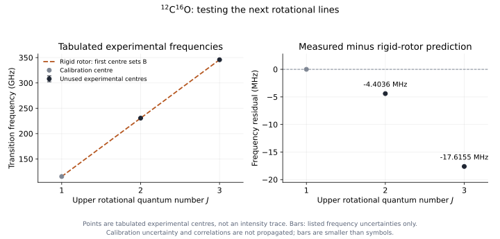
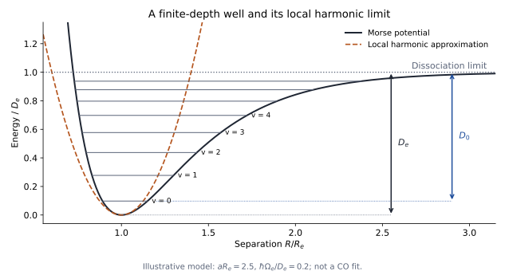

# Unit 6 · Molecules and nuclear motion

## 6.1 What new energies can a molecule reveal?

Unit 5 connected an energy-level model to transition strengths, widths and coherence. Could we use the same framework for a molecule? The interaction with light still probes energy differences, but two bound nuclei can also change their separation and the orientation of their bond. These motions suggest energies beyond the electronic levels of an isolated atom.

We need measurements that can distinguish the possibilities. Prepare an identified molecular gas and scan across microwave and infrared frequencies, recording transmission relative to an incident reference. Are there low-energy resonances as well as larger intervals? How do their positions respond when we change nuclear mass while keeping the element identities fixed?

We will use carbon monoxide, CO, as the main example. It has measurable microwave and infrared transitions and a simple closed-shell ground electronic state. This keeps the species fixed while we investigate different motions. Recorded frequencies are the evidence; calling an interval rotational or vibrational is an interpretation to test.

## 6.2 What potential could bind two nuclei?

Before quantizing nuclear motion, ask what keeps the nuclei near one another. For a fixed separation $`R`$, an electronic calculation gives an energy $`\epsilon_a(R)`$ for electronic state $`a`$. Add nuclear repulsion once:

```math
U_a(R)=\epsilon_a(R)+\frac{Z_AZ_Be^2}{4\pi\varepsilon_0R}.
```

A bound molecule requires a minimum below an appropriate separated-fragment limit. The equilibrium distance $`R_e`$ is the minimum, where $`dU_a/dR=0`$. Electronic kinetic energy, electron–nuclear attraction and electron–electron interactions all contribute to $`\epsilon_a`$; the nuclei do not bind through a direct attraction to each other.

To see the electronic issue in its simplest form, consider H₂⁺: one electron and two protons. It retains the one-electron physics of Unit 1 but introduces two attraction centres. A trial electronic orbital spread over both centres can lower the total energy over a range of separations. Whether it binds must be checked by calculating the complete energy, including nuclear repulsion; “sharing an electron” alone is not a quantitative explanation. CO requires a many-electron calculation, but the resulting potential plays the same role for nuclear motion.

Choose the minimum of the bound potential as our energy zero. Its dissociation limit then lies at a positive well depth $`D_e`$. A few spectral lines cannot determine the whole potential uniquely. Rotational, vibrational, isotope and dissociation measurements will constrain different properties of it.

## 6.3 Can electronic and nuclear motion be separated?

Nuclei are heavier than electrons, suggesting that an electronic state may adjust while the nuclei move more slowly. Make this a controlled approximation rather than freezing the nuclei permanently:

```math
\Psi(\mathbf r,\mathbf R)
\simeq\phi_a(\mathbf r;\mathbf R)\chi_a(\mathbf R),
\qquad
\mu_{\mathrm{red}}=\frac{M_AM_B}{M_A+M_B}.
```

Here $`\mathbf r`$ represents electronic coordinates, $`\mathbf R`$ the nuclear separation vector, and $`\mu_{\mathrm{red}}`$ the nuclear reduced mass. In the **Born–Oppenheimer approximation**, solve the electronic problem at fixed nuclear positions, then solve nuclear motion on one potential $`U_a(R)`$.

Nuclear derivatives also act on $`\phi_a`$ because it depends on the nuclear positions. The simplest separation neglects the resulting derivative-coupling terms. Large nuclear masses help, but small electronic energy gaps can make the neglected couplings important. The approximation is therefore also a statement about the electronic states sampled by the nuclear motion.

For a closed-shell electronic state such as CO's ground state, neglect spin structure and use $`J`$ for rotation, excluding nuclear spin. After separating the angular coordinates, write the radial nuclear function as $`u_{avJ}(R)/R`$. Its equation is

```math
\left[
-\frac{\hbar^2}{2\mu_{\mathrm{red}}}\frac{d^2}{dR^2}
+U_a(R)
+\frac{\hbar^2J(J+1)}{2\mu_{\mathrm{red}}R^2}
\right]u_{avJ}(R)=E_{avJ}u_{avJ}(R).
```

The same equation contains radial vibration and rotation through the separation-dependent centrifugal energy. We will first simplify each motion, then test where those simplifications fail.

Born and Oppenheimer's [original 1927 paper](https://doi.org/10.1002/andp.19273892002) develops the separation using the electron–nuclear mass hierarchy. It provides historical context for the approximation; the measurement tests below address its consequences.

## 6.4 Can rotation predict an unused line?

First hold the separation approximately fixed. The molecule behaves as a **rigid rotor** with moment of inertia $`I=\mu_{\mathrm{red}}R_e^2`$:

```math
E_J^{\mathrm{rot}}=\frac{\hbar^2J(J+1)}{2I}
=hcB_eJ(J+1),
\qquad
B_e=\frac{\hbar^2}{2\mu_{\mathrm{red}}hcR_e^2}.
```

Here $`B_e`$ is a spectroscopic wavenumber. The levels are not equally spaced: consecutive gaps grow with $`J`$. For CO, its electric dipole allows microwave transitions between neighbouring rotational levels, so this predicts

```math
\tilde\nu_{J\to J+1}=2B_e(J+1).
```

The transition frequencies, unlike the level energies, form an equally spaced sequence. Unit 7 will examine the probe coupling more fully.

Test this with the first line alone. The published reference frequency for $`{}^{12}\mathrm C{}^{16}\mathrm O`$, $`J=0\to1`$, is 115271.2018 MHz. A rigid-rotor model fixed by this line predicts $`J=1\to2`$ at twice that frequency, 230542.4036 MHz. The tabulated experimental centre is 230538.0000 MHz: about **4.4 MHz lower**. The agreement on the overall scale is good, while the discrepancy is resolvable by precision spectroscopy.



*Figure 6.1. Published experimental line centres transcribed from the JPL CO catalogue, not a detector-intensity scan. The first line sets the rigid-rotor constant; the next two test that approximation. The residual plot exposes deviations hidden on the absolute frequency scale. Listed frequency uncertainties and the limits of this comparison are documented in the [local data record](data/co-rotational-jpl/README.md); the [plotting script](analysis/plot_co_rotational_test.py) reproduces the figure.*

The first-line calibration gives an effective rigid-rotor constant, estimating the ground-vibrational-state constant $`B_0`$. Once centrifugal distortion is included, it is $`B_{\mathrm{fit}}\simeq B_0-2\mathcal D_0`$. Its inferred length is near 1.13 Å, not automatically the exact equilibrium distance: even the lowest vibrational state samples a range of separations. We will refine that interpretation below.

Winnewisser and colleagues' [original sub-Doppler CO study](https://doi.org/10.1006/jmsp.1997.7341) describes precision rotational measurements and their experimental limits. It is useful context for asking whether a model discrepancy is experimentally distinguishable.

> **TODO — Add the rotational detector record.**
>
> Show calibrated transmission or absorption versus microwave frequency for identified CO transitions. Specify pressure, temperature and frequency reference. Reserve lines from the fit and compare their measured centres with predictions, including uncertainties and any shared calibration errors. The published centre comparison above does not replace the scan or its measurement model.

## 6.5 Can vibration explain a larger interval?

Rotation changes orientation. What if the nuclear separation also oscillates about $`R_e`$? Near a stable minimum, expand the potential:

```math
U_a(R)\simeq\frac12k(R-R_e)^2,
\qquad
\Omega_e=\sqrt{\frac{k}{\mu_{\mathrm{red}}}},
\qquad
E_v^{\mathrm{harm}}=\hbar\Omega_e\left(v+\frac12\right).
```

The curvature $`k`$ is the effective bond stiffness. This **harmonic approximation** predicts equal vibrational intervals and a nonzero ground-state energy. The nuclei cannot sit motionless at the minimum in their quantum ground state.

To test it, record an infrared band of the same molecule. Each line can change rotation as well as vibration. Use assigned rotational contributions and linked line frequencies to infer the interval between vibrational states; the band origin need not be a visible peak. Ask whether another vibrational interval is equal to the first.

Define the harmonic wavenumber $`\tilde\nu_e=\Omega_e/(2\pi c)`$. For CO, its spectroscopically inferred value is about $`2169.81\ \mathrm{cm}^{-1}`$. This is a fitted harmonic constant, not the frequency of a single observed line. The lowest vibrational interval is instead near $`2143\ \mathrm{cm}^{-1}`$; section 6.7 will explain why they differ. At this stage the harmonic model provides the scale and a testable equal-spacing prediction.

For comparison, CO's rotational constant is near $`1.9\ \mathrm{cm}^{-1}`$. Rotation is much lower in energy than vibration; electronic excitations generally introduce another, larger scale. These are different motions of the same system, rather than unrelated families of emitters.

> **TODO — Reconstruct a vibrational interval from a band.**
>
> Show calibrated CO infrared absorption and identify the rotational contributions needed to determine a vibrational band origin. Keep fitted origins, harmonic constants and directly recorded peaks distinct. Reserve another interval to test equal spacing. The detailed branch and intensity analysis belongs to Unit 7.

## 6.6 Does changing the isotope test the nuclear-motion model?

We have assigned low-energy structure to nuclear motion. A controlled test is to change nuclear mass without changing nuclear charge. Within the leading Born–Oppenheimer picture, isotopic molecules share approximately the same electronic potential, including $`R_e`$ and curvature $`k`$. The rotor and oscillator therefore predict

```math
\frac{B_e'}{B_e}=\frac{\mu_{\mathrm{red}}}{\mu_{\mathrm{red}}'},
\qquad
\frac{\Omega_e'}{\Omega_e}
=\sqrt{\frac{\mu_{\mathrm{red}}}{\mu_{\mathrm{red}}'}}.
```

A heavier isotope should have smaller rotational and vibrational spacings, with different mass powers. This is a stronger test than merely expecting “some isotope shift.”

Replace $`{}^{12}\mathrm C`$ by $`{}^{13}\mathrm C`$ in the CO sample. Using isotopic masses, the reduced-mass ratio is approximately 0.956. The rotational frequency scale should decrease by about 4.4%, while the harmonic vibrational scale decreases by about 2.2%. Applying the leading rotational scaling to the first CO line predicts about **110.2 GHz**; the $`{}^{13}\mathrm C{}^{16}\mathrm O`$ reference line is also near 110.2 GHz.

This is a leading comparison, not a precision equality. Ground-state rotational constants include vibrational averaging, and finite-mass corrections can modify the shared-potential approximation. The vibrational prediction concerns the harmonic constant; a fundamental interval also contains mass-dependent anharmonic corrections.

> **TODO — Add a matched isotope comparison.**
>
> Record the same assigned rotational and vibrational transitions for the two CO isotopic species under a common calibration. Predict both mass scalings before comparing them with the record. State the mass convention and separate leading agreement from residual effects; one unexplained residual does not uniquely identify a Born–Oppenheimer correction.

## 6.7 What do higher excitations reveal about the potential?

The two simple models have clear limitations. A harmonic well has equal spacing forever and cannot describe dissociation. A rigid rotor cannot stretch as rotation increases. More measurements can tell us which corrections matter.

A useful anharmonic model is the **Morse potential**,

```math
U(R)=D_e[1-e^{-a(R-R_e)}]^2,
\qquad
\Omega_e=a\sqrt{\frac{2D_e}{\mu_{\mathrm{red}}}}.
```

Its bound vibrational levels are

```math
E_v=\hbar\Omega_e\left(v+\frac12\right)
-\frac{(\hbar\Omega_e)^2}{4D_e}\left(v+\frac12\right)^2.
```

The spacing decreases as excitation grows, and only finitely many states are bound. The formula must not be extended beyond that bound-state range. Morse's [original 1929 paper](https://journals.aps.org/pr/abstract/10.1103/PhysRev.34.57) introduces this solvable departure from the harmonic oscillator; an accurate molecular potential may need further terms.

In spectroscopic units the first two vibrational terms are conventionally written

```math
G(v)=\frac{E_v}{hc}
\simeq\tilde\nu_e\left(v+\frac12\right)
-\tilde\nu_ex_e\left(v+\frac12\right)^2.
```

For a shared Morse potential, $`x_e\propto\mu_{\mathrm{red}}^{-1/2}`$, so the anharmonic coefficient $`\tilde\nu_ex_e`$ scales as $`\mu_{\mathrm{red}}^{-1}`$.

CO's reference $`\tilde\nu_ex_e\simeq13.2883\ \mathrm{cm}^{-1}`$ gives $`G(1)-G(0)\simeq2169.8136-2(13.2883)\simeq2143.24\ \mathrm{cm}^{-1}`$. Thus the harmonic constant and the fundamental have different meanings. Their numerical agreement with an interval must be tested after fitting inputs, rather than fitting every interval independently.



*Figure 6.2. Calculated illustrative potential and level scheme, not a fit to CO or an experimental record. The harmonic curve approximates the minimum locally; the finite-depth well permits dissociation. $`D_e`$ measures from the potential minimum, while $`D_0`$ measures from the lowest nuclear level. The [plotting script](analysis/plot_diatomic_potential.py) specifies the model parameters.*

The distinction suggests a separate threshold test. From $`v=0,J=0`$, the dissociation energy is

```math
D_0=D_e-E_{00}.
```

For a heavier isotope in the same potential, the lower zero-point energy should increase $`D_0`$, even though $`D_e`$ is approximately unchanged.

Rotation and vibration also interact. Vibrational averaging gives

```math
B_v=\frac{\hbar^2}{2\mu_{\mathrm{red}}hc}
\langle R^{-2}\rangle_v,
\qquad B_v\simeq B_e-\alpha_e\left(v+\frac12\right).
```

Thus $`B_0`$ determines $`\langle R^{-2}\rangle_0^{-1/2}`$, not simply the mean separation or $`R_e`$. Increasing rotation can stretch the bond, producing the leading centrifugal-distortion correction:

```math
\frac{E_{vJ}}{hc}\simeq G(v)+B_vJ(J+1)
-\mathcal D_v[J(J+1)]^2,
\qquad
\tilde\nu_{J\to J+1}\simeq2B_v(J+1)-4\mathcal D_v(J+1)^3.
```

The positive $`\mathcal D_v`$ lowers the high-$`J`$ intervals relative to the rigid prediction, as the CO residuals suggest. It has wavenumber units and is distinct from the dissociation energy $`D_e`$. Fit it with a second line, then predict another; do not use every line both to set and to test the parameters.

> **TODO — Test higher rotational and vibrational excitations.**
>
> Use independently reserved line centres to compare rigid and distorted rotation, equal and decreasing vibrational intervals, and rotational constants in different vibrational states. Plot residuals with uncertainties. Add model terms only where the pattern and precision justify them; check isotope scaling of the refined constants as another test.

> **TODO — Add a dissociation or potential-depth test.**
>
> Specify the initial rovibrational state and the separated-fragment channel in a threshold or fragment-energy measurement. Compare the inferred $`D_0`$ with the potential depth and zero-point correction, including isotope dependence. A few low-lying intervals do not establish the full potential or its dissociation limit.

## 6.8 Why do different probes reveal different parts of this structure?

Nuclear motion has supplied a connected explanation for rotational and vibrational energy scales. Changing isotope tests their mass dependence; higher excitations test the shape of the potential and the limits of the simplest approximations.

But a level scheme still does not specify which lines an experiment will show. CO's dipole made the microwave test possible. A molecule without a permanent dipole can still rotate and vibrate: absence from the same absorption experiment would not remove those states. Which interaction could reveal them instead? How do electronic transitions distribute intensity among different nuclear states?

[Unit 7](unit-7-molecular-spectroscopy.md) follows these questions through infrared, Raman and electronic spectroscopy, applying Unit 5's interaction framework to the molecular states developed here.

---

## Sources and conventions

- **Scope:** molecular binding, Born–Oppenheimer separation and the levels behind diatomic rotational, vibrational and electronic spectroscopy, following Section VII of the supplied CSIR–UGC NET Physical Sciences syllabus. Probe-dependent branches, strengths and Franck–Condon factors follow in Unit 7.
- Molecular potentials and nuclear motion: G. Herzberg, *Spectra of Diatomic Molecules*; C. N. Banwell and E. M. McCash, *Fundamentals of Molecular Spectroscopy*. The introductory rotor uses a closed-shell electronic state with spin structure omitted.
- CO rotational references: JPL molecular spectral catalogues, species tags 28001 and 29001. The selected $`{}^{12}\mathrm C{}^{16}\mathrm O`$ entries are marked experimental in the source. The [local record](data/co-rotational-jpl/README.md) distinguishes tabulated centres, uncertainty fields and detector scans. G. Winnewisser, S. P. Belov, Th. Klaus and R. Schieder, *Journal of Molecular Spectroscopy* **184**, 468–472 (1997), doi:10.1006/jmsp.1997.7341, provides original experimental context.
- CO equilibrium and vibrational constants: NIST Chemistry WebBook, carbon monoxide, ground-state diatomic constants. Its conventional $`\omega_e`$ in $`\mathrm{cm}^{-1}`$ is the $`\tilde\nu_e`$ used here, not our angular frequency $`\Omega_e`$. Isotope estimates use isotopic masses as a leading spectroscopic approximation; precision work must state the nuclear/effective-mass convention and corrections.
- Original models: M. Born and R. Oppenheimer, “Zur Quantentheorie der Molekeln,” *Annalen der Physik* **389**, 457–484 (1927), doi:10.1002/andp.19273892002; P. M. Morse, “Diatomic Molecules According to the Wave Mechanics. II. Vibrational Levels,” *Physical Review* **34**, 57–64 (1929), doi:10.1103/PhysRev.34.57.
- Wavenumbers use vacuum frequencies, $`\tilde\nu=\nu/c`$; $`B_v,G(v),\mathcal D_v`$ are in wavenumber units, while $`D_e,D_0`$ are energies. The potential minimum is the energy zero in the nuclear-motion formulas. $`\mu_{\mathrm{red}}`$ denotes reduced mass, avoiding the $`\mu_N`$ nuclear-magneton symbol of earlier units. Constants use CODATA 2018, and comparisons are rounded to the accuracy of their approximations.
