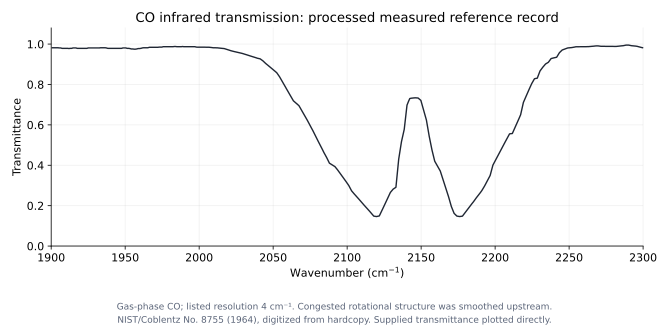
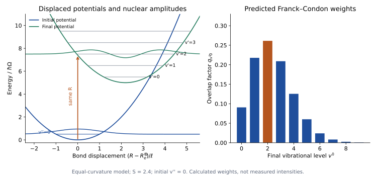

# Unit 7 · Molecular spectroscopy

## 7.1 Which molecular levels can the probe reveal?

Unit 6 supplied rotational and vibrational levels and tested their mass dependence. A level scheme still leaves a measurement question: which transitions will a chosen probe produce, and with what strength?

Begin with the same molecule, CO, but examine infrared transmission. Figure 7.1 is a measured reference record: a lower transmitted fraction means greater absorption. What produces the groups of absorption on either side of a central recovery in transmission? Could rotational changes accompany one vibrational transition, rather than each feature requiring a separate vibration?



*Figure 7.1. NIST/Coblentz No. 8755 CO gas spectrum (1964), digitized from hardcopy. The source lists 4 cm⁻¹ resolution and explicitly states that congested rotational structure was smoothed. The supplied transmittance is plotted without new smoothing or fitting. It motivates a band model but cannot establish precise individual line centres. Acquisition details, processing and the unchanged source file are in the [local record](data/co-infrared-nist/README.md); the [script](analysis/plot_co_infrared.py) reproduces the figure.*

To test an interpretation, combine Unit 6's energies with Unit 5's interaction matrix elements. Then propose a measurement with enough resolution to distinguish the predicted transitions. The broad appearance alone does not establish the detailed assignments.

## 7.2 Why do rotation and vibration have different dipole requirements?

Within one electronic state of a diatomic molecule, write the body-fixed dipole as $`d_a(R)\hat{\mathbf R}`$. Here $`d_a(R)`$ is the electronic-state-averaged electric dipole along the bond. A permanent body-fixed dipole does not imply a net laboratory polarization in a freely rotating gas.

For pure rotation within a vibrational state, the relevant radial factor is its vibrationally averaged dipole. If it is nonzero, the electric field can couple different orientations. For the closed-shell states considered here, electric-dipole absorption connects neighbouring rotational levels, giving the $`\Delta J=+1`$ sequence tested in Unit 6.

Vibrational excitation is a different matrix element. Expand near equilibrium:

```math
d_a(R)=d_e+d'_e(R-R_e)+\frac12d''_e(R-R_e)^2+\cdots.
```

The constant term cannot connect orthogonal vibrational states. In the harmonic approximation, the linear term connects $`\Delta v=\pm1`$, so a fundamental electric-dipole band requires $`d'_e\ne0`$. It is the change of dipole with vibration, rather than the permanent value alone, that matters.

This gives a further prediction. A harmonic oscillator with only a linear dipole term has no overtone absorption. A weak band associated with $`v=0\to2`$ would require extending that model: anharmonic wavefunctions or nonlinear terms in the dipole can supply the coupling. Its frequency also need not be exactly twice the fundamental. Positions and strengths together can test these extensions.

> **TODO — Compare a fundamental and an overtone.**
>
> Record calibrated absorption in both frequency ranges for the same identified molecule. Account for column density, detector response and saturation. Compare the overtone position with the harmonic prediction and its integrated strength with the dipole model; one weak band alone does not separate mechanical from electrical anharmonicity.

## 7.3 Can the infrared branches be predicted before assigning the lines?

For CO's fundamental, vibration and rotation can both change. Take $`v''=0,J''=J`$ initially and $`v'=1`$ finally. To leading order,

```math
\frac{E_{vJ}}{hc}\simeq G(v)+B_vJ(J+1),
\qquad
\tilde\nu_0=G(1)-G(0).
```

For this $`{}^1\Sigma\leftrightarrow{}^1\Sigma`$ band, electric-dipole coupling gives $`\Delta J=\pm1`$. Increasing rotation produces the **R branch**, decreasing it the **P branch**:

```math
\begin{aligned}
\tilde\nu_R(J)&=\tilde\nu_0+B'(J+1)(J+2)-B''J(J+1),
&&J\ge0,\\
\tilde\nu_P(J)&=\tilde\nu_0+B'(J-1)J-B''J(J+1),
&&J\ge1.
\end{aligned}
```

Here $`B'=B_1`$ and $`B''=B_0`$. If they were equal, each branch would have spacing $`2B`$, with a central separation $`4B`$ between P(1) and R(0). There is no $`\Delta J=0`$ **Q branch** in this particular band. The vibrational origin $`\tilde\nu_0`$ therefore need not be an observed line. Other molecular symmetries can permit Q branches.

Unit 6 already constrained $`B_0`$ through microwave frequencies. Can an infrared assignment recover the same value? Pair R($`J-1`$) and P($`J+1`$), which share an upper rotational state. Their difference cancels the upper energy and the vibrational origin:

```math
\tilde\nu_R(J-1)-\tilde\nu_P(J+1)
=2B''(2J+1),\qquad J\ge1.
```

This tests the assignment with an independent energy scale. Use a small set of lines to estimate the remaining constants, then predict unused positions. Systematic residuals can test centrifugal distortion or additional state interactions.

Line areas also depend on the initial rotational populations and angular matrix elements. Heating the sample changes which $`J`$ states are populated, altering the band envelope. The two broad groups in Figure 7.1 are therefore a starting observation, not a substitute for this line-by-line test.

> **TODO — Test the P/R assignments at sufficient resolution.**
>
> Add a frequency-calibrated CO rovibrational record with known temperature and instrument response. Use the microwave rotational constant as an independent input. Test combination differences and unused line positions, and compare corrected branch areas with the population model. The smoothed reference spectrum in Figure 7.1 is not adequate for this precision test.

## 7.4 What if ordinary dipole absorption misses the motion?

Now make a deliberate change of molecule. Nitrogen, N₂, still has rotational and vibrational states, but its homonuclear symmetry makes $`d_a(R)=0`$ within the ground electronic state. Ordinary electric-dipole rotational and vibrational absorption is therefore absent. This tests probe access, not the existence of nuclear motion.

What interaction could connect those states? An applied optical field can induce a dipole even when the permanent dipole vanishes:

```math
\mathbf d_{\mathrm{ind}}=\boldsymbol\alpha(R)\mathbf E,
\qquad
\boldsymbol\alpha(R)\simeq\boldsymbol\alpha_e+
\left(\frac{\partial\boldsymbol\alpha}{\partial R}\right)_e(R-R_e)+\cdots.
```

The **polarizability tensor** describes how the electronic distribution responds to the field. Its orientation dependence can couple rotation; its bond-length dependence can couple vibration. Thus a new interaction supplies a specific reason to look for scattered light at shifted frequencies.

Illuminate the gas with a narrow-frequency source and analyse the scattered light. In **Raman scattering**, a photon and molecule exchange energy, so

```math
\nu_S=\nu_L-\frac{\Delta E}{h},
\qquad
\nu_{AS}=\nu_L+\frac{\Delta E}{h}.
```

The molecule gains energy in Stokes scattering and loses initially stored excitation in anti-Stokes scattering. Change the exciting frequency: the scattered frequencies should move with it while the molecular energy shift remains fixed. That is a useful test of the interpretation.

Raman and Krishnan's [original 1928 paper](https://www.nature.com/articles/121501c0) describes a filter-based investigation of shifted light. Their illumination predates lasers; a tunable laser is the modern route proposed here for testing the frequency-shift relation.

> **TODO — Reveal a nonpolar molecule through Raman shifts.**
>
> Supply a calibrated N₂ scattered-light record, with excitation frequency, gas preparation and collection geometry. State the elastic-light rejection and low-shift acceptance window. Predict molecular shifts before assigning them, then repeat with another excitation frequency. Raman accessibility must follow from the polarizability coupling, rather than being assumed from a missing infrared line.

## 7.5 What should Raman positions and strengths test?

For a linear molecule, polarizability anisotropy supplies the leading pure rotational Raman transitions with $`\Delta J=\pm2`$. The rigid-rotor Stokes sequence is

```math
\Delta\tilde\nu_{J\to J+2}
=B[(J+2)(J+3)-J(J+1)]
=(4J+6)B.
```

The first shift is $`6B`$, and consecutive shifts differ by $`4B`$, rather than the $`2B`$ spacing of electric-dipole pure rotation. These are two probe-dependent patterns derived from the same rotational levels. For N₂, a ground-state constant $`B_0\simeq1.9896\ \mathrm{cm}^{-1}`$ predicts a first Stokes shift near $`11.94\ \mathrm{cm}^{-1}`$ and spacing near $`7.96\ \mathrm{cm}^{-1}`$. These are predictions from reference molecular constants; the Raman record remains to be added. Integrated strengths additionally contain populations, angular factors and nuclear-spin statistical weights.

Vibrational Raman scattering requires a nonzero polarizability derivative. A harmonic mode can then give $`\Delta v=\pm1`$, with rotational changes $`\Delta J=0,\pm2`$. The $`\Delta J=0`$ vibrational Raman Q branch has a nonzero energy shift. Only a process leaving both vibrational and rotational state unchanged is unshifted Rayleigh scattering in this setting.

Can the two sides of a vibrational Raman spectrum test thermal populations? For weak, nonresonant scattering from one harmonic mode in equilibrium, with the same collection geometry, the calibrated **power** ratio is

```math
\frac{P_{AS}}{P_S}
=\left(\frac{\nu_L+\nu_v}{\nu_L-\nu_v}\right)^4
\exp\left(-\frac{h\nu_v}{k_BT}\right).
```

Here $`\nu_v`$ is the vibrational frequency. Corrected photon-count ratios instead carry the third power of the frequency ratio; raw counts also contain detector sensitivity. Increasing temperature should enhance anti-Stokes scattering relative to Stokes, while laser heating can change the temperature being tested. Polarization dependence supplies another check of the tensor coupling.

> **TODO — Test Raman populations and polarization.**
>
> Compare matched Stokes and anti-Stokes vibrational features over a controlled temperature range, with independently measured temperature and calibrated spectral response. State whether the signal is photon counts or power. Record polarization channels and account for rotational populations and nuclear-spin weights before interpreting intensity patterns.

## 7.6 What changes when the electronic state changes?

Microwave and infrared measurements mostly kept CO in one electronic potential. At higher photon energies, an electronic transition can move the molecule to a different potential $`U_{a'}(R)`$. Each potential has its own nuclear levels. We should therefore expect several vibrational bands within one electronic system.

Use higher-frequency absorption or fluorescence, establish which initial states are populated, and resolve enough structure to reconstruct band origins. In wavenumber units,

```math
\tilde\nu_{v'v''}=T_e+G'(v')-G''(v''),
```

where $`T_e`$ is the separation of the electronic potential minima. The 0–0 origin contains the difference of zero-point energies and is generally not $`T_e`$. Initial excited vibrational populations can produce additional hot bands, so a progression cannot be assigned by spacing alone.

Electronic symmetry also enters the dipole matrix element. The projection of electronic orbital angular momentum onto the bond is labelled $`\Lambda=0,1,2,\ldots`$, written $`\Sigma,\Pi,\Delta,\ldots`$. Different electronic angular symmetries can change the rotational branches; a Q branch in another band would not contradict the specific CO fundamental model above. Spin and, for homonuclear molecules, inversion symmetry impose further restrictions. Homonuclear molecules can have allowed electronic absorption even though their ground-state pure rotation and vibration lack ordinary electric-dipole absorption.

> **TODO — Establish an electronic-band progression.**
>
> Add a calibrated electronic absorption or fluorescence record with identified molecular species and initial preparation. Separate rotational contributions, infer band origins and test assignments using shared-level differences, temperature or isotope changes. Distinguish the 0–0 origin, the electronic minimum separation and the strongest observed band.

## 7.7 Why are the vibrational bands unequally strong?

The band positions test the two potential-energy curves. Their strengths can test the associated wavefunctions. In the Born–Oppenheimer picture, apart from rotational and polarization factors, the transition amplitude is

```math
M_{v'v''}=\int u_{a'v'}^*(R)\,
 d_{a'a}(R)\,u_{av''}(R)\,dR.
```

The reduced radial functions use the normalization $`\int|u(R)|^2dR=1`$. The electronic transition dipole $`d_{a'a}(R)`$ is a matrix element between electronic states at fixed separation, not the permanent dipole within one state used for infrared vibration.

If this electronic matrix element varies slowly across the important nuclear region, the **Condon approximation** treats it as constant. The remaining squared overlap is the **Franck–Condon factor**,

```math
q_{v'v''}=\left|\int u_{a'v'}^*(R)u_{av''}(R)\,dR\right|^2.
```

The electronic transition is fast relative to nuclear motion. A vertical transition on a potential diagram expresses approximately unchanged separation during that change of electronic state. It does not require $`v'=v''`$, nor a transition occurring only at the equilibrium distance. The wavefunction overlap is an amplitude integral; signs matter before its magnitude is squared.

For a testable simple model, take equal-curvature harmonic potentials displaced by $`\Delta R`$, initially in $`v''=0`$. Then

```math
q_{v'0}=e^{-S}\frac{S^{v'}}{v'!},
\qquad
S=\frac{\mu_{\mathrm{red}}\Omega(\Delta R)^2}{2\hbar}.
```

A displacement can make a band with $`v'>0`$ stronger than 0–0. The parameter $`S`$ depends on the square of the displacement; these weights alone do not determine whether the bond becomes longer or shorter. Rotational constants provide an independent way to test that direction of change.



*Figure 7.2. Calculated equal-curvature model with an initial vibrational ground state, not molecular data. Small curves about the levels show rescaled nuclear wavefunction amplitudes. The vertical construction indicates the sudden electronic change at fixed separation. The bars are overlap factors, not raw spectral intensities. The [plotting script](analysis/plot_franck_condon_model.py) states the model parameters.*

Before comparing these weights with a record, identify the signal. For fixed transition-dipole and angular factors, weak integrated absorption contains a frequency factor $`\nu`$; spontaneous photon emission contains $`\nu^3`$; emitted power contains $`\nu^4`$. Populations, detector response and rotational contributions also affect band areas. A raw peak-height progression cannot be identified directly with $`q_{v'v''}`$.

Condon's [original 1926 paper](https://journals.aps.org/pr/abstract/10.1103/PhysRev.28.1182) compares intensity distributions with band assignments and considers alternative interpretations where agreement fails. Here the corresponding test is to estimate the displacement or potential from selected bands, then predict unused corrected areas and their response to changed preparation. Unequal curvatures, a varying electronic transition dipole or mixed electronic states can require a more detailed model.

> **TODO — Test a corrected Franck–Condon progression.**
>
> Use calibrated integrated bands with known initial vibrational populations. Apply the frequency, angular and detector corrections appropriate to absorption or fluorescence. Determine model parameters from a subset, then predict other band areas, isotope changes or excitation from another initial vibrational state. Compare the inferred displacement with rotational constants instead of fitting an independent strength to every band.

## 7.8 What remains ambiguous in a complicated spectrum?

Different interactions have revealed different parts of the same molecular level structure. Dipole absorption tested permanent moments and their derivatives; Raman scattering tested polarizability; electronic band strengths tested nuclear overlaps between different potentials. Positions, polarization, temperature and isotope changes supplied complementary checks.

A spectrum containing several species adds another inference problem. Features can overlap, preparation can hide expected transitions, and instrument response can alter apparent strengths. Which assignments are supported by more than one independent prediction? What change of sample, probe or resolution would distinguish the remaining possibilities?

[Unit 8](unit-8-putting-the-ideas-together.md) uses these questions to interpret individual-element records and mixtures, carrying the distinction between measured signals and microscopic conclusions back to Unit 0.

---

## Sources and conventions

- **Scope:** electronic, rotational, vibrational and Raman spectra of diatomic molecules; molecular selection rules; Franck–Condon principle, following Section VII of the supplied CSIR–UGC NET Physical Sciences syllabus. Units 5–6 supply the interaction and level models used here.
- Molecular spectra and angular factors: G. Herzberg, *Spectra of Diatomic Molecules*; C. N. Banwell and E. M. McCash, *Fundamentals of Molecular Spectroscopy*. The P/R formulas assume a simple closed-shell $`{}^1\Sigma\leftrightarrow{}^1\Sigma`$ band and omit centrifugal distortion. Prime and double-prime denote final and initial states.
- N₂ rotational prediction: NIST Chemistry WebBook, ground-state diatomic constants, $`B_e=1.998241`$ and $`\alpha_e=0.017318\ \mathrm{cm}^{-1}`$; $`B_0\simeq B_e-\alpha_e/2`$. The displayed Raman positions are calculated from these reference constants, not supplied as measured peaks.
- Figure 7.1: NIST Chemistry WebBook, Coblentz Society CO gas-phase reference No. 8755, Dow Chemical Company (1964), digitized from hardcopy. The source copyright notice is retained in the unchanged JCAMP file; [provenance](data/co-infrared-nist/README.md) records the sample conditions and upstream smoothing. This processed record is not a high-resolution branch measurement.
- Original Raman report: C. V. Raman and K. S. Krishnan, “A New Type of Secondary Radiation,” *Nature* **121**, 501–502 (1928), doi:10.1038/121501c0. Raman signal conventions: IUPAC, *Pure and Applied Chemistry* **69**, 1451–1468 (1997), doi:10.1351/pac199769071451. The stated thermal intensity ratio assumes weak, nonresonant vibrational Raman scattering.
- Original intensity theory: E. Condon, “A Theory of Intensity Distribution in Band Systems,” *Physical Review* **28**, 1182–1201 (1926), doi:10.1103/PhysRev.28.1182; J. Franck, “Elementary Processes of Photochemical Reactions,” *Transactions of the Faraday Society* **21**, 536–542 (1926), doi:10.1039/TF9262100536. Figure 7.2 is an illustrative model with no fit to CO or another measured molecule.
- Frequencies $`\nu`$ are ordinary frequencies; wavenumbers are vacuum $`\tilde\nu=\nu/c`$. $`T_e,G(v),B_v`$ use wavenumber units. $`d_a(R)`$ is a permanent body-fixed electric dipole, $`d_{a'a}(R)`$ an electronic transition dipole, and $`\boldsymbol\alpha`$ the polarizability tensor. Signal areas, photon counts, emitted power and overlap factors remain distinct.
