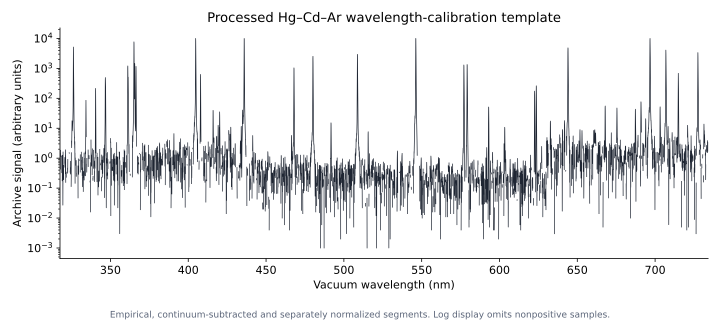
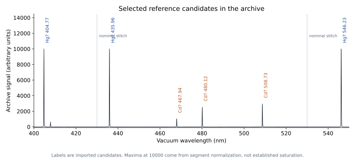
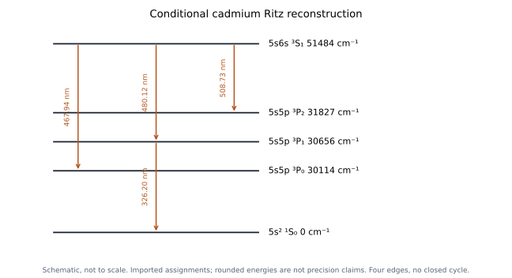

# Unit 8 · Putting the ideas together

## 8.1 What control measurements would identify the emitters?

We have models for atomic and molecular levels, probe coupling, populations and spectral widths. Can those models help us interpret a spectrum containing several emitters? The final investigation uses an archived Hg–Cd–Ar calibration spectrum, where the source identities are known but individual features still require interpretation.

Before opening a reference line list, propose a control: record mercury, cadmium and argon separately, then compare their combined signal using the same spectrometer settings. Which features appear with each source? Which remain unresolved or change when excitation conditions change? A set of companion features gives a stronger identification than one wavelength coincidence.

The repository does not yet contain those separate records. The source name is prior information, not an elemental composition discovered blindly from the spectrum. We can still examine the archive, but must keep the missing control visible.

> **TODO — Add the individual-element controls.**
>
> Record Hg, Cd and Ar separately under documented excitation and instrument conditions before comparing their mixture. Preserve wavelength calibration, exposure and intensity-response information. Do not extract selected peaks from the mixture and present them as separately measured spectra.

## 8.2 What does the existing archive actually contain?

Figure 8.1 shows a processed, empirically built wavelength-calibration template for the DeVeny spectrograph at the Lowell Discovery Telescope. It contains 7205 vacuum-wavelength samples, approximately 318–734 nm. Its numerical signal is in arbitrary archive units.



*Figure 8.1. Empirical calibration archive, not a raw detector exposure. The log display shows positive samples; the original signed, continuum-subtracted values remain in the data file. No species assignments are placed on individual features at this stage.*

The source audit matters to the physics. PypeIt's template-creation code combines four calibration exposures at different grating settings, subtracts continuum, aligns wavelength segments and normalizes each input snippet to a maximum of 10000. The four maxima at 10000 are therefore normalization maxima, not evidence of detector clipping. Cross-segment heights have lost their original common physical scale.

The [source record](data/lamp-archive/README.md) preserves the upstream FITS template, processing code and checksums. Every local CSV sample matches the upstream columns after the stated rounding. The old CSV header's claim of clipped lines is incorrect; it is retained and explicitly corrected in the provenance rather than silently changing the archived file.

For an unprocessed detector spectrum, a useful local measurement model is

```math
S_{\mathrm{det}}(\lambda)
=[\eta(\lambda)S_{\mathrm{source}}(\lambda)]*G_{\mathrm{inst}}(\lambda)
+b(\lambda).
```

The factors describe spectral sensitivity, instrumental broadening and background. The stored template adds further processing to that signal. Before interpreting an ordinate as emitted power or photon counts, we need to know those operations and calibrations.

## 8.3 Which features are reliably measured?

Begin with reproducible candidate detection, then inspect the candidates. A declared relative threshold finds **38 local maxima** in this archive. That is a method-dependent inventory, not a count of confirmed atomic transitions or a detection-significance statement.

The supplied analysis estimates a centre by fitting a quadratic to the logarithm of positive core samples, equivalent to a local Gaussian approximation. It includes the normalization maxima. It rejects undersampled cores, upward-curving fits, vertices outside the fitting window and implausibly broad window-limited estimates. With the current settings, **31 core estimates pass these guards and seven fail**. Passing the guards does not establish an isolated line or supply a formal uncertainty.

Why inspect the profile? A blend can shift a fitted centre. A residual background can bias a logarithmic fit. Changes of threshold or window can reveal instability. The sampling is about 0.58 Å, with only a few samples across many bright profiles. Printing more centre digits does not determine their accuracy.

The selected feature near 480 nm has an apparent FWHM near 1.70 Å. If instrumental broadening dominates an isolated feature, this corresponds to resolving power $`\mathcal R\simeq\lambda/\delta\lambda\simeq2800`$. An independent instrument profile is needed before identifying that width with resolution; it is not a natural-linewidth measurement.

> **TODO — Establish calibration and profile uncertainties.**
>
> Add repeated observations, detector variance information and an independently characterized instrumental profile. Vary extraction and fit choices, inspect residuals and identify blends. Use independent wavelength standards or reserved calibration lines to assess systematic errors and their correlations before assigning centroid uncertainties.

## 8.4 Which candidate assignments survive further checks?

Now compare stable feature estimates with reference transitions, using the same vacuum convention. A nearby reference wavelength is a candidate, not proof. Search for its expected companions and ask whether source controls, selection rules and excitation conditions support the assignment.

The numerical example considers seven imported Cd/Hg references:

| Feature near (nm, vacuum) | Reference hypothesis |
|---:|---|
| 326.2 | Cd: 5s5p $`{}^3P_1`$ → ground |
| 467.9 | Cd: 5s6s $`{}^3S_1`$ → 5s5p $`{}^3P_0`$ |
| 480.1 | Cd: same upper state → $`{}^3P_1`$ |
| 508.7 | Cd: same upper state → $`{}^3P_2`$ |
| 404.8 | Hg: 6s7s $`{}^3S_1`$ → 6s6p $`{}^3P_0`$ |
| 436.0 | Hg: same upper state → $`{}^3P_1`$ |
| 546.2 | Hg: same upper state → $`{}^3P_2`$ |



*Figure 8.2. The recorded archive values with candidate labels supplied by external references. Nominal stitch locations separate independently normalized segments. Equal maxima across segments do not imply equal emission strengths.*

The [current diagnostic table](data/lamp-analysis/candidate-lines.csv) distinguishes retained estimates, failed fits and these seven reference candidates. It does not reproduce a full Hg/Cd/Ar identification search. The older `measured-lines.csv` is preserved as a legacy table; its broader assignments and clipping flags are not conclusions of this analysis.

Other maxima remain unassigned in this restricted comparison. They might include other transitions, blends or processing features, but their causes have not been established. An absent companion also needs checking against spectral coverage, preparation, sensitivity and resolution before rejecting a hypothesis.

> **TODO — Test a candidate with unused companions.**
>
> Select a proposed species or upper-level assignment, predict another accessible transition and record the relevant source control. Keep that feature out of the initial identification step. Compare its position and response to changed source conditions, preserving alternative assignments where the evidence remains insufficient.

## 8.5 Can shared transitions reconstruct a level scheme?

Assume the candidate assignments in the table and convert the fitted vacuum wavelengths to wavenumbers. If two emission lines share upper state $`u`$,

```math
\tilde\nu_{ua}-\tilde\nu_{ub}
=\frac{E_b-E_a}{hc}.
```

The unknown upper energy cancels. The cadmium branches give lower-level intervals near **542 and 1171 cm⁻¹**. The mercury branches give approximately **1767 and 4631 cm⁻¹**. These are useful relative constraints even before an absolute ground-state anchor is supplied.

For Cd, the proposed 326.2 nm branch connects $`{}^3P_1`$ to the singlet ground state. It is an intercombination branch whose strength involves state mixing, as discussed in Unit 3. It gives $`E({}^3P_1)/(hc)\simeq30656\ \mathrm{cm}^{-1}`$. Adding the 480.1 nm branch puts the common upper state near $`51484\ \mathrm{cm}^{-1}`$. Subtracting the other two branch energies then places $`{}^3P_0`$ near $`30114\ \mathrm{cm}^{-1}`$ and $`{}^3P_2`$ near $`31827\ \mathrm{cm}^{-1}`$.



*Figure 8.3. Schematic reconstruction conditional on the imported assignments and the archive's wavelength calibration. Rounded energies illustrate the calculation; they are not uncertainty claims. Four transition edges connect five levels, including the ground state.*

The Hg ground-state connection near 253.7 nm is outside this archive's wavelength range. Its absence here says nothing about whether the corresponding state exists. The visible branches give relative intervals without establishing an absolute ground-referenced diagram.

The [numerical companion](worked-example-raw-spectrum.md) and [analysis report](data/lamp-analysis/analysis-summary.json) reproduce the calculations. Numerical agreement with tabulated energies is conditional on assignments and on a wavelength scale already calibrated using known lamp lines. It is not an independent validation of those same references.

## 8.6 What measurement would genuinely test the reconstruction?

Four transitions connecting five levels form a tree. Once one energy zero is fixed, they determine four relative energies exactly within the assigned graph. There is no redundant relation left to test. Withholding one of these four transitions would also leave an energy undetermined unless another constraint were introduced.

Propose a second upper state $`v`$ with branches to two of the existing lower states. One new branch locates $`v`$; the other then tests a prediction. For two upper states connected to lower states $`a,b`$,

```math
\tilde\nu_{ua}-\tilde\nu_{ub}
=\tilde\nu_{va}-\tilde\nu_{vb}.
```

This is a closed combination relation. A discrepancy could reveal a wrong shared-state assignment, a blend or a calibration problem. Adding many redundant transitions allows a weighted least-squares level reconstruction, with measurement uncertainties and shared systematic errors treated explicitly.

Kramida's [original LOPT methods paper](https://doi.org/10.1016/j.cpc.2010.09.019) develops that larger network problem. Our four-line example shows why more measured lines provide a test only when they add independent constraints, rather than merely repeating the fitted inputs.

> **TODO — Add an independent Ritz closure.**
>
> Identify accessible extra branches that close a level cycle and reserve one from the fit. Predict its frequency before inspecting its measurement. Include an independent calibration check and uncertainty correlations. Do not describe agreement on calibration lines, or a four-edge tree fitting four unknown energies, as an independent test.

## 8.7 Do strengths and field responses support the labels?

The assigned $`{}^3P`$ intervals invite an LS-coupling check. Their ratios are about **2.16 for Cd** and **2.62 for Hg**, compared with 2 in the simple Landé interval rule. These departures motivate examining the isolated-term approximation and state mixing. The ratios alone do not uniquely identify the additional interaction, especially without a complete uncertainty and blend analysis.

Can branching strengths help? For a common upper population, optically thin photon emission has rate $`N_uA_{ul}`$. A corrected integrated detector signal therefore contains sensitivity and collection factors as well as $`A_{ul}`$. In a pure, unpolarized LS model, the $`{}^3S_1\to{}^3P_{0,1,2}`$ angular strengths are 1:3:5; photon rates also contain $`\nu^3`$, and emitted powers contain $`\nu^4`$.

The archive's peak heights are neither calibrated branch areas nor a common physical scale across snippets. A difference from an ideal strength ratio cannot uniquely establish detector sensitivity, state mixing or self-absorption. That question needs a suitable intensity measurement.

> **TODO — Test calibrated branching areas.**
>
> Observe branches from a common upper state with retained exposure and segment scales, known spectral response and documented collection geometry. Integrate profiles, account for blends and optical depth, and identify whether the signal counts photons or measures power. Compare with angular and frequency factors before attributing residuals to a specific mechanism.

The labels also predict magnetic behaviour. Under electric-dipole coupling to a $`J=0`$ ground state, a $`J=1`$ upper level is permitted while $`J=0,2`$ are excluded for that particular interaction. This supports a candidate assignment, but does not make every possible radiative channel or every missing line equivalent. Controlled Zeeman slopes and polarization patterns provide additional information of the kind developed in Unit 4.

> **TODO — Test the angular-momentum assignments in a field.**
>
> Choose isotopes and field conditions with a tractable hyperfine treatment. Predict component frequencies and polarization from the candidate labels, then measure their field dependence. Compare competing assignments instead of using the same zero-field spacings both to choose and to confirm the labels.

## 8.8 What is established, and what should we measure next?

A useful interpretation states what each conclusion depends on:

| Present evidence | Supported inference | Further test |
|---|---|---|
| Archived samples and verified processing history | A processed empirical spectrum with a known wavelength convention | Raw exposures, independent calibration and profile information |
| Seven selected reference coincidences | Candidate transitions and conditional shared-level assignments | Single-source controls and unused companion lines |
| Four Cd branches and a ground-state anchor | A conditional relative-energy reconstruction | A new transition closing an independent cycle |
| Interval ratios and processed heights | Questions about coupling and signal formation | Field-dependent components and calibrated branch areas |

The same reasoning applies to the molecular spectra of Units 6–7: a proposed band assignment should predict further positions, isotope shifts, polarization or corrected intensities. More theory is useful when it makes the alternatives distinguishable by a feasible measurement.

We began with a detector signal and asked how it could reveal microscopic states. We can now construct and test explanations involving energies, interactions, populations, dynamics and the instrument. Which conclusions follow from the evidence already in hand, and what next measurement would distinguish the interpretations that remain?

---

## Sources and conventions

- **Scope:** synthesis of Units 0–7, using calibrated spectra, quantum states, Ritz combinations, coupling, selection rules, strengths and widths. This unit introduces no additional large theoretical topic.
- Archive: PypeIt, `ldt_deveny_1200_HgCdAr.fits`, with the preserved FITS, processing-source copies, hashes and CSV comparison in the [provenance record](data/lamp-archive/README.md). The upstream material retains the [BSD licence](data/PypeIt-LICENSE.txt). Prochaska et al., *PypeIt: The Python Spectroscopic Data Reduction Pipeline*, JOSS **5**, 2308 (2020), doi:10.21105/joss.02308.
- Candidate transitions and term energies: NIST Atomic Spectra Database and *Handbook of Basic Atomic Spectroscopic Data*, Cd I and Hg I tables. The seven reference assignments are imported hypotheses in this exercise, not labels extracted from detector values alone.
- Level-network methods: A. Kramida, “The program LOPT for least-squares optimization of energy levels,” *Computer Physics Communications* **182**, 419–434 (2011), doi:10.1016/j.cpc.2010.09.019. Coupling and transition-strength assumptions follow Units 3–5.
- Wavelengths here are vacuum values. The pipeline estimates core centres without formal errors; displayed rounding is for readability, not an accuracy claim. Figure 8.1 is an unlabelled processed record, Figure 8.2 adds reference candidates, and Figure 8.3 is a conditional schematic. Separate single-element records and the six proposed tests remain visible TODOs.
