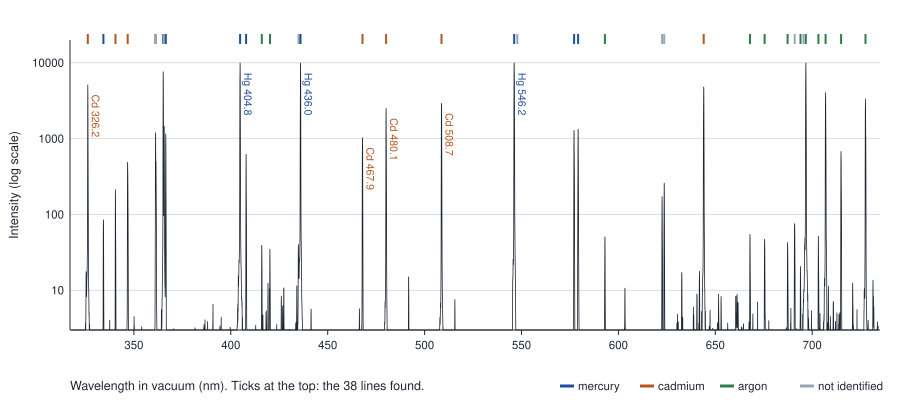
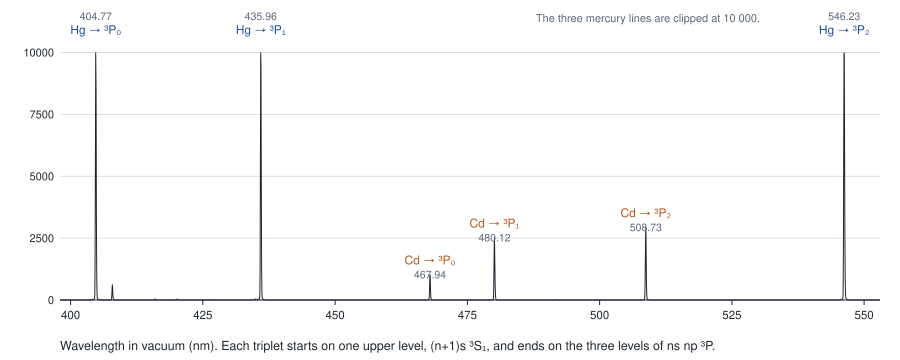
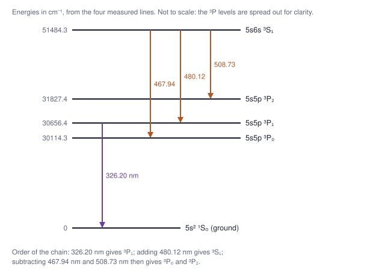

# Worked example · From a raw spectrum to energy levels

Experiments do not measure level diagrams. They measure **spectra**: intensity against wavelength, full of lines. Spectroscopists find the lines, measure their positions, identify some of them, and only then work out the energy levels. A level diagram, such as Figure 9.1 in [Unit 3](unit-3-many-electron-atoms.md), is the final product of that work.

This example starts from a real lamp spectrum and follows the same route, step by step, to the energy levels of cadmium and mercury. It uses the methods of Lecture 1 (the Ritz combination principle), Lecture 9 (LS coupling and the Landé interval rule) and Lecture 10 (line widths).

**Try it yourself.** The spectrum is in [`data/hg-cd-ar-lamp-spectrum.csv`](data/hg-cd-ar-lamp-spectrum.csv), and [`analysis/raw_spectrum_to_levels.py`](analysis/raw_spectrum_to_levels.py) carries out every step below. It needs only Python and NumPy.

---

## The data

> **How it was measured.** Light from mercury, cadmium and argon lamps was passed through the DeVeny spectrograph on the 4.3 m Lowell Discovery Telescope in Arizona and recorded on a CCD camera. The spectrum is distributed as a wavelength-calibrated "arc" spectrum with the PypeIt data-reduction package (file `ldt_deveny_1200_HgCdAr.fits`; BSD licence, see [`data/PypeIt-LICENSE.txt`](data/PypeIt-LICENSE.txt)). Wavelengths are **in vacuum**. The intensity is in arbitrary units, normalized so that the brightest lines reach 10 000; four lines are clipped at that value.

*Figure E.1. The raw spectrum, 318–734 nm, on a logarithmic intensity scale. Measured data. The coloured ticks mark the lines found in Step 1.*

This is what an experiment actually produces. Nothing in it says "³P₁" or "J = 2": it is counts against wavelength.

---

## Step 1 · Find the lines

The spectrum has 7205 points. A line is a local maximum that stands clearly above the background. Taking every peak higher than 0.2% of the brightest line gives **38 lines**.

A low-resolution lamp spectrum like this one has a few dozen lines. A high-resolution spectrum of an iron arc, or of the Sun, has thousands; the method is the same.

## Step 2 · Measure each line's position

Fit a Gaussian to the top of each line (a parabola through the logarithm of the intensity), leaving out clipped points. This gives:

- **The centre,** to a few hundredths of an ångström for a strong line.
- **The width.** Most fitted full widths at half maximum are about 1.6 to 2.6 Å; broader or unreliable fits can occur for blends or weak features. This 1.6–2.6 Å width is the **resolution of the spectrograph**, not a property of the atoms. The Doppler width of a cadmium line at 400 K is only 0.007 Å, and its natural width about 10⁻⁴ Å (Unit 5). The resolving power near 480 nm is λ/Δλ ≈ 2800.

## Step 3 · Identify the lines

Compare each centre with tables of known wavelengths. Here the tables are the NIST lists of mercury, cadmium and argon lines, compiled in PypeIt.

- **29 of the 38 lines** match a known line within 1.5 Å: 9 of mercury, 8 of cadmium and 12 of argon.
- **9 lines are not identified.** They are blends, weak lines from impurities or ions, or instrumental effects. Real spectra always leave some lines unexplained.

The full list is in [`data/measured-lines.csv`](data/measured-lines.csv). We need seven of the lines:

| Atom | Measured centre (nm, vacuum) | Reference (nm) | Wavenumber (cm⁻¹) |
|---|---|---|---|
| Cd | 326.196 | 326.200 | 30 656.38 |
| Cd | 467.945 | 467.946 | 21 370.05 |
| Cd | 480.124 | 480.125 | 20 827.96 |
| Cd | 508.726 | 508.724 | 19 656.95 |
| Hg | 404.771 | 404.771 | 24 705.32 |
| Hg | 435.960 | 435.956 | 22 937.89 |
| Hg | 546.229 | 546.227 | 18 307.33 |

The wavenumber of a line is simply 1/λ in vacuum: $`\tilde\nu\ [\text{cm}^{-1}] = 10^8/\lambda\ [\text{Å}]`$.

*Figure E.2. The region 400–550 nm on a linear scale. Measured data. The labels give the lower level of each line.*

## Step 4 · Look for patterns: the Ritz principle

Three cadmium lines (467.9, 480.1 and 508.7 nm) and three mercury lines (404.8, 436.0 and 546.2 nm) form two **triplets**. In each triplet, all three lines start from the same upper level, (n + 1)s ³S₁, and end on the three levels of the ns np ³P term.

When lines share an upper level, their wavenumber differences are the spacings between their lower levels. These are energy differences that no single line measures:

| | ³P₁ − ³P₀ (cm⁻¹) | ³P₂ − ³P₁ (cm⁻¹) |
|---|---|---|
| Cadmium, this spectrum | 542.1 | 1171.0 |
| Cadmium, NIST | 542.1 | 1170.9 |
| Mercury, this spectrum | 1767.4 | 4630.6 |
| Mercury, NIST | 1767.2 | 4630.7 |

Historically, levels were discovered this way. Spectroscopists noticed that the same wavenumber differences turned up again and again between different pairs of lines. Each repeated difference was the spacing between two levels.

## Step 5 · Build the level diagram for cadmium

To place the levels above the ground state we need one line that ends on the ground state. Cadmium's 326.2 nm line does. Then each level follows from the one before:

1. 326.2 nm: ³P₁ → ground state, so ³P₁ = 30 656.38 cm⁻¹.
2. 480.1 nm: ³S₁ → ³P₁, so ³S₁ = 30 656.38 + 20 827.96 = 51 484.34 cm⁻¹.
3. 467.9 nm: ³S₁ → ³P₀, so ³P₀ = 51 484.34 − 21 370.05 = 30 114.29 cm⁻¹.
4. 508.7 nm: ³S₁ → ³P₂, so ³P₂ = 51 484.34 − 19 656.95 = 31 827.39 cm⁻¹.

| Level | From this spectrum (cm⁻¹) | NIST (cm⁻¹) |
|---|---|---|
| 5s5p ³P₀ | 30 114.3 | 30 114.0 |
| 5s5p ³P₁ | 30 656.4 | 30 656.1 |
| 5s5p ³P₂ | 31 827.4 | 31 827.0 |
| 5s6s ³S₁ | 51 484.3 | 51 484.0 |

Four measured lines give four energy levels, each within 0.4 cm⁻¹ of the accepted value.

*Figure E.3. Cadmium levels built from the four measured lines. Schematic: the ³P levels are spread out for clarity.*

For mercury the corresponding line to the ground state is at 253.7 nm, outside this spectrum. Its glass lamp envelope and the spectrograph do not pass that ultraviolet light, so we get mercury's ³P spacings but not its position above the ground state.

## Step 6 · Label the levels

The numbers alone do not say which level is ³P₀, ³P₁ or ³P₂. Three pieces of evidence decide it.

- **Which level reaches the ground state.** The ground state has J = 0. A level with J = 0 cannot decay to it (J = 0 → 0 is forbidden), and neither can one with J = 2 (ΔJ = 2 is forbidden). Only J = 1 can. Of the three levels, only the middle one has a line to the ground state (326.2 nm), so it is J = 1.
- **The Landé interval rule.** For J = 0, 1, 2 the intervals should be in the ratio 2 : 1. For cadmium, 1171.0/542.1 = **2.16**, close to 2.
- **Intensities.** In LS coupling, the three lines from ³S₁ to ³P₀, ³P₁ and ³P₂ have strengths in the ratio 1 : 3 : 5, set by the 2J + 1 states of each lower level. The measured heights are 1 : 2.44 : 2.84. Including the ν³ dependence of the emission rate gives an expected 1 : 2.78 : 3.89. The remaining shortfall in the redder lines is plausibly the instrument's sensitivity, which we have not corrected for.

**Mercury breaks the interval rule:** 4630.6/1767.4 = **2.62**. Mercury is heavy, so spin–orbit coupling is strong and the atom is in intermediate coupling (Lecture 9). The same mixing makes its 253.7 nm singlet–triplet line strong. Together with zinc's NIST value, these spectra show the same trend down group 12 as Figure 9.1 shows from carbon to lead:

| Atom | Configuration | Interval ratio |
|---|---|---|
| Zn | 4s4p ³P | 2.05 (NIST) |
| Cd | 5s5p ³P | 2.16 (this spectrum) |
| Hg | 6s6p ³P | 2.62 (this spectrum) |

---

## What a professional analysis adds

- **Much higher resolution.** Fourier-transform spectrometers reach λ/Δλ ≈ 10⁶, about a thousand times better than here, and separate blended lines.
- **An independent wavelength standard.** The wavelength scale of this archived spectrum was itself calibrated by fitting known lamp lines, so it cannot test the reference wavelengths independently. It demonstrates the method; it is not a new measurement. Real level work calibrates against an interferometer or a frequency comb.
- **Thousands of lines and many configurations.** A least-squares program (for example NIST's LOPT) adjusts all the levels at once to fit all the lines.
- **Zeeman patterns** (Unit 4) to confirm J and the g-factor of each level.

## Exercises

**E.1** Mercury's yellow pair, measured at 577.13 and 579.23 nm (vacuum), comes from the levels 6s6d ¹D₂ and 6s6d ³D₂, and both lines end on 6s6p ¹P₁. What does the difference of their wavenumbers measure, and how big is it?

**E.2** Pick one of the nine unidentified lines in [`data/measured-lines.csv`](data/measured-lines.csv) and suggest what it might be.

**E.3** Use the line widths to estimate the resolving power of the spectrograph at 326 nm and at 700 nm.

**E.4** Change the detection threshold in the script from 0.2% to 1% and to 0.05%. How does the number of lines change, and why?

### Answers

**E.1** The two lines share their lower level, so the difference is the spacing between the two upper levels, ¹D₂ and ³D₂: about 62.8 cm⁻¹.

**E.2** Open-ended. Check the wavelength against the NIST Atomic Spectra Database, including ions such as Ar II and common impurities.

**E.3** About 3261.96/1.57 ≈ 2100 at 326 nm, and about 2900–3000 near 700 nm (widths of 2.3–2.4 Å).

**E.4** Fewer lines at 1% (only the bright ones) and more at 0.05%, where noise peaks and the faint wings of strong lines start to be counted as lines. Choosing the threshold is a real judgement in data analysis.
